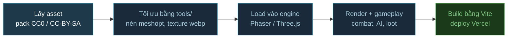

# game-r — Thử nghiệm làm game ARPG trên web bằng AI

Sandbox build cùng một vertical slice ARPG (hầm ngục -> sảnh -> boss) qua nhiều bộ art và engine khác nhau, để so sánh A/B về đồ họa, hiệu năng và quy trình xử lý asset. Toàn bộ code do AI agent viết, art lấy từ các pack free (CC0 / CC-BY-SA).

## Các demo

| Demo | Tên game | Thể loại | Engine | Art | Trạng thái | Live |
|---|---|---|---|---|---|---|
| [demo1](demo1/) | Hầm Ngục Pixel | Roguelike top-down 2D | Phaser 3 (CDN, 1 file HTML) | Kenney Tiny Dungeon | Preview | [wcg-game-r-demo1.vercel.app](https://wcg-game-r-demo1.vercel.app/) |
| [demo2](demo2/) | Hầm Mộ Vua Xương | ARPG 3D | Three.js | KayKit (CC0) | Xong | [wcg-game-r-demo2.vercel.app](https://wcg-game-r-demo2.vercel.app/) |
| [demo3](demo3/) | Ngai Quỷ Vương | ARPG 3D, đổi art từ demo2 | Three.js | Quaternius (CC0) | Xong | [wcg-game-r-demo3.vercel.app](https://wcg-game-r-demo3.vercel.app/) |
| [demo4](demo4/) | Ngai Quỷ Vương | Dark fantasy kiểu Diablo 4 | Three.js + N8AO | Poly Haven PBR + Quaternius (Mixamo dự kiến) | Phase A xong, Phase B chờ Mixamo | [wcg-game-r-demo4.vercel.app](https://wcg-game-r-demo4.vercel.app/) |
| [demo5](demo5/) | Hầm Mộ Ardwen | ARPG isometric 2D | Phaser 4 (npm) | Flare (CC-BY-SA 3.0) | Xong | [wcg-game-r-demo5.vercel.app](https://wcg-game-r-demo5.vercel.app/) |
| [demo6](demo6/) | Ngai Ma Nữ | Anime kiểu Genshin | Three.js + three-vrm | VRoid + Quaternius UAL | Đang làm | [wcg-game-r-demo6.vercel.app](https://wcg-game-r-demo6.vercel.app/) |
| [demo8](demo8/) | Hầm Mộ Vua Xương (Godot) | ARPG 3D, port demo2 sang Godot | Godot 4.7.2 (export Web) + Godot MCP | KayKit (CC0) | Xong, chờ test tay | [wcg-game-r-demo8.vercel.app](https://wcg-game-r-demo8.vercel.app/) |
| [demo9](demo9/) | Bụi Sa Mạc | FPS chiến thuật kiểu Counter-Strike 1.3, 5v5 với bot | Three.js + Rapier | Quaternius + Poly Haven (CC0) | Xong, chờ test tay | [wcg-game-r-demo9.vercel.app](https://wcg-game-r-demo9.vercel.app/) |

Deploy: Vercel team `wecare2`, project `wcg-game-r-demoN`. demo2–6 và demo9 chạy `vercel deploy --prod` trong folder demo (Vercel tự build Vite). demo1 deploy riêng: bọc `demo1/preview/index.html` vào skeleton HTML rồi deploy như static. demo8 export Web bằng Godot headless rồi deploy folder `export/web` như static.



Mọi demo (trừ demo1 và demo8) đi chung pipeline trên. demo8 thay bước Vite bằng Godot: import glTF -> chạy headless kiểm lỗi -> export Web (WASM).

## Engine & art từng demo

Version lấy theo `package.json` (demo1: link CDN). Chi tiết nguồn art và license nằm trong `CREDITS.md` của từng demo.

### demo1 — Hầm Ngục Pixel
- **Engine:** Phaser 3.90.0, nạp qua CDN (jsDelivr), cả game nằm trong 1 file HTML, không cần build.
- **Art:** Kenney Tiny Dungeon + Kenney UI RPG (CC0), sprite 2D pixel.

### demo2 — Hầm Mộ Vua Xương
- **Engine:** Three.js 0.169.0 · Vite 5.4.10.
- **Art:** KayKit Adventurers, Skeletons, Dungeon Remastered (CC0, Kay Lousberg), model glTF low-poly đã nén meshopt.

### demo3 — Ngai Quỷ Vương
- **Engine:** Three.js 0.169.0 · Vite 5.4.10.
- **Art:** Quaternius RPG Characters, Ultimate Monsters, Modular Dungeon, Medieval Dungeon (CC0). Dungeon được chuyển OBJ sang GLB rồi gom vào 1 file `dungeon.glb`; nhân vật dùng texture WebP 512px.

### demo4 — Ngai Quỷ Vương (dark fantasy)
- **Engine:** Three.js 0.169.0 + N8AO 1.10 (ambient occlusion) · Vite 5.4.10. Script build dùng gltf-transform, meshoptimizer, sharp.
- **Art:** Poly Haven, gồm 26 props và 7 bộ texture PBR (CC0). Nhân vật và quái tạm dùng Quaternius (CC0), phase B dự kiến thay bằng Mixamo.

### demo5 — Hầm Mộ Ardwen
- **Engine:** Phaser 4.2.1 cài qua npm (nâng từ 3.90.0 ngày 2026-10-10) · Vite 5.4.10. Filter v4: bloom, glow loot hiếm/boss, vignette đỏ khi trúng đòn, grayscale khi chết; thêm `?nofx` để tắt filter khi so FPS.
- **Art:** Flare: Empyrean Campaign (CC-BY-SA 3.0), sprite isometric 2D. Đã cắt bớt animation, scale 0.75 và đóng atlas WebP.

### demo6 — Ngai Ma Nữ
- **Engine:** Three.js 0.169.0 + @pixiv/three-vrm 3.5 · Vite 5.4.10.
- **Art:** 7 avatar mẫu VRoid (license VRoid Hub, riêng `dark.vrm` là CC0) cho nhân vật. Animation lấy từ Quaternius Universal Animation Library 1 + 2 (CC0), retarget sang rig VRM lúc chạy. Môi trường và vũ khí dùng lại Quaternius từ demo3, tô bằng toon material.

### demo8 — Hầm Mộ Vua Xương (Godot)
- **Engine:** Godot 4.7.2, renderer Compatibility (WebGL2), export Web không thread. Agent lái Godot qua MCP (koltyakov/godot-mcp) ở chế độ headless trên VM không GPU. Có selftest tự chơi từ quán tới boss và chế độ chụp ảnh render CPU qua Xvfb.
- **Art:** KayKit giống demo2. Model nhân vật được giải nén meshopt vì Godot không đọc `EXT_meshopt_compression`.

### demo9 — Bụi Sa Mạc (FPS kiểu CS 1.3)
- **Engine:** Three.js 0.169.0 + Rapier 0.21 (character controller, raycast đạn, lựu đạn nảy) · Vite 5.4.10. Logic game (`src/sim`) tách khỏi render nên selftest 10 bot đánh nhau chạy được trên Node. Có thêm smoke test client bằng jsdom + renderer giả, và tool chụp góc nhìn FPS bằng rasterizer CPU (không cần browser).
- **Art:** Quaternius Ultimate Animated Character (SWAT cho CT, Adventurer cho T) + Ultimate Gun Pack (CC0). Texture sa thạch / cát của Poly Haven (CC0). Âm thanh lấy từ Kenney + OpenGameArt; tiếng súng của Vincent Sevedge theo CC-BY 3.0.

## Engine web-native (ghi chú 2026)

Repo ưu tiên engine **web-native**: viết bằng JS/TS, browser chạy thẳng, build bằng Vite. Lý do: build nhẹ, debug bằng DevTools, và AI agent đọc/sửa code trực tiếp được. Ngoại lệ là demo8 (Godot export WebAssembly), làm để thử AI lái engine có editor qua MCP. Bản Godot nặng hơn hẳn: ~14.5MB tải về (wasm 9.5MB + pck 4.9MB, đã nén brotli).

| Engine | Loại | Vị thế 2026 | Repo |
|---|---|---|---|
| **Phaser 4** | Framework 2D | Mặc định cho 2D web. v4.0 "Caladan" ra 10/4/2026 với renderer WebGL viết lại, filters, lighting; bản mới nhất 4.2.1 (7/2026) | demo5 (4.2.1); demo1 vẫn ở 3.90 |
| **PixiJS v8** | Renderer 2D | Renderer 2D nhanh nhất, ưu tiên WebGPU, nhưng không phải game framework | Chưa dùng |
| **Three.js** | Library 3D | Phổ biến nhất cho 3D web, AI tool hiểu rõ nhất. Có WebGPURenderer + TSL | demo2/3/4/6 |
| **Babylon.js** | Engine 3D trọn bộ | Có sẵn physics (Havok), GUI, inspector, WebXR. Game tiêu biểu: Shell Shockers | Chưa dùng |
| **PlayCanvas** | Engine 3D + editor cloud | Tối ưu mobile web, hợp team cần editor cộng tác. Game tiêu biểu: Venge.io | Chưa dùng |

Thư viện hay đi kèm: Rapier / cannon-es (physics), bitECS / Koota (ECS), glTF + meshopt / KTX2 (asset).

Xu hướng: các engine đang chuyển dần sang **WebGPU**, cho phép dùng compute shader cho particle, crowd và culling.

## Chạy thử

Yêu cầu: Node.js 18+.

```bash
cd demo3          # hoặc demo2, demo4, demo5, demo6
npm install
npm run dev       # Vite dev server (--host, mở được từ điện thoại cùng mạng LAN)
npm run build     # build ra dist/
```

**demo1** không cần build: mở thẳng `demo1/preview/index.html` (ảnh đã inline). Sửa `index.src.html` xong thì chạy `python3 demo1/preview/build.py` để sinh lại.

**Script xử lý asset** (chỉ cần khi đổi/thêm asset, kết quả đã commit sẵn trong `public/`):

| Demo | Lệnh | Việc làm |
|---|---|---|
| demo4 | `node tools/build-env.mjs` | Tải props + texture từ Poly Haven API, simplify, gom `props.glb` |
| demo5 | `python tools/build_assets.py` | Cắt animation Flare, scale, đóng atlas WebP |
| demo6 | `npm run assets` | Nén VRM, lọc clip animation Quaternius UAL |

Tham số URL hữu ích: `?debug` (phím T dịch chuyển giữa các phòng, demo3/4/6), `?hq` (ép chất lượng cao, demo4).

## Cấu trúc

```
game-r/
├── demo1 … demo6/     # mỗi demo độc lập: package.json, src/, public/, tools/, CREDITS.md
├── demo8/             # project Godot: project.godot, scenes/, scripts/, assets/, tools/
├── docs/
│   └── research-ai-game.md   # research xu hướng làm game bằng AI 2026
├── tasks/
│   ├── todo.md        # plan + tiến độ từng demo
│   └── lessons.md     # bài học rút ra khi làm với agent
├── glossary.md        # sổ tay thuật ngữ build game web (engine, asset, animation, render…)
└── _inbox/            # asset tải về chưa xử lý (gitignore)
```

## License asset

Mỗi demo có `CREDITS.md` ghi nguồn, tác giả, license; file license gốc nằm trong `public/` của demo đó.

- **CC0**: KayKit, Quaternius, Kenney, Poly Haven — free cả thương mại, không bắt buộc ghi công.
- **CC-BY-SA 3.0**: Flare (demo5) — phải ghi công và phát hành bản sửa đổi cùng license.
- **VRoid sample** (demo6): license nhúng trong metadata từng file `.vrm`, xem `demo6/CREDITS.md`.
- **Mixamo** (demo4 phase B): license cấm phát tán file gốc -> chỉ để trong `_inbox/`, không commit.

## Tài liệu liên quan

- [docs/research-ai-game.md](docs/research-ai-game.md) — tool, workflow, thị trường game làm bằng AI
- [glossary.md](glossary.md) — giải thích thuật ngữ, gắn với demo dùng tới
- [tasks/todo.md](tasks/todo.md) — plan, checklist và review từng demo
