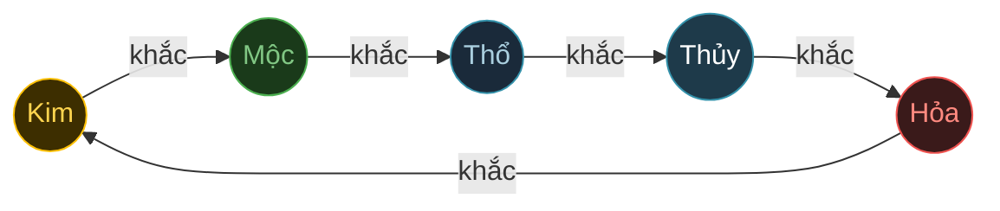
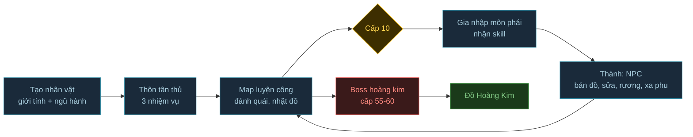

# demo10 — Clone gameplay Võ Lâm Truyền Kỳ 1 (bản 2008-2010) · RESEARCH + SCOPE ĐÃ CHỐT (2026-10-13), CHỜ BÀN ASSET

- **Engine (đã chốt):** Phaser 4.2.1 + Vite, dựa trên khung isometric của demo5
- **Asset:** bàn sau. Danh sách art cần có nằm ở mục 4
- **Đánh dấu nguồn:** `[CN]` = cẩm nang chính thức VNG · `[TQ]` = 17173/xoyo (bản Trung) · `[CTC]` = server Công Thành Chiến mở lại · `[?]` = chưa xác minh · `[tự đặt]` = số em tự chọn cho demo

---

## 1. Research: VLTK1 chơi thế nào

### 1.1 Tổng quan
- Kingsoft ra mắt ở TQ năm 2003, VNG phát hành ở VN năm 2005. Bản free có từ 11/2008. Các bản mở rộng quanh 2009: Tình Nghĩa Giang Hồ (2007, thêm skill 120), Phong Hỏa Liên Thành (2008-2009, thêm đồ Bạch Kim, Trùng sinh), Thất Thành Đại Chiến (7/2010).
- Đồ họa 2D sprite, góc nhìn isometric 2.5D.
- **Điều khiển** `[CN]`:
  - Click mặt đất để đi. Rê chuột lên quái, con trỏ thành hình kiếm, click trái để đánh.
  - Skill gán vào chuột trái/phải `[?]`.
- **Phím tắt** `[CN]`:
  - F3 trang bị/thuộc tính, F4 túi đồ, F5 võ công, F11 nhiệm vụ, F9 bật/tắt PK
  - 1-2-3: ô thuốc nhanh
  - R đi/chạy (thể lực về 0 thì không chạy được), V ngồi hồi phục, M lên/xuống ngựa
  - Tab bản đồ, giữ Alt hiện tên đồ dưới đất

### 1.2 Tạo nhân vật `[CN]`
- Chọn tên, giới tính, ngũ hành, rồi chọn 1 trong 8 thôn tân thủ để xuất phát.
- **Kim chỉ cho nam, Thủy chỉ cho nữ.** Mỗi hệ ứng với 2 môn phái. **Lên cấp 10 mới gia nhập môn phái.**

### 1.3 Mười môn phái `[CN]`

| Hệ | Phái (phe) | Hướng tu luyện | Skill 90 | Skill 120 |
|---|---|---|---|---|
| Kim | Thiếu Lâm (chính, chỉ nam) | Quyền / Côn / Đao | Đạt Ma Độ Giang, Hoành Tảo Thiên Quân, Vô Tướng Trảm | Đại Thừa Như Lai Chú |
| Kim | Thiên Vương (trung lập) | Thương / Đao / Chùy | Phá Thiên Trảm, Truy Tinh Trục Nguyệt, Truy Phong Quyết | Đảo Hư Thiên |
| Mộc | Đường Môn (trung lập) | Ám khí (phi đao, tiêu, tiễn), bẫy | Nhiếp Hồn Nguyệt Ảnh, Cửu Cung Phi Tinh, Bạo Vũ Lê Hoa, Loạn Hoàn Kích | Mê Ảnh Tung |
| Mộc | Ngũ Độc (tà) | Đao / Chưởng / bùa độc | Âm Phong Thực Cốt, Huyền Âm Trảm, Đoạn Cân Hủ Cốt | Hấp Tinh Yểm |
| Thủy | Nga My (chính, nữ) | Kiếm / Chưởng / hỗ trợ | Tam Nga Tế Nguyệt, Phong Sương Toái Ảnh, Phổ Độ Chúng Sinh | Bế Nguyệt Phất Trần |
| Thủy | Thúy Yên (trung lập, nữ) | Đao / Song đao | Băng Tung Vô Ảnh, Băng Tâm Tiên Tử | Ngự Tuyết Ẩn |
| Hỏa | Cái Bang (chính) | Bổng / Chưởng | Phi Long Tại Thiên, Thiên Hạ Vô Cẩu | Hỗn Thiên Khí Công |
| Hỏa | Thiên Nhẫn (tà) | Đao / Mâu / bùa | Vân Long Kích, Thiên Ngoại Lưu Tinh, Nhiếp Hồn Loạn Tâm | Ma Âm Phệ Phách |
| Thổ | Võ Đang (chính) | Kiếm / Quyền (khí tông) | Thiên Địa Vô Cực, Nhân Kiếm Hợp Nhất | Xuất Ứ Bất Nhiễm |
| Thổ | Côn Lôn (trung lập) | Đao / Kiếm / bùa chú | Ngạo Tuyết Tiêu Phong, Lôi Động Cửu Thiên | Lưỡng Nghi Chân Khí |

- Skill được mở dần qua chuỗi nhiệm vụ môn phái ở cấp 10/20/30/40/50, sau đó Xuất sư. Skill 90 phải làm nhiệm vụ riêng.
- **Skill tiêu biểu cấp thấp:**
  - Thiếu Lâm: La Hán Trận, Sư Tử Hống. Thiên Vương: Kim Chung Tráo.
  - Đường Môn: Tiểu Lý Phi Đao, Thiên La Địa Võng. Ngũ Độc: Cửu Thiên Cuồng Lôi.
  - Nga My: Từ Hàng Phổ Độ. Thúy Yên: Hộ Thể Hàn Băng.
  - Cái Bang: Giáng Long Chưởng. Thiên Nhẫn: Hỏa Phần Liên Hoa.
  - Võ Đang: Thất Tinh Trận. Côn Lôn: Thanh Phong Phù, Ngũ Lôi Chính Pháp.
- **Hiệu ứng skill:** phần lớn chưa xác minh được (trang chính thức chỉ có ảnh), nên khi làm em sẽ tự thiết kế lại theo tên và đặc trưng của phái `[tự đặt]`.

### 1.4 Ngũ hành `[CN]`
- **Tương sinh:** Mộc → Hỏa → Thổ → Kim → Thủy → Mộc
- **Tương khắc:** Kim khắc Mộc, Mộc khắc Thổ, Thổ khắc Thủy, Thủy khắc Hỏa, Hỏa khắc Kim

*Vòng khắc. Vòng sinh là chiều ngược lại, cách một bước.*

- **Trong combat:** ngũ hành tác động chủ yếu qua **kháng**. Có 5 loại kháng, tính theo %:
  - phổ phòng (giảm sát thương ngoại công)
  - độc, băng, hỏa, lôi
  - Theo bản TQ, kháng tối đa 95%.
  - Ví dụ chính thức: người hệ Kim sinh ra đã có kháng hỏa thấp.
  - Hệ số sát thương khi khắc chế chưa xác minh `[?]`.
- **Kích ẩn trang bị** (đặc sản của VLTK):
  - 10 ô trang bị chia thành 5 cặp:
    1. Áo + Dây chuyền
    2. Mũ + Vũ khí
    3. Giày + Nhẫn trên
    4. Bao tay + Ngọc bội
    5. Thắt lưng + Nhẫn dưới
  - Cặp 1 kích cặp 2, cặp 2 kích cặp 3, cứ thế đến cặp 5 thì vòng lại kích cặp 1.
  - Đồ "kích" phải có ngũ hành **tương sinh** với đồ "được kích".
  - Dòng ẩn chưa kích hiện màu xám, kích được thì chuyển xanh.

### 1.5 Chỉ số
- Mỗi lần lên cấp được **+5 điểm tiềm năng, +1 điểm kỹ năng** `[CN]`.
- **4 chỉ số** (quy đổi lấy theo bản TQ `[TQ]`, dùng tham khảo):

| Chỉ số | Tác dụng |
|---|---|
| Sức mạnh | 5 điểm = +1 sát thương vũ khí cận chiến |
| Thân pháp | 4 điểm = +16 chính xác, +1 né tránh; 5 điểm = +1 sát thương vũ khí tầm xa |
| Sinh khí | 1 điểm = máu tối đa +8 (Kim) / +7 (Hỏa) / +6 (Thủy) / +5 (Mộc) / +3 (Thổ) |
| Nội công | 1 điểm = +1 sát thương nội công; nội lực tối đa +1 (Kim, Mộc) / +2 (Hỏa) / +3 (Thủy) / +4 (Thổ) |

- **3 thanh:** sinh lực, nội lực, thể lực.
- **Chỉ số chiến đấu khác:** chính xác, né tránh (chỉ áp lên đòn ngoại công), tốc độ chạy, tốc độ xuất chiêu.
- **Trạng thái:**
  - Choáng
  - Trúng độc: mất máu theo thời gian
  - Làm chậm do băng: giảm cả tốc chạy lẫn tốc đánh
  - Khựng khi trúng đòn ("thời gian phục hồi")

### 1.6 Combat, chết, exp
- Click vào quái để đánh bằng skill đang chọn.
- Exp phụ thuộc chênh lệch cấp giữa người và quái. Lệch khoảng 15 cấp trở lên thì gần như không có exp `[TQ]`.
- Hồi phục bằng cách ngồi (V) hoặc uống thuốc.
- **Chết** khi PK = 0: mất 1% exp và 5% tiền, về điểm hồi sinh. Exp có thể âm `[CN]`.
- Level cap là 200 (bản Trùng sinh 2009 đưa nhân vật cấp 166-200 về cấp 10).

### 1.7 Trang bị và vật phẩm
- **10 ô:** vũ khí, áo, mũ, giày, bao tay, thắt lưng, dây chuyền, ngọc bội, nhẫn trên, nhẫn dưới.
- **Phẩm chất:**
  - Trắng.
  - Xanh: thuộc tính ngẫu nhiên, tối đa 6 dòng (3 dòng hiện + 3 dòng ẩn). Dòng nào được ra phụ thuộc loại đồ và ngũ hành của đồ.
  - Hoàng Kim: bộ theo môn phái, do boss hoàng kim rơi.
  - Bộ An Bang (4 món), Định Quốc (5 món): mặc đủ bộ thì **kích toàn bộ dòng ẩn** của mọi trang bị khác.
- **Độ bền:** về 0 là hỏng. Thợ rèn sửa được.
- **Vật phẩm:**
  - Thuốc hồi sinh lực / nội lực / giải độc, mua ở Dược điếm.
  - Thổ Địa Phù (về thành), mua ở Tạp hóa.
  - Rương chứa đồ: một nhân vật dùng chung ở mọi thành.

### 1.8 Thế giới và NPC
- **7 đại thành:** Biện Kinh, Thành Đô, Dương Châu, Lâm An, Đại Lý, Phượng Tường, Tương Dương.
- **8 thôn tân thủ:** Ba Lăng huyện, Chu Tiên trấn, Đạo Hương thôn, Giang Tân thôn, Long Môn trấn, Long Tuyền thôn, Thạch Cổ trấn, Vĩnh Lạc trấn.
- Quái cấp 10-20 ở ngay ngoài thành và quanh môn phái (vd heo rừng cấp 10-14, linh miêu 16-20). Ngoài ra có hang động, mê cung.
- **NPC chức năng:**
  - Xa phu: từ cấp 5, đi giữa thành/thôn, tốn phí theo quãng đường
  - Rương chứa đồ, Dược điếm, Tạp hóa, Thợ rèn
  - Dã Tẩu, Lễ quan, Người bán ngựa
  - Vệ binh: chỉ chỗ luyện công
  - Nha dịch: nhà lao

### 1.9 Nhiệm vụ và hoạt động
- **Tân thủ:** mỗi thôn 3 nhiệm vụ, thưởng đồ cơ bản và danh vọng.
- **Môn phái:** chuỗi nhiệm vụ cấp 10 đến 50 để mở skill, rồi Xuất sư, rồi nhiệm vụ cấp 90.
- **Dã Tẩu:** 40 nhiệm vụ/ngày: tìm đồ, diệt quái, đạt điểm Tống Kim/PK. Chuỗi càng dài thưởng càng cao.
- **Boss hoàng kim:** 10 con theo môn phái, rơi đồ Hoàng Kim.
- **Tống Kim:** chiến trường 2 phe, tích điểm theo quân hàm (Binh sĩ → Hiệu úy → Thống lĩnh → Phó tướng → Đại tướng). Có thưởng liên trảm. Thể thức: sát lục, đoạt cờ, bảo vệ Nguyên soái.
- **Hoạt động khác:**
  - Phong Lăng Độ: chuyến thuyền 30 phút, PK tự do, giữa chuyến có boss thủy tặc.
  - Vượt Ải: tổ đội dọn quái khoảng 30 ải, tính giờ.
  - Bang hội, Công Thành Chiến.

### 1.10 PK `[CN]`
- **4 trạng thái:**
  - Luyện công: không đánh người được.
  - Chiến đấu: đánh người khác màu tên.
  - Đồ sát: đánh cả người đang luyện công, +1 PK.
  - Cừu sát: đánh người cùng màu tên, +2 PK.
- PK từ 0 đến 10, càng cao thì chết càng mất nhiều. Ở PK 10: mất 35% exp, 100% tiền, rơi toàn bộ đồ đang mặc.

### 1.11 HUD
- Có thanh sinh lực / nội lực / thể lực, ô thuốc 1-3, minimap, khung chat, các panel mở bằng F-key.
- Vị trí chính xác của từng khối chưa xác minh `[?]`, nên em sẽ dựng lại theo trí nhớ chung về VLTK.

---

## 2. Đề xuất scope demo10 (anh review phần này)

**Định hướng:** chơi offline 1 người, cảm giác đúng chất VLTK1 ở cấp **1 → 60**, tập trung vào những gì tạo nên "chất VLTK":
- Click-to-move rồi click đánh quái
- Ngũ hành và kháng
- Đồ xanh có dòng ẩn kích theo vòng tương sinh
- Gia nhập môn phái ở cấp 10
- NPC trong thành
- Boss hoàng kim

*Vòng chơi chính của demo10.*

### 2.1 Làm / Không làm

| Hạng mục | Làm trong demo10 | Không làm (để sau hoặc bỏ) |
|---|---|---|
| Nhân vật | Tạo nhân vật (giới tính, ngũ hành, luật Kim nam / Thủy nữ), 4 chỉ số, +5 tiềm năng và +1 kỹ năng mỗi cấp, 2 thanh sinh lực/nội lực, 3 slot nhân vật | Trùng sinh, thể lực |
| Môn phái | **5 phái, mỗi hệ 1 phái** (đã chốt): Thiếu Lâm (Kim), Đường Môn (Mộc), Nga My (Thủy), Cái Bang (Hỏa), Võ Đang (Thổ). Mỗi phái khoảng 6 skill, mở theo chuỗi nhiệm vụ môn phái ở cấp 10/20/30/40/50 như bản gốc, 1 skill "tuyệt kỹ" khi Xuất sư `[tự đặt]` | 5 phái còn lại, skill 90/120, chọn nhánh tu luyện |
| Combat | Click-to-move có pathfinding, click quái để đánh, skill chuột trái/phải, chính xác/né, 5 loại kháng, trạng thái choáng/độc/chậm, chết thì về điểm hồi sinh và mất 1% exp (không mất tiền, exp không âm) | PK người chơi, hệ thống PK 0-10 |
| **Auto train** | Nút bật/tắt trên HUD + panel cài đặt. Tự tìm và đánh quái trong bán kính quanh điểm bật auto, dùng skill theo thứ tự đã gán, tự uống thuốc khi máu/nội lực dưới X%, tự nhặt đồ theo lọc phẩm chất + nhặt tiền. Hết thuốc hoặc túi đầy thì dừng auto và báo log | Tự về thành mua thuốc |
| Ngũ hành | Quái có hệ, kháng theo hệ, vòng khắc tăng/giảm sát thương `[tự đặt hệ số]` | — |
| Trang bị | 10 ô, đồ trắng/xanh có dòng ngẫu nhiên, **kích dòng ẩn theo vòng tương sinh 5 cặp**, 1 bộ Hoàng Kim / phái (rơi từ boss) | Độ bền + sửa đồ, Bạch Kim, An Bang/Định Quốc, khảm, chế tạo |
| Thế giới | Thôn tân thủ Ba Lăng huyện, đại thành Tương Dương, 4 map luyện công theo cấp: 1-10, 10-25, 25-45, 45-60 `[tự đặt]`, sảnh môn phái làm thành 1 khu nhỏ chung | 7 thành, 8 thôn, Đào Hoa đảo |
| NPC | Xa phu (dịch chuyển giữa các map), Dược điếm, Tạp hóa, Thợ rèn, Rương chứa đồ, Chưởng môn (nhận vào phái), Vệ binh | Tiền trang, Nha dịch, Lễ quan, Người bán ngựa |
| Nhiệm vụ | 3 nhiệm vụ tân thủ, chuỗi nhiệm vụ môn phái cấp 10 → 50 + Xuất sư | Dã Tẩu (tạm hoãn), nhiệm vụ cấp 90, Sát thủ, Liên Kết Võ Lâm |
| Hoạt động | Boss hoàng kim hồi sinh theo giờ | Tống Kim (tạm hoãn), Phong Lăng Độ, Vượt Ải, bang hội, công thành (đều cần nhiều người) |
| Nền tảng | Web desktop, chuột + phím, HUD cho màn ngang | Mobile, cảm ứng |
| Khác | Thổ Địa Phù về thành, ngồi hồi phục (V), ô thuốc 1-3, bản đồ Tab, Alt hiện tên đồ, lưu game vào localStorage | Ngựa, giao dịch, bày bán, tổ đội, chat thật |
| HUD | Phỏng theo VLTK: thanh máu đỏ + nội lực xanh, ô skill trái/phải, nút Auto, ô thuốc, minimap, khung log hệ thống, phím F3/F4/F5/F11 mở panel | — |

### 2.2 Milestone

| # | Milestone | Kết quả chơi được |
|---|---|---|
| M1 | Khung + di chuyển | Map iso, click-to-move có pathfinding, camera bám nhân vật, ngồi hồi phục |
| M2 | Combat lõi | Quái AI (đi tuần, đuổi, đánh), click đánh, sát thương, exp/level, chết/hồi sinh, chỉ số + panel F3 |
| M3 | Ngũ hành + trang bị | Hệ của quái, kháng, rơi đồ trắng/xanh, túi đồ F4, 10 ô trang bị, kích dòng ẩn |
| M4 | Thành + NPC | Ba Lăng huyện, Tương Dương, các NPC mua/bán/rương/xa phu, Thổ Địa Phù |
| M5 | Auto train | Nút auto + panel cài đặt: tìm/đánh quái trong bán kính, xoay skill, uống thuốc theo ngưỡng, nhặt đồ theo lọc, dừng khi hết thuốc/đầy túi |
| M6 | Môn phái + skill | Tạo nhân vật, nhập phái cấp 10, 5 phái × khoảng 6 skill, panel võ công F5, hiệu ứng skill |
| M7 | Nhiệm vụ + boss | Nhiệm vụ tân thủ, chuỗi môn phái 10 → 50 + Xuất sư, boss hoàng kim + đồ Hoàng Kim, lưu game |
| M8 | Hoàn thiện + deploy | HUD đầy đủ, âm thanh, cân bằng để lên cấp 60 mất khoảng 2 giờ khi bật auto (đo bằng selftest giả lập), deploy Vercel `wcg-game-r-demo10` |

Asset sẽ chốt trước M1. Lúc đầu M1-M2 tạm dùng art Flare của demo5 để chạy khung, có art thật thì thay sau.

---

## 3. Câu hỏi cần anh chốt

1. ~~**Số môn phái**~~ → **CHỐT 2026-10-13:** làm trước 5 phái, mỗi phái đại diện 1 hệ: Thiếu Lâm (Kim), Đường Môn (Mộc), Nga My (Thủy), Cái Bang (Hỏa), Võ Đang (Thổ).
2. ~~**Level cap demo**~~ → **CHỐT 2026-10-13:** cấp tối đa 60. Chuỗi nhiệm vụ môn phái 10/20/30/40/50 giữ đúng bản gốc, Xuất sư ở 50+.
3. ~~**Tống Kim với bot**~~ → **CHỐT 2026-10-13:** tạm thời chưa làm.
4. ~~**Bối cảnh**~~ → **CHỐT 2026-10-13:** Tương Dương + thôn tân thủ Ba Lăng huyện.
5. ~~**Dã Tẩu rút gọn**~~ → **CHỐT 2026-10-13:** tạm thời chưa làm. Nhiệm vụ chỉ gồm tân thủ + chuỗi môn phái.

### Chốt thêm (grill-me 2026-10-13)
- **MVP đơn giản:** bỏ chi tiết phụ như độ bền/sửa đồ, thể lực, exp âm. Chết chỉ mất 1% exp.
- **Bắt buộc có auto train** (kiểu AutoVLBS rút gọn), làm thành milestone riêng M5.
- **Thời lượng:** lên cấp 60 mất khoảng 2 giờ khi bật auto.
- **Nền tảng:** chỉ web desktop, chưa làm mobile.
- **Mặc định:**
  - Mỗi phái 1 hướng tu luyện: Thiếu Lâm **Côn** (Flare không có animation tay không nên đổi từ Quyền), Đường Môn Phi đao, Nga My Kiếm, Cái Bang Chưởng, Võ Đang Kiếm.
- **Chốt kỹ thuật (anh giao em quyết, 2026-10-13):**
  - Map: lấy map có sẵn trong flare-game, đổi tên. Thiếu map nào thì code tự sinh từ tileset Flare.
  - Code: tạo project Vite mới, chỉ copy phần dùng được của demo5 (A*, atlas, lighting, `build_assets.py`).
  - Lưu localStorage, 3 slot nhân vật.
  - UI tiếng Việt.
- **Verify:**
  - `npm run build` sạch lỗi.
  - Selftest headless giả lập auto train từ cấp 1 lên 60, thời gian nằm trong khoảng 1h45-2h15.
  - Phần nhìn bằng mắt anh tự test trên link Vercel.

---

## 4. Art — CHỐT 2026-10-13: dùng art Flare
- **Nguồn:** chỉ dùng **Flare** (flare-game: fantasycore + empyrean_campaign, CC-BY-SA 3.0), giống demo5.
  - Không tự vẽ, không tự render 3D.
  - Theme phương Tây được chấp nhận: tên thành, NPC, skill vẫn theo VLTK, nhưng hình là art Flare.
- **Cần lấy từ Flare:**
  - Nhân vật nam/nữ 8 hướng dạng paper-doll (ghép từng món đồ). 5 phái phân biệt bằng bộ đồ + vũ khí.
  - Quái khoảng 10-12 loại cho 4 map luyện công, cộng 1 boss.
  - NPC trong thành.
  - Tileset cỏ, hang, thị trấn.
  - Icon skill/đồ, hiệu ứng phép theo 5 hệ: lửa, băng, độc, lôi, kim quang.
- **Pipeline:** dùng lại `demo5/tools/build_assets.py` (cắt animation, scale, đóng atlas WebP). Ghi credit trong `CREDITS.md`.

### Ánh xạ đã chốt khi build (M0)

| VLTK | Flare |
|---|---|
| Ba Lăng Huyện | map `perdition_harbor` (cảng nhỏ) |
| Tương Dương | map `black_oak_city` |
| Ngoại Ô Ba Lăng (cấp 1-10) | map `salted_field` |
| Phục Ngưu Sơn (cấp 10-25) | map `nazia_highlands` |
| Thiên Sơn Tuyết Lĩnh (cấp 25-45) | map `lake_kuuma` (tuyết) |
| Lão Hổ Động (cấp 45-60) + boss | map `the_breach` (hang) |
| Thiếu Lâm | đầu trọc, áo cà sa đỏ, gậy |
| Đường Môn | mũ trùm + áo da, dao găm (phi đao) |
| Nga My (nữ) | áo bào xanh, trường kiếm |
| Cái Bang | áo vải, tay không (chưởng) |
| Võ Đang | áo bào nâu, trường kiếm |
| Quái | Sơn Tặc = goblin, Độc Hạt = antlion nhỏ, Cương Thi = zombie, Cường Đạo = hobgoblin, Băng Nghĩ / Hỏa Nghĩ = kiến băng / kiến lửa, Khô Lâu = skeleton, Hỏa Dực Long = wyvern lửa, Ngưu Ma Vương = minotaur nhuộm vàng (xem `src/core/data/monsters.js`) |

---

## 5. Nguồn chính
- Cẩm nang VNG: https://volam.vnggames.com/cam-nang/gioi-thieu/cam-nang.html (ngũ hành, phím tắt, giao đấu/PK, NPC, di chuyển, nhiệm vụ tân thủ, phục hồi trang bị)
- Trang môn phái VNG: https://volam.vnggames.com/mon-phai/gioi-thieu-mon-phai/
- Cẩm nang CTC: https://ctc.vnggames.com/bai-viet/cam-nang.thao-tac-co-ban/he-thong-phim-tat-294.html (cùng các trang Tống Kim, Phong Lăng Độ, Vượt Ải, Dã Tẩu)
- 17173 chuyên trang JX: https://news.17173.com/z/jx/guide/index.htm
- JX Classic (xoyo): https://jxjd.xoyo.com/index.php?a=show&c=index&catid=1768&id=110&m=content
- vi.wikipedia: https://vi.wikipedia.org/wiki/Võ_Lâm_Truyền_Kỳ
- Phối đồ ngũ hành: https://tanvolam.gigantic.vn/news/nghe-thuat-phoi-do-ngu-hanh-phien-ban-do-xanh-tim
