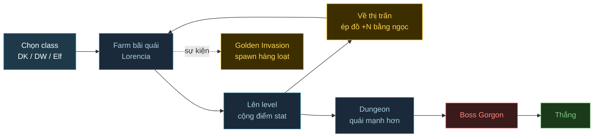

# demo11 — Lục Địa MU (plan)

> Theo template [`docs/new-game-plan.md`](../docs/new-game-plan.md). Lần build đầu là MVP: vừa đủ chơi hết 1 vòng core loop.
>
> **Anh duyệt 2026-10-13:** "tạm k build elf, còn lại ok". MVP chỉ có Dark Knight + Dark Wizard, Fairy Elf để sau (ô chọn class hiện "Sắp có").
> Đã build + deploy: https://wcg-game-r-demo11.vercel.app. Kết quả + số đo: `tasks/todo.md` mục demo11.

## 1. Mục tiêu thử nghiệm

- **Câu hỏi A/B:** Phaser 4 có chạy được cảnh kiểu MU Online ở 60fps không: 150+ quái hoạt động cùng lúc, skill AoE của 3 class, đồ +N phát sáng, và đợt Golden Invasion spawn hàng loạt?
- **So với demo nào:** demo5 (Phaser 4.2.1 + Flare). demo5 có vài chục quái, demo11 nhiều hơn khoảng 5-10 lần.
- **Kết quả mong đợi:**
  - HUD hiện FPS, số quái đang sống, số sprite đang vẽ.
  - `?bench=N` spawn N quái quanh hero để đo FPS theo mốc 50 / 150 / 300 / 500.
  - `?nofx` tắt filter (giống demo5) để tách phần tốn do FX và phần tốn do số lượng sprite + logic.
  - Ghi kết quả đo vào phần review trong `tasks/todo.md`.

## 2. Gameplay

- **Thể loại + reference:** ARPG isometric 2D, nhái MU Online thời season 1-2: Lorencia, Dungeon, cộng điểm, ép đồ bằng ngọc, Golden Invasion.
- **Core loop 3 tầng:**
  - 30 giây: click đánh quái, dùng skill AoE gom cả bầy, nhặt Zen/ngọc/đồ.
  - 5 phút: lên level, cộng 5 điểm stat, ép đồ +N ở thị trấn, chuyển sang bãi quái mạnh hơn.
  - Cả phiên: Lorencia -> Dungeon -> diệt boss Gorgon thì thắng. Giữa phiên có Golden Invasion.

- **Class (đủ 3 class như MU):**

  | Class | Stat chính | Đánh thường | Skill (MVP) |
  |---|---|---|---|
  | Dark Knight | STR | Chém cận chiến | Twisting Slash (xoay vòng, AoE quanh người), Rageful Blow (đập đất, AoE trước mặt) |
  | Dark Wizard | ENE | Energy Ball (bắn xa) | Evil Spirit (8 tia quanh người), Meteor (AoE tại điểm click), Teleport (dịch chuyển ngắn) |
  | ~~Fairy Elf~~ (hoãn) | AGI | Bắn cung | Triple Shot (3 mũi tên hình quạt), Heal, Greater Damage (buff) |

- **Verbs + controls** (đề xuất theo kiểu MU):

  | Hành động | Phím / chuột | Ghi chú |
  |---|---|---|
  | Di chuyển | Click / giữ chuột trái | Giữ chuột thì đi theo con trỏ |
  | Tấn công | Click trái lên quái | Tự đi tới tầm đánh rồi đánh liên tục |
  | Skill | Click phải | Dùng skill đang chọn, đổi skill bằng phím 1-4 |
  | Bình HP / MP | Q / W | Giống MU |
  | Nhặt đồ | Click lên đồ / Space nhặt quanh | |
  | Bảng nhân vật | C | Cộng điểm STR / AGI / VIT / ENE |
  | Túi đồ | V | Kéo ngọc thả lên món đồ để ép |

- **Camera:** isometric cố định góc nhìn kiểu MU, camera bám theo hero, không xoay.
- **Game feel:** số damage bay lên (critical màu vàng, excellent damage màu xanh), quái nháy trắng + bị đẩy lùi nhẹ khi trúng đòn, hit-stop ngắn khi trúng crit, rung màn hình khi dùng skill lớn. Lên level có cột sáng, ép đồ thành công/thất bại có hiệu ứng + âm thanh riêng.
- **Kẻ địch** (tên theo MU, dùng sprite Flare):

  | Loại | Vùng | Hành vi | Ghi chú |
  |---|---|---|---|
  | Spider | Lorencia | Đi theo bầy, nhanh, máu thấp | Quái đông nhất, dùng để thử số lượng |
  | Budge Dragon | Lorencia | Bay lượn, lao vào cắn rồi lùi ra | |
  | Bull Fighter | Lorencia | Cận chiến, chậm, máu trâu | |
  | Lich | Lorencia/Dungeon | Giữ khoảng cách, bắn phép | |
  | Skeleton | Dungeon | Cận chiến, đi theo nhóm | |
  | Ghost | Dungeon | Đi xuyên tường, máu thấp | |
  | Golden Goblin / Golden Dragon | Golden Invasion | Chạy trốn khi bị đánh, rớt Box of Kundun | Spawn 30-50 con khắp map |
  | Boss Gorgon | Cuối Dungeon | Phase 1 đánh cận chiến + dậm AoE. Máu < 50%: gọi đệ tử + đánh nhanh hơn | |

- **Progression:**
  - Level -> mỗi level được 5 điểm, cộng vào STR / AGI / VIT / ENE (công thức kiểu MU: STR tăng damage DK, ENE tăng damage phép DW, AGI tăng tốc đánh + damage Elf, VIT tăng máu).
  - Drop: Zen, bình HP/MP, đồ thường, đồ **Excellent** (tên xanh lá, thêm 1-2 dòng chỉ số), Jewel of Bless, Jewel of Soul.
  - Ép đồ: Bless nâng +0 -> +6 (luôn thành công). Soul nâng +6 -> +9: tỉ lệ 50%, đồ có Luck thì 75%, thất bại thì đồ về +0.
  - Đồ +7 trở lên phát sáng, +9 sáng mạnh hơn, đổi màu theo cấp. Hiện trên cả icon lẫn nhân vật.
  - NPC thị trấn: bán bình máu/mana, mua lại đồ.
- **Thắng / thua:**
  - Thắng khi diệt Gorgon.
  - Chết: hồi sinh ở thị trấn Lorencia, mất một ít EXP và Zen (giống MU), đồ giữ nguyên.
- **Tiêu chí "vui":**
  - DK lao vào bầy 20+ Spider, Twisting Slash một phát, số damage bay đầy màn hình mà không thấy giật.
  - Ép đồ +7 hồi hộp. Thành công thì vũ khí trên tay nhân vật phát sáng ngay.

## 3. Engine + version + đường build

- **Chọn:** Phaser 4.2.1 (npm) + Vite 5.4.10, giống demo5.
- **Lý do (theo gameplay mục 2):**
  - Nhiều quái có animation: sprite 2D cùng atlas gộp được batch, không phải skinning từng con như 3D.
  - Câu hỏi A/B là về Phaser 4 nên engine cố định.
  - Dùng lại được từ demo5: render isometric, paperdoll hero, atlas, `tools/build_assets.py`, filter v4.
- **Build:** `vite build`, Vercel tự build (giống demo5).

## 4. Art + danh sách asset

- **Nguồn:** Flare: Empyrean Campaign (`flareteam/flare-game` trên GitHub), chỉ lấy các folder cần (hero, enemies, tilesets, powers, sounds). Dùng lại atlas đã build của demo5 khi được.
- **License:** CC-BY-SA 3.0. File art đã chỉnh sửa vẫn theo CC-BY-SA 3.0. Tạo `CREDITS.md` ngay từ ngày đầu, kèm `CREDITS-flare.txt`.
- **Format + tối ưu:** atlas WebP + JSON, scale 0.75, cắt bỏ animation không dùng (`tools/build_assets.py` sửa lại từ demo5). Quái vàng, Lich, Ghost... dùng tint lúc chạy thay vì làm thêm sprite.
- **Danh sách asset:**

  | Hạng mục | Cần gì (MVP) | Nguồn | License | Format | Animation cần | Rủi ro |
  |---|---|---|---|---|---|---|
  | Hero DK | Paperdoll giáp nặng + kiếm | Flare hero (có sẵn ở demo5) | CC-BY-SA 3.0 | atlas WebP | stance, run, swing, hit, die | Thấp |
  | Hero DW | Áo choàng + gậy phép | Flare hero (staff có sẵn, áo choàng/cloth lấy thêm) | CC-BY-SA 3.0 | atlas WebP | stance, run, cast, hit, die | Bộ áo choàng có trong Flare không |
  | ~~Hero Elf~~ (hoãn) | Giáp da + cung | Flare hero (bow + `shoot`) | CC-BY-SA 3.0 | atlas WebP | stance, run, shoot, hit, die | Đã kiểm: Flare có `shortbow/longbow/greatbow` + anim `shoot` cho avatar male, làm được khi anh cần |
  | Quái Lorencia | Spider, Budge Dragon, Bull Fighter, Lich | Flare enemies (antlion/spider, wyvern, minotaur nhỏ, skeleton_mage) | CC-BY-SA 3.0 | atlas WebP | stance, run, attack, hit, die | Map tên MU sang sprite Flare cho hợp |
  | Quái Dungeon | Skeleton, Ghost | Flare skeleton, zombie (có sẵn ở demo5) + tint | CC-BY-SA 3.0 | atlas WebP | như trên | Thấp |
  | Golden Invasion | Golden Goblin / Golden Dragon | Flare goblin, wyvern + tint vàng | CC-BY-SA 3.0 | dùng chung atlas | như trên | Thấp |
  | Boss | Gorgon | Flare minotaur (demo5) scale to + tint | CC-BY-SA 3.0 | atlas WebP | stance, run, swing, hit, die | Thấp |
  | Môi trường | Lorencia (thị trấn + bãi cỏ), Dungeon | Flare tileset grassland + dungeon | CC-BY-SA 3.0 | atlas WebP | | Map tự sinh bằng code hay lấy map Flare có sẵn: chốt lúc build |
  | NPC | Thợ rèn/bán đồ, bán bình | Flare NPC (có sẵn ở demo5) | CC-BY-SA 3.0 | atlas WebP | stance | Thấp |
  | Loot | Zen, bình HP/MP, ngọc Bless/Soul, vũ khí, giáp, Box of Kundun | Flare loot + icons (demo5) + tint ngọc | CC-BY-SA 3.0 | atlas WebP | | Thấp |
  | VFX | Twisting Slash, Evil Spirit, Meteor, Triple Shot, glow đồ +N, cột sáng lên level | Flare powers (demo5) + filter Phaser 4 (glow, bloom) | CC-BY-SA 3.0 | atlas WebP + filter | | FX nhiều + filter full màn hình là phần tốn nhất, đúng phần cần đo |
  | SFX | Chém, phép, trúng đòn, nhặt đồ, ép đồ, lên level | Flare sounds / Kenney (CC0) | CC-BY-SA 3.0 / CC0 | ogg/mp3 | | |
  | UI | HUD máu/mana kiểu quả cầu MU, bảng stat, túi đồ, FPS/bench | Tự vẽ bằng CSS + icon Flare | | HTML/CSS | | |

- **Rủi ro chung:** (1) Elf cần cung + anim `shoot`, làm thử đầu tiên. Không có thì Elf dùng anim `cast` + sprite mũi tên. (2) Sắp thứ tự vẽ (depth sort) cho 300+ sprite isometric mỗi frame. (3) Logic AI/va chạm cho số quái lớn phải dùng spatial hash, không check từng cặp.
