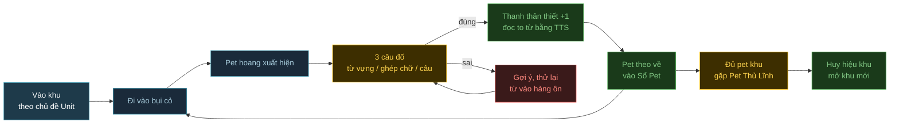

# demo12 — Đảo Pet Tiếng Anh (plan)

> Theo template [`docs/new-game-plan.md`](../docs/new-game-plan.md). Lần build đầu là MVP: vừa đủ chơi hết 1 vòng core loop.
>
> **Anh duyệt 2026-10-14:** sách Tiếng Anh 3 Global Success "ok", khu đầu "Rừng Thú Cưng" "ok". Chưa build, để session sau.

## 1. Mục tiêu thử nghiệm

Demo này **không** A/B engine/art. Đây là game thật cho bé 8 tuổi (lớp 3) vừa chơi vừa học tiếng Anh.

- **Câu hỏi:** bé chơi khoảng 15 phút/ngày có **tự quay lại** chơi và **nhớ được từ mới** không?
- **So với demo nào:** không so. Mốc so là chính bé: tuần 1 vs tuần 2.
- **Kết quả mong đợi (đo trong game, lưu localStorage của máy bé chơi):**
  - Số từ "đã thuộc" (trả lời đúng 3 lần ở 3 lượt khác nhau, không liên tiếp trong cùng 1 trận).
  - Số ngày bé mở game, số phút mỗi ngày, chuỗi ngày liên tiếp (streak).
  - Tỉ lệ đúng theo từng loại câu hỏi -> biết bé yếu phần nào (từ, đánh vần, câu).
  - Màn **Góc phụ huynh** (giữ nút 3 giây mới mở) hiện các số trên để anh xem.

## 2. Gameplay

- **Thể loại + reference:** sưu tầm pet kiểu Pokémon, bản rất nhẹ cho trẻ em. Đi map, gặp pet hoang trong bụi cỏ, trả lời câu đố tiếng Anh để pet "kết bạn" và theo về.
- **Không có đánh nhau, không có thua.** Trả lời sai thì có gợi ý và thử lại, không trừ gì.
- **Core loop 3 tầng:**
  - 30 giây: đi vào bụi cỏ -> pet hoang hiện ra -> trả lời 3 câu -> thanh "thân thiết" đầy -> pet theo về.
  - 5 phút: dạo hết 1 khu, kết bạn 6-8 pet của khu -> gặp **Pet Thủ Lĩnh** (5 câu, có câu mẫu dài hơn) -> nhận huy hiệu khu.
  - Cả phiên / nhiều ngày: lấp đầy **Sổ Pet** (Pet-dex), mở khu mới. Từ bé hay sai sẽ quay lại nhiều hơn.

- **Nội dung học** (đề xuất theo SGK **Tiếng Anh 3 Global Success**, anh check lại sách bé đang học, đổi được vì nội dung nằm trong 1 file data):
  - Mỗi khu = 1-2 Unit. **MVP làm 1 khu: "Rừng Thú Cưng"** = Unit *My pets* + *At the zoo*. Lý do: từ vựng chính là con vật, nên pet bé bắt được cũng chính là từ bé học (bắt con `rabbit` thì phải biết chữ `rabbit`).
  - Khoảng 16 từ: cat, dog, rabbit, parrot, fish, hamster, turtle, mouse, elephant, monkey, tiger, giraffe, zebra, lion, bear, crocodile.
  - Mẫu câu: `It's a ___.` · `I have a ___.` · `I can see a ___.` · `The ___ is big / small.` · `How many ___s? Three ___s.`
  - Các khu sau (hiện trên bản đồ thế giới nhưng khóa trong MVP): Trường Học (*school things, colours*), Nhà Của Bé (*my house, my bedroom, family*), Phòng Đồ Chơi (*our toys*), Bàn Ăn (*at the dining table*).

- **Loại câu đố (theo anh chọn: nhìn hình -> từ, câu mẫu):**

  | Loại | Bé thấy | Bé làm | Độ khó tăng khi từ đã quen |
  |---|---|---|---|
  | Hình -> chọn từ | Hình con vật | Chạm 1 trong 3 chữ | 3 -> 4 lựa chọn, chữ nhiễu gần giống (cat / car / hat) |
  | Ghép chữ | Hình + ô trống `_ _ _` | Chạm chữ cái theo thứ tự (PC gõ phím được) | Thêm 1-2 chữ nhiễu |
  | Điền câu | Hình + `It's a ___.` | Chạm từ đúng | Câu dài hơn, nhiều chỗ trống hơn |
  | Xếp câu | Hình + các từ bị xáo | Chạm từ theo thứ tự thành câu | Câu 4 -> 6 từ |

  Đúng thì game **đọc to** từ/câu bằng giọng tiếng Anh của trình duyệt (Web Speech API), có nút loa để nghe lại, có nút tắt.
  Ôn tập: mỗi từ có 1 "hộp" (Leitner 3 hộp). Sai -> về hộp 1, gặp lại sớm. Đúng 3 lần ở 3 lượt khác nhau -> "đã thuộc", ít hỏi lại.

- **Verbs + controls** (máy cảm ứng và PC như nhau):

  | Hành động | Cảm ứng | PC | Ghi chú |
  |---|---|---|---|
  | Di chuyển | Chạm chỗ muốn tới | Click, hoặc phím mũi tên / WASD | Tự tìm đường đi vòng cây |
  | Trả lời | Chạm đáp án | Click, hoặc phím 1-4 | Nút to tối thiểu 64px |
  | Ghép chữ | Chạm chữ cái | Gõ phím chữ | Chạm chữ đã đặt để gỡ ra |
  | Nghe lại | Nút loa | Phím Space | |
  | Mở Sổ Pet | Nút sách góc màn | Phím B | Chạm pet để nghe tên + câu mẫu |

- **Camera:** top-down 2D, đi theo bé. Màn ngang và màn dọc đều dùng được (Phaser Scale RESIZE, khung câu đố là DOM overlay co giãn theo màn).
- **Game feel:** pet nảy nhẹ (squash/stretch), bụi cỏ rung trước khi pet hiện ra, đúng thì có sao bay + confetti + tiếng "ting", pet bắt được nhảy vào Sổ Pet. Sai thì nút rung nhẹ + gợi ý (hiện chữ cái đầu), **không** dùng màu đỏ gắt, **không** có tiếng buzzer.
- **Các loại pet** (thay cho bảng kẻ địch, mỗi loại 1 hành vi):

  | Loại | Hành vi | Câu đố |
  |---|---|---|
  | Pet thường | Ngồi trong bụi cỏ, chờ bé tới | 3 câu dễ (hình -> từ, điền câu) |
  | Pet nhút nhát | Chạy ra xa khi bé lại gần, phải đi chậm / chặn góc | 3 câu, có ghép chữ |
  | Pet lấp lánh (hiếm) | Phát sáng, chỉ hiện ~10% lần | 3 câu khó hơn, phần thưởng là màu lông khác trong Sổ Pet |
  | Pet Thủ Lĩnh (cuối khu) | Đứng ở cổng khu, chỉ mở khi đã có 6 pet | 5 câu, có xếp câu |

- **Progression:** Sổ Pet (mỗi pet gắn 1 từ, chạm vào để nghe), huy hiệu khu, độ khó câu đố tăng theo hộp Leitner của từng từ. Không có tiền ảo hay cửa hàng trong MVP.
- **Thắng / thua:** không có thua. Sai 3 lần cùng 1 câu thì game hiện đáp án, đọc to, pet "ngại ngùng chạy mất" và gặp lại sau. Xong 1 khu = thắng phiên đó.
- **Ngôn ngữ giao diện:** hướng dẫn bằng tiếng Việt, ngắn, kèm icon. Nội dung học bằng tiếng Anh.
- **Tiêu chí "vui"** (anh test tay cùng bé):
  - Bé tự chơi từ đầu tới lúc bắt được pet đầu tiên mà không cần người lớn đọc hộ.
  - Bắt 1 pet mất khoảng 30-45 giây, và bé đòi bắt tiếp sau con đầu tiên.

## 3. Engine + version + đường build

- **Chọn:** Phaser 4.2.1 + Vite 5.4.10 (cùng bộ với demo10, demo11).
- **Lý do (theo gameplay mục 2):**
  - Game 2D, cần chạm/click, tween cho game feel, Scale Manager cho màn ngang/dọc -> Phaser có đủ, không cần 3D hay physics.
  - Khung câu đố làm bằng **DOM overlay** (như `src/ui` của demo10): chữ sắc nét ở mọi độ phân giải, nút to dễ chạm, dễ responsive hơn vẽ trong canvas.
  - Logic thuần JS (`src/core/`: ngân hàng câu hỏi, Leitner, Sổ Pet, thống kê) không import Phaser -> selftest chạy bằng Node. Dùng lại cách smoke test headless của demo11 để bot chơi hết 1 khu.
  - Lưu tiến độ bằng localStorage (có try/catch, mất dữ liệu thì chơi lại từ đầu chứ không crash).

## 4. Art + danh sách asset

- **Nguồn chính:** **Microsoft Fluent Emoji** bản 3D (license **MIT**). Có sẵn đủ con vật, cây, hoa, đồ vật, phong cách tròn trịa dễ thương, đồng bộ cho cả pet, hình từ vựng và cảnh vật. Các khu sau (đồ dùng học tập, đồ chơi, đồ ăn) cũng có sẵn hình.
- **Phụ:** Kenney Interface Sounds + Digital Audio + Music Jingles (CC0) cho âm thanh. Font **Nunito** (OFL, có tiếng Việt).
- **License:** MIT (Fluent Emoji, phải giữ file LICENSE) + CC0 + OFL. Tạo `CREDITS.md` ngay từ ngày đầu.
- **Format + tối ưu:** PNG 256px gốc -> resize 128px (pet to thì 192px) -> đóng atlas WebP bằng script `tools/` (sharp). Nền map vẽ bằng Phaser Graphics + rải emoji cây/hoa, không cần tileset.
- **Danh sách asset:**

  | Hạng mục | Cần gì (MVP) | Nguồn | License | Format | Animation cần | Rủi ro |
  |---|---|---|---|---|---|---|
  | Nhân vật bé | 1 bé trai + 1 bé gái để chọn | Fluent Emoji (👦 👧) | MIT | Atlas WebP | Không có frame, dùng tween nảy khi đi | Emoji chỉ có mặt, không có dáng đi -> bù bằng tween |
  | Pet | 16 con theo từ vựng khu 1 + bản lấp lánh (tint + glow) | Fluent Emoji (🐈 🐕 🐇 🦜 🐠 🐹 🐢 🐁 🐘 🐒 🐅 🦒 🦓 🦁 🐻 🐊) | MIT | Atlas WebP | Tween: thở, nảy, chạy, nhảy vào sổ | Vài con không có emoji khớp chữ (goldfish -> dùng `fish`) |
  | Pet Thủ Lĩnh | 1 (vd 🦁 to x2 + vương miện 👑) | Fluent Emoji | MIT | Atlas WebP | Tween | |
  | Môi trường | 1 khu rừng + bản đồ thế giới 5 khu (4 khóa) | Graphics + Fluent Emoji (🌳 🌲 🌷 🌻 🌿 🪨 🏠) | MIT | Atlas WebP | Bụi cỏ rung | Map trông "dán emoji" -> thêm bóng đổ, nền gradient |
  | UI câu đố | Khung, nút, thanh thân thiết, Sổ Pet, Góc phụ huynh | Tự làm CSS + Fluent Emoji (⭐ 📖 🔊 🏅) | MIT | DOM + CSS | Rung, nảy (CSS) | |
  | Âm thanh | Ting, confetti, bước chân, pet kêu, nhạc ngắn khi bắt được | Kenney Interface Sounds / Digital Audio / Music Jingles | CC0 | ogg + mp3 | | |
  | Giọng đọc | Đọc từ và câu tiếng Anh | Web Speech API của trình duyệt | — | — | | Giọng khác nhau giữa máy; iPad phải chạm 1 lần mới phát được; máy không có giọng en thì ẩn nút loa |

- **Rủi ro chung:** giọng TTS không đều giữa Windows / Android / iPad (làm thử phần này trước). Nội dung SGK em đề xuất theo trí nhớ, cần anh xác nhận sách bé học.

## Agent tự làm (không hỏi)

- [ ] Deploy Vercel: team `wecare2`, project `wcg-game-r-demo12`
- [ ] Thêm 1 dòng vào bảng demo trong `README.md`, kèm mục "Engine & art"
- [ ] Ghi plan vào `tasks/todo.md`, review cuối vào cùng file
- [ ] Thêm thuật ngữ mới vào `glossary.md` (Leitner, TTS / Web Speech API, DOM overlay)
- [ ] Gặp lỗi đáng nhớ thì ghi vào `tasks/lessons.md`
