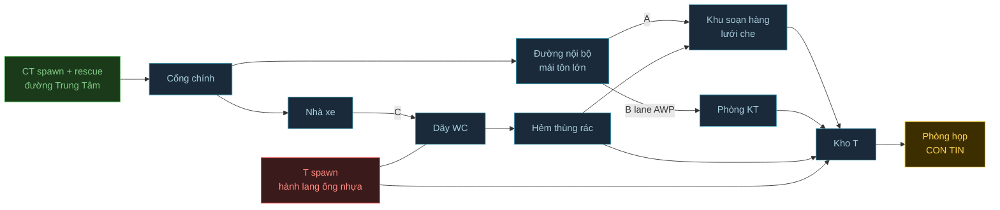

# demo19 — map 2: cs_wecare (khu xưởng Wecare, Quy Nhơn Bắc) cho Counter-Strike 1.3

> Map thứ 2 dùng chung pipeline của `cs_benthanh` (`PLAN.md`): script TS -> `.map` -> SDHLT -> `.bsp`.
> Trạng thái: **layout v8 duyệt 2026-10-27; MVP đã build + cài vào `E:\Game\HL` cùng ngày, chờ anh test tay.**
> Ảnh tham khảo: `_inbox/demo19-wecare-ref/` (gitignore).
> Build: `npm run build -- --map=wecare --install`, selftest: `npx tsx tools/selftest.ts --map=wecare` (ảnh `build/layout-wecare.png`).
> Lưu ý: demo19 ở branch này được chép từ worktree `day-function-claude-3c2afe` (khi đó chưa commit) -> lúc gộp 2 branch
> phải đối chiếu `tools/build.ts`, `tools/selftest.ts`, `src/textures.ts` (3 file có sửa). Ảnh ambientCG lấy qua biến `AMBIENTCG`.

## 1. Mục tiêu thử nghiệm

- **Câu hỏi A/B:** Pipeline demo19 có dựng được map thứ 2 chỉ bằng cách thêm file map + prop + texture mới, không phải
  sửa phần lõi (`brush`, `wad`, `bsp`, `waypoints`) không?
- **So với:** `cs_benthanh` (cùng pipeline), `cs_office` (cùng chế độ, bối cảnh công ty).
- **Kết quả mong đợi:** `npm run build -- --map wecare` compile sạch (không leak, không vượt limit), load được trong
  CS 1.3, chơi hết 1 round cứu con tin. Diff phần lõi chỉ gồm cờ `--map`.

## 2. Gameplay

- **Thể loại:** map `cs_` 5v5, khu xưởng có tường rào. Tỉ lệ 1 m ≈ 40 unit, **không thu nhỏ** (khu thật ~80 x 60 m
  -> ~3200 x 2400 unit, cỡ cs_italy). Kích thước ước từ ảnh vệ tinh (lấy bề rộng đường Trung Tâm làm mốc), chỉnh sau khi test tay.
- **Hướng:** Bắc ở trên. Cổng chính ở tường rào phía Tây, mở ra đường Trung Tâm.

Sơ đồ trên chỉ thể hiện các khu nối với nhau thế nào. Mặt bằng nhìn từ trên xuống (bản v8) nằm ở bảng khu dưới đây.

### Các khu

| Khu | Vị trí | Chơi được | Ảnh |
|---|---|---|---|
| CT spawn + rescue | Vỉa hè, lề đường Trung Tâm, ngoài cổng | Có | 1, 23 |
| Cổng chính | Tường rào Tây: 2 trụ kem, cổng trượt xám mở | Có | 1, 20, 23 |
| Đường nội bộ | Từ cổng chạy về Đông, mái tôn lớn xanh rêu, nền bê tông rồi đá dăm | Có | 10, 22 |
| Kho bên cạnh | Phía Bắc đường nội bộ: tôn rỉ, "Vô phận sự miễn vào", "Cổng xuất hàng" | Không, chỉ làm mặt tiền | 19, 21, 22 |
| Dãy xưởng vàng | Cuối đường nội bộ, phía Đông Bắc, có núi phía xa | Không | 10 |
| Nhà VP + nhà mái ngói | Phía Nam cổng | Không, chỉ làm cảnh | 18, 20, 23 |
| Nhà xe | Phía Nam cổng, mái bạt + mái tôn, xe máy | Có | 8, 15, 16 |
| Khu soạn hàng | Dải trước kho T, lưới che xanh nhìn thẳng ra cổng | Có | 7, 9, 19, 21 |
| Phòng KT | Đầu Đông khu soạn hàng, vách trắng, cửa đôi kính | Có | 17 |
| Kho T | Dải sau, trần tôn cao, kệ + bạt cam + bao tải + pallet | Có | 4, 5 |
| Phòng họp (con tin) | Trong kho T, phía Đông, cửa kính nhôm | Có | 6 |
| Hẻm | Dọc mép Tây kho, thùng rác, lavabo | Có | 12 |
| Dãy WC | Phía Nam, gộp luôn lối dọc tường rào cũ | Có | 13, 14 |
| T spawn | Cùng dãy WC: hành lang hẹp sau kho, lưới rào, ống nhựa xanh | Có | 3 |

### 3 đường tấn công của CT

| Đường | Lộ trình | Tính chất |
|---|---|---|
| A (chính) | Cổng -> đường nội bộ -> qua lưới khu soạn hàng -> kho -> phòng họp | Trung bình, đánh trong đống hàng |
| B (lane AWP) | Cổng -> thẳng đường nội bộ -> phòng KT -> kho -> phòng họp | Dài, thẳng, ngắn nhất tới con tin -> phòng KT chỉ 1 cửa + 1 ô kính để T giữ được |
| C (vòng) | Cổng -> nhà xe -> dãy WC -> hẻm -> khu soạn hàng hoặc kho | Hẹp, nhiều góc khuất, đi ngang sát T spawn nên rủi ro cao |

### Góc nấp (layout v8)

| # | Vật | Khu | Vai trò |
|---|---|---|---|
| 1, 3 | Cây lớn ven đường | CT spawn | CT nấp lúc spawn |
| 2 | Xe tải xanh đỗ chéo | Trước cổng | Che cửa spawn; **leo lên thùng xe**, nhìn qua tường rào chỉ thấy khu soạn hàng qua lưới |
| 4 | Trụ cổng, cánh cổng trượt | Cổng | CT ló nhìn dọc đường nội bộ |
| 5 | Xe đẩy hàng, ghế băng trắng | Đầu đường nội bộ | Nấp cho đường A và B |
| 6 | Xe nâng, thùng phuy xanh, pallet | Cuối đường nội bộ | **T giữ lane AWP** |
| 7 | Hàng xe máy | Nhà xe | Nấp thấp, đường C |
| 8 | Lưới che, bàn gỗ | Khu soạn hàng | Lưới nhìn mờ, đạn xuyên; T canh cổng |
| 9 | Bình nước 20L, cân, bao kraft | Khu soạn hàng | Nấp thấp |
| 10 | Đống đồ trùm bạt xanh | Khu soạn hàng | Góc tối |
| 11 | Thùng đá, chồng ghế nhựa | Trước phòng KT | Nấp trước cửa kính |
| 12 | Thùng rác xanh | Hẻm | Ô nấp duy nhất trong hẻm |
| 13 | Kệ sắt chất thùng carton | Kho T | Tường nấp cao |
| 14 | Chồng cuộn bạt cam | Kho T | **Leo lên đứng cao**, nhìn cửa phòng họp |
| 15 | Bao tải trắng | Kho T | Nấp thấp, chặn đường A |
| 16 | Pallet, đồ bọc nilon | Kho T | Nấp trước phòng họp |
| 17 | Bàn họp | Phòng họp | Thủ cuối cạnh con tin |
| 18 | Bậc thềm, tường thấp | Dãy WC | Cuối đường C |
| 19 | Cuộn ống nhựa xanh chồng cao | T spawn | Tường nấp |
| 20 | Ghế VP đen, cục nóng máy lạnh | T spawn | Nấp cuối hành lang |

Điểm đứng cao chia đều: CT 1 (xe tải), T 2 (xe nâng ở lane, bạt cam trong kho).

- **Con tin:** 4 người trong phòng họp, dùng model scientist mặc định (không patch như `cs_benthanh`).
- **Thắng / thua:** luật CS 1.3 mặc định.
- **Tiêu chí "vui":** (1) T từ spawn tới khu soạn hàng trước khi CT qua được cổng (hẻm ngắn hơn đường nội bộ).
  (2) Không có chỗ nào ở khu soạn hàng bắn thẳng được vào CT spawn mà không bị lưới che hoặc xe tải chặn.
  (3) Mỗi đường có ít nhất 3 góc nấp.

### Sửa sau test tay lần 1 (2026-10-27)

| Góp ý của anh | Đã sửa |
|---|---|
| Phòng họp là bức vách trắng trống | Tách thành 2 phòng sát vách tựa tường Đông kho, trần 256: phòng họp (con tin) + phòng IT (tủ rack, bàn, màn hình), cửa nhôm + biển tên |
| Kho có 2 cửa phía Bắc | Còn 1 cửa lớn (chỗ cửa nhỏ cũ) + cánh cổng tôn xám kéo bên cạnh |
| Kho có cửa ra hẻm | Bịt thành tường kín: hẻm chỉ nối dãy WC với khu soạn hàng |
| T spawn thông thẳng ra nhà xe | Lưới B40 chắn ngang hành lang: nhìn + bắn xuyên được, không đi qua (lưới không va chạm + CLIP) |
| Xe tải che mặt cổng | Lùi xe về phía Nam |
| Cổng chính nhỏ | Rộng ~9 m (368 unit), 2 cánh cổng xám kéo ra mặt ngoài tường rào, bảng hiệu dời lên phía Bắc |
| Nhà nhỏ cạnh cổng là phòng bảo vệ | Thêm cửa sổ nhìn ra cổng; nhà VP lùi về Nam để chừa chỗ |
| Phòng KT: ô kính phải là cửa chính | Cửa chính khung nhôm mở ra khu soạn hàng (cửa ra đường vẫn giữ cho đường B) |
| Khu soạn hàng + kho ít hàng | Kệ khay bu lông ốc vít, bàn soạn hàng có hộp bu lông, thùng "BU LÔNG" / "ỐC VÍT"; kho thêm 2 dãy kệ, 4 pallet carton, bao tải sau cửa lớn, cuộn ống |

Lưới che khu soạn hàng cũng đổi sang lưới không va chạm + CLIP cho đúng mục 3 (đạn xuyên).

### Sửa sau test tay lần 2 (2026-10-27)

| # | Góp ý của anh | Đã sửa |
|---|---|---|
| 1 | Hẻm giữa nhà VP và vách nhà xám quá rộng | Hẻm còn ~3,2 m (128 unit), dẫn thẳng xuống dãy WC |
| 2 | Nhà VP là tòa 2 tầng, phòng làm việc có ban công; trái là hẻm ra WC, phải là nhà xe | Dựng lại khu phía Nam cổng theo thứ tự Tây -> Đông: nhà xe dọc tường rào (mái bạt + mái tôn, 4 dãy xe máy) / nhà VP 2 tầng + nhà mái ngói phía sau / hẻm. Ban công tầng 2 có lan can nhìn ra đường nội bộ (chỉ làm cảnh, chưa vào được) |
| 3 | Phòng KT chỉ 1 cửa, bỏ 2 cửa hông | Bỏ cửa ra đường và cửa xuống kho, còn cửa chính mở ra khu soạn hàng. Đường B giờ đi lane AWP rồi rẽ vào khu soạn hàng |
| 4 | Cửa lớn kho thêm 2 cửa kéo 2 bên, mở sẵn | 2 cánh kéo sẵn sang 2 bên cửa + ray trên |
| 5 | Phòng KT: cửa kính khung nhôm trắng, có tên phòng | Cửa kính 2 cánh khung nhôm trắng mở sẵn vào trong + biển "PHÒNG KẾ TOÁN" |
| 6 | Kho cao hơn khu soạn hàng + phòng KT 2 bậc | Sàn kho cao 48 (soạn hàng 16): 1 bậc ở cửa lớn, 2 bậc ở cửa ra T spawn; 2 phòng + hàng trong kho nâng theo |
| 7 | Vì sao anh + 2 bot tự DEAD | Lỗi map: spawn đặt cách nhau 80..128 unit, engine coi điểm trong 128 unit có người là không trống -> hết điểm thì người spawn sau đè chết người trước (telefrag). Giãn spawn 144 unit, mỗi phe 16 điểm |
| 8 | Cửa kho là cửa lớn màu xám | 2 cánh cửa kéo ở mục 4 làm bằng tôn xám lớn, mỗi cánh rộng nửa cửa |
| 9 | Có 2 hẻm song song xuống WC | Giữ hẻm cạnh nhà VP (dọc lưới che), lấp hẻm sát kho thành dãy nhà xám; thùng rác + lavabo dời sang. Đường C giờ cụt ở lưới B40 (bắn xuyên lưới vào T spawn), anh chốt giữ cụt |
| 10 | Cửa lớn kho rộng ra | 192 -> 384 unit (~9,6 m), 2 cánh xám 128 mỗi bên; kệ khay + logo dời sang trái cho cánh cửa không che |
| 11 | Xe nâng to ra, màu vàng cho dễ thấy | To ~1,5 lần, thân + mái che vàng, khung + trụ nâng tối |
| 12 | Bảng "CỔNG XUẤT HÀNG" bị cột che chữ | Dời sang phải, lệch khỏi cột mái tôn |
| 13 | Lưới che chỉ phủ phần trái, dải sát nhà xám đi ra được | Lưới + CLIP chỉ từ y -80 lên phía đường; chừa lối 80 unit từ khu soạn hàng ra hẻm WC (đường C lại vào được khu soạn hàng) |
| 14 | Cửa hông nhà VP dời tới vị trí 2 | Dời vào sâu trong hẻm, ngay sau cột cửa sổ |
| 15 | Thùng rác nằm chỗ số 3 | Sát vách nhà VP, chỗ cửa cũ |
| 16 | Bồn rửa mặt thêm gương soi, đặt chỗ số 4 | Bồn + gương sát vách nhà xám, cạnh chỗ thùng rác cũ |
| 17 | Thêm 2 WC ở góc cạnh lưới B40 | Dãy WC nối dài tới sát lưới: 2 cửa nhôm, bậc thềm, biển WC (thay tường thấp) |
| 18 | Nhà xe rộng gấp đôi, map rộng hơn | Tường rào Tây, cổng, phòng bảo vệ và cả đường Trung Tâm (CT spawn, xe tải, cây) dời ra 224 unit; nhà xe rộng 448 với 4 dãy xe máy |
| 19 | Nhà VP (tòa trắng) rộng gấp rưỡi | 160 -> 240 unit, nới về phía nhà xe (hẻm giữ 128); cửa + cửa sổ mặt trước căn giữa |
| 20 | Mái tôn lớn nhỏ lại, cột đứng trước cửa VP | Mái chỉ từ x -400 về Đông; 5 cột đặt né cửa tối, biển và cửa nhà VP |
| 21 | Nhà xe giữ diện tích, bớt xe | 3 dãy, mỗi dãy 7 + 5 xe (từ 66 xuống 36 xe) |
| 22 | Ghế băng thay bằng thùng sơn WIN; khu soạn hàng không nâng bậc | Cụm thùng sơn WIN trên pallet; khu soạn hàng + phòng KT ngang mặt sân, kho vẫn cao hơn 2 bậc (sàn kho 32) |
| 23 | Cửa hông nhà VP dời tới số 1 | Lên tường vàng nhà mái ngói, ngay sau nhà VP |
| 24 | Phòng bảo vệ rộng ra | Kéo dài về phía Nam gấp đôi (88 -> 176 unit) |
| 25 | Xe tải, xe máy vẽ lại cho giống | Xe tải cabin bằng: kính lái vát, lưới tản nhiệt, đèn, cản, gương, kính hông, thùng dầu, thùng lửng thành xanh + trụ thép. Xe máy riêng cho cs_wecare: yếm vát, phuộc nghiêng, đèn, ghi đông + gương, sàn để chân, thân sau, yên, ống pô, mâm. Cả 2 vào func_detail (bớt ~30% clipnode); leaf lên ~5800/8192 vì nhiều mặt vát |
| 26 | Phòng bảo vệ: biển tên, máy chấm công, thềm dài hơn, bồn rửa mặt + gương ở số 3 | Biển "PHÒNG BẢO VỆ" trên cửa, máy chấm công bên trái cửa, thềm gạch bông chạy hết mặt nhà, bồn + gương dựa vách Nam (phía nhà xe). Bồn ở hẻm WC vẫn giữ |
| 27 | Mái hiên nhà xe có 2 trụ | 2 cột thép ở mép Nam mái tôn nhà xe |
| 28 | Lưới B40 thấp lại | Tấm lưới cao 128; CLIP vô hình giữ tới mái (280) để không đứng lên chồng ống nhảy qua |
| 29 | Gương soi đè lên cửa sổ lá sách | Dời bồn + gương vào giữa 2 cửa sổ |
| 30 | Xe nâng vàng dời tới số 1 | Giữa đường nội bộ, cạnh khu soạn hàng |
| 31 | Máy chấm công thấp xuống, thềm thấp hơn, biển phòng bảo vệ nhỏ + bớt nổi | Máy chấm công hạ ~70..94 và dời sang trái; thềm 16 -> 8 (cửa + biển hạ theo); biển 48 x 12, nền kem chữ xám |
| 32 | Bồn rửa tay phòng bảo vệ dựa nhầm vách | Dựa tường rào phía Tây, mặt quay ra lối đi nhà xe; thêm tấm vách ốp cao 152 sau bồn để treo gương |
| 33 | 2 cột mái hiên nhà xe giãn ra | Dời ra x -1256 và -1008 (gần 2 mép mái) |

### Đợt sửa gộp 34..44 (2026-10-28): ghi hết trước, build 1 lần

| # | Góp ý | Cách sửa |
|---|---|---|
| 34 | Đổi chỗ xe nâng với 3 xe đẩy hàng | Xe nâng sát mặt tiền kho bên cạnh, 3 xe đẩy ra giữa đường nội bộ (đã build trước đợt này) |
| 35 | 2 cửa kho bên cạnh màu xám, không đen | Đổi tấm cửa tối sang tôn xám như cửa kho T |
| 36 | Xe nâng còn 2/3 | Thu toàn bộ kích thước xe nâng còn 2/3 |
| 37 | 2 phòng trắng: (1) phòng họp, (2) phòng IT | Khối trắng cũ thành 1 phòng IT lớn (4 tủ rack, 2 bàn màn hình); phòng họp mới sát vách phía Bắc, có ô kính nhìn ra kho; con tin chuyển sang phòng họp mới; chồng carton chỗ đó dời ra |
| 38 | T spawn 1 cửa hẹp, chật | 2 cửa rộng 128 ra hành lang T, mỗi cửa 2 bậc |
| 39 | Cửa kính bắn vỡ được | Kính cửa KT + ô kính phòng họp thành func_breakable (vật liệu kính), mỗi tấm vỡ riêng |
| 40 | Phòng KT thêm dãy bàn, bảng trắng vách đối diện | 2 dãy bàn có màn hình, lối đi giữa; bảng trắng ghi chú trên vách đối diện cửa |
| 41 | Phòng KT lắp máy lạnh | Máy lạnh treo trên vách phía Bắc, phía trên dãy bàn |
| 42 | Góc tường cạnh cửa KT: bàn nhỏ, bình nước, ly, máy nước nóng | Bàn nhỏ + cây nước nóng lạnh có bình 20L + 3 ly |
| 43 | Phòng KT: tủ lạnh ở tường bên phải khi đi vào | Tủ lạnh ở góc Tây Nam (giữa cửa và dãy bàn phía Nam) |
| 44 | Tường CT spawn cao lên, khỏi nhảy vào | Tường rào cao 96 -> 128; thêm CLIP vô hình dọc tường rào tới độ cao 280 (đứng trên nóc xe tải / tán cây cũng không nhảy qua được), cổng vẫn mở |
| 45 | Nhà VP: 1 = cửa chính, 2 = cửa sổ (cả 2 tầng), tầng trệt lên 2 bậc | Cửa chính bên trái mỗi tầng (tầng trệt có 2 bậc), cửa sổ bên phải mỗi tầng |
| 46 | Dưới cửa sổ ngoài sân có 1 bàn + 2 ghế dài ăn cơm | Bàn gỗ + 2 ghế dài trước mặt nhà VP, dưới cửa sổ tầng trệt |

Kết quả đợt gộp: build 1 lần, selftest OK, compile sạch.

### Đợt sửa gộp 47..52 (2026-10-28)

| # | Góp ý | Cách sửa |
|---|---|---|
| 47 | Nhà mái ngói phía sau là cùng dãy nhà VP | Đổi sang tường trắng, cao 288 bằng nhà VP |
| 48 | 2 cửa sổ hông nhà VP cách ra, theo vị trí số 1 | Tầng trệt: cửa sổ ở y -360 và -200 (cách 96); logo dời lên y -110..-14 cho khỏi đè |
| 49 | Thùng rác dời tới số 2 | Sát vách nhà VP gần góc phía đường (y -60..-24) |
| 50 | 2 cửa sổ trên lầu cách ra như tầng 1 | Tầng 2 cùng vị trí với tầng trệt |
| 51 | Cửa toilet có miếng che mưa nhỏ | Mái tôn vát nhỏ trên cả 5 cửa WC |
| 52 | Bên phía T spawn có núi với tượng đài Nữ Tù Binh | Nới vỏ trời về Nam + nâng trần trời; 3 quả đồi (núi chính có tượng đài trên đỉnh: bệ đá + tượng đồng cách điệu), chỉ làm cảnh. CLIP chặn cuối đường Trung Tâm và trên đỉnh tường rào Nam để không ai đi ra vùng núi |
| 53 | Đường Trung Tâm ở CT spawn dài ra | Đường chạy tiếp về Nam tới chân núi; đi được tới y -1500 (CLIP), thêm 1 cây |
| 54 | Gương rửa mặt hạ thấp | Cả 2 gương (hẻm WC, phòng bảo vệ) hạ xuống z 72..120 |
| 55 | Phòng bảo vệ: cửa sổ thành cửa kính | Cửa kính khung nhôm thay lá sách (mặt nhìn ra cổng) |
| 56 | Cửa sổ mặt trước nhà VP thành cửa kính | Cả tầng trệt và tầng 2 mặt trước; mặt hông giữ lá sách |
| 57 | 2 cánh cửa lớn kho hẹp lại | Mỗi cánh 128 -> 96 |

Kết quả đợt 47..57: build 1 lần, selftest cả 2 map OK, compile sạch. Phòng IT: dãy bàn Bắc áp sát vách chung, ghế phía Nam bàn (hết góc kẹt bot). Leaf ~6050/8192 (74%).

### Đợt sửa 58..61 (2026-10-28)

| # | Góp ý | Cách sửa |
|---|---|---|
| 58 | Đảo cửa chính với cửa sổ nhà VP (bản #45 bị ngược khi nhìn từ đường vào) | Nhìn từ đường: cửa chính + cửa ban công bên trái (phía hẻm, x -772..-724), cửa sổ kính bên phải (phía nhà xe); bàn + ghế dài dời theo cửa sổ |
| 59 | Nhà VP trồi ra quá, dài quá: cắt ngang vách bên kho | Mặt trước lùi từ y 40 về `FRONT.y0` (-160), ngang dãy nhà xám + vách kho. Cửa sổ hông dời về y -400 / -240, logo lên trên cửa hông, thùng rác theo góc mới. Mái bạt nhà xe giữ tới y 40, thêm 1 cột đỡ góc |
| 60 | Nâng nền cửa chính thêm 1 bậc | 3 bậc (8 / 16 / 24), cửa chính hạ chân ở z 24 |
| 61 | Xe nâng lớn ra chút | Hệ số `K` 2/3 -> 0,8 (to thêm ~20%) |
| 62 | Phòng họp: tủ thấp lại, nâu giả gỗ, ra dáng cái tủ | Tủ gỗ cao 54: chân đen, thân + mặt tủ gỗ, khe 2 cánh, 2 tay nắm |
| 63 | Thùng chắn cửa ra T spawn: dời sang phải chừa lối | Pallet + bao tải dời từ x 600 sang 470 (cửa x 520..648 trống) |
| 64 | Phòng IT cửa kính 2 cánh như phòng họp | 2 cánh `func_door_rotating` bản lề 2 mép, cánh Bắc đảo chiều, cùng mở ra phía kho |
| 65 | Phòng IT: 2 dãy bàn ngồi được, dãy trái không có lối | Bàn x 806 và 980: lối 60 sát vách cửa, lối 104 giữa 2 dãy |
| 66 | Phòng IT: máy lạnh + quạt ở vách cửa | Máy lạnh trên cao phía Bắc cửa, quạt treo tường bên dưới (lồng lưới, cánh chữ thập) |
| 67 | Bỏ logo trên vách kho (phía khu soạn hàng) | Bỏ |
| 68 | Cuối đường nội bộ không cần dài | Tường chặn cuối đường từ x 1440 về `ROAD_END` = 1100 (ngang vách Đông phòng KT + kho); thùng phuy + pallet T giữ lane dời theo |
| 69 | Phòng KT: cây nước thấp còn 1/2, dời sang số 1 | Thân 96 -> 48, sát vách ngay bên phải cửa (nhìn từ trong), sau cánh kính Bắc |
| 70 | Ghế phòng KT + IT thành ghế dựa | Hàm `chair()`: chân sao + trụ, mặt ngồi, lưng tựa phía xa bàn |

Tường CT spawn (#44) đã có từ đợt 34..46: tường rào cao 128 + CLIP tới 280.

Waypoint bot: nhà VP lùi làm sân trước rộng ra, điểm đầu hẻm WC + lối nhà xe dùng hết 8 link phía sân -> thêm điểm giữa (-640,-290), (-1098,-150). Bàn ghế IT chắn đường thẳng từ cửa -> thêm điểm (748,-580) sau cửa. Selftest đổi điểm dò "phòng IT" sang lối giữa 2 dãy (900,-600).
Build ở worktree này cần `AMBIENTCG` trỏ tới `_inbox/ambientcg` của worktree `day-function-claude-3c2afe` (worktree này không có ảnh).

| # | Góp ý | Dự kiến sửa |
|---|---|---|
| 58 | CT spawn: khoảng trống đầu Bắc đường Trung Tâm (sau hàng cây) dài và rộng ra | Nới vỏ trời về Bắc + Tây; đường + vỉa hè chạy dài thêm, thêm cây; giữ CLIP ở mép để không ra khỏi map |
| 59 | Xe nâng: chiều cao OK, bề ngang rộng thêm 1/3 | Giữ chiều cao (hệ số 2/3), nhân bề ngang (trục X: thân, mái, khung, trụ nâng, càng, bánh) thêm 4/3 |
| 61 | 2 cánh cửa lớn kho T rộng ra (mục 57 em đọc nhầm "bè ngang" thành "bé", làm hẹp lại) | Mỗi cánh 96 -> 160 (cánh phải tới sát vách phòng KT ở x 700); kệ khay linh kiện thứ 2 dịch trái cho cánh trái khỏi đè |
| 62 | Phòng KT: bỏ mấy cục màu xanh trên bàn | Bỏ 4 khối màn hình (wc_screen) trên 2 dãy bàn phòng KT |
| 63 | Phòng KT: cây nước nóng lạnh đứng dưới sàn cạnh bàn, không đặt trên bàn | Cây nước đứng sàn cao ~96 (bình 20L trên nóc) đặt sát cạnh bàn nhỏ; ly giữ trên bàn |
| 64 | Khối vuông xanh cạnh cửa phòng KT (thùng đá) thay bằng 5-7 bình nước tròn | 6 bình 20L tròn (bát giác r 12, cao 44, nắp xanh đậm) xếp 2 x 3 sát vách KT + 1 bình chồng lên trên |
| 65 | Bậc lên cửa lớn kho T thêm 1 bậc, nền kho cao lên | Sàn kho 32 -> 48 (3 bậc x 16 so với khu soạn hàng): cửa lớn có 2 bậc 16 + 32 rồi tới sàn kho; cửa ra T spawn cũng thành 3 bậc. Phòng họp, phòng IT và hàng trong kho nâng theo |
| 66 | Dời bớt hàng hoá, không để trước cửa 2 phòng (họp + IT) | Chồng carton (560,-260) dời sang (180,-480); pallet chồng 3 (680,-300) dời sang (-200,-200); cuộn ống nhựa (620,-480) dời sang (-60,-216) sát tường Bắc. Chừa trống dải x 640..780 trước 2 cửa phòng |
| 67a | Phòng họp: bỏ ô kính | Bịt ô kính trên vách Tây thành tường kín |
| 67b | Bàn họp dài ra tới cửa | Bàn x 850..1040 (190 x 50) nằm trên trục cửa, 4 con tin giữ 2 bên bàn |
| 67c | Thêm cửa kính: bắn vỡ được hoặc E để mở | Cửa kính bản lề (func_door_rotating): chạm hoặc E là mở, mở rồi giữ nguyên để không nhốt con tin. Nav/waypoint coi cửa là lối đi được. Kính vỡ được thì cửa không mở bằng E được (engine không gộp 2 kiểu), nên em chọn kiểu mở |
| 67d | Thêm tivi | Tivi treo vách Đông, đối diện cửa, ngay trên đầu bàn họp |
| 67e | Trên cửa vào có máy lạnh | Máy lạnh treo phía trong, ngay trên cửa |
| 67f | Thêm tủ nhỏ màu vàng + bảng điện | Tủ vàng thấp + bảng điện trên vách Bắc, góc gần cửa |
| 67g | Phòng họp màu trắng | Ốp lớp vách trắng mỏng lên 2 mặt tường vàng của kho bên trong phòng họp (vách Bắc + vách Đông), cả phòng một màu trắng |
| 67h | Vách chung phòng họp / phòng IT có ô kính mờ nhìn sang IT, không bắn vỡ | Ô kính mờ dài x 840..1060, cao từ trên mặt bàn (KB+60..KB+180) trên vách chung; func_wall bán trong suốt (không phải func_breakable) |
| 68a | Phòng IT: bỏ các tủ server | Bỏ 4 tủ rack |
| 68b | 2 dãy bàn đang dọc, sửa lại ngang | Xoay 2 dãy bàn thành chạy Bắc - Nam (ngang so với người đi từ cửa vào), ghế phía Tây, màn hình mỏng phía Đông |
| 68c | Phòng IT màu trắng, không vàng | Ốp vách trắng lên tường vàng của kho bên trong phòng IT (vách Nam + vách Đông) |
| 68d | Vách bên phải phòng IT có 2 máy lạnh | 2 máy lạnh trên vách Nam (bên phải khi đi từ cửa vào) |
| 68e | Phòng họp + phòng IT rộng hơn | Mép Tây 2 phòng dời từ x 780 sang 700 (rộng 304 -> 384); cửa, biển, khung nhôm dời theo; bàn họp (67b) kéo tới gần cửa mới; dải trống trước cửa giữ ở x 620..700 |
| 60 | Kho bên cạnh: cửa 1 là cổng xuất, cửa 2 là cổng nhập | Biển "CỔNG XUẤT HÀNG" dời lên trên cửa 1 (trái), thêm biển "CỔNG NHẬP HÀNG" trên cửa 2 (phải), cùng kiểu biển xanh |

## 3. Engine + version + đường build

- **Engine:** GoldSrc WON 1.1.0.6 + CS 1.3 (`E:\Game\HL`), SDHLT ở `E:\game-r-tools\sdhlt`, giống `cs_benthanh`.
- **Thay đổi code (dự kiến):**

  | File | Việc |
  |---|---|
  | `tools/build.ts` | Thêm cờ `--map <benthanh\|wecare>`, bỏ hardcode `cs_benthanh` (mặc định vẫn benthanh) |
  | `src/wecare.ts` | Layout + entity, export cùng interface với `benthanh.ts` (`TEXTURES`, map, `TITLE`, `WAYPOINT_HINTS`, `BOUNDS`) |
  | `src/wecare-props.ts` | Prop xưởng: pallet, kệ sắt, cuộn bạt, bao tải, xe tải, xe nâng, xe máy, bình nước, thùng rác, ghế |
  | `src/textures.ts` | Thêm bộ texture xưởng (hoặc tách `wecare-textures.ts` nếu file vượt ~400 dòng) |

- **Kỹ thuật GoldSrc:**
  - Lưới che: texture `{` + `func_illusionary` (đi không xuyên qua được thì thêm `clip`) để nhìn mờ và bắn xuyên.
  - Cửa kính: `func_wall`, rendermode texture, độ trong 120-150.
  - Kho bên cạnh, nhà VP, dãy xưởng: chỉ dựng mặt tiền, mặt sau là vỏ trời; cửa tối dùng texture đen + `clip`.
  - Xe tải, xe nâng, xe máy: ghép từ brush như prop `motorbike` của `cs_benthanh`.
- **Rủi ro:** (1) Nhiều prop nhỏ (xe máy, bình nước) làm tăng clipnode/face -> gộp chung thành `func_wall`, giới hạn số
  lượng. (2) Mái tôn lớn che cả đường nội bộ -> ánh sáng tối, cần `light` bù dưới mái. (3) Kích thước ước từ ảnh có thể lệch
  -> build bản hộp xám (chỉ khối, chưa texture) cho anh đi thử trước.

## 4. Art + danh sách asset

Không dùng ảnh AI gen, không lấy pixel từ Street View hay ảnh chụp (chỉ dùng tham khảo màu và bố cục).
Giới hạn GoldSrc: tối đa 256 x 256, cạnh chia hết cho 16, 256 màu.

| Hạng mục | Cần gì | Nguồn | License |
|---|---|---|---|
| Tường | Sơn vàng loang ố, sơn xanh nhạt, vách trắng, tường rào bê tông cũ | ambientCG (nhuộm màu bằng code) | CC0 |
| Tôn | Tôn sóng trắng xám, tôn rỉ sét, mái tôn xanh rêu | ambientCG | CC0 |
| Sàn | Bê tông loang, đá dăm, nhựa đường, gạch bông thềm nhà | ambientCG | CC0 |
| Prop | Gỗ pallet, bạt cam, bạt xanh dương, bao tải, carton, nhựa xanh | ambientCG + vẽ bằng code | CC0 / tự làm |
| Chữ + biển | Logo Wecare (lục giác teal, chữ trắng), bảng "CP Phước Hưng – WECARE", "Vô phận sự miễn vào", "Cổng xuất hàng", biển WC | Vẽ bằng code (SVG) | Tự làm; logo là của công ty, chỉ chơi local |
| Trong suốt | Lưới che xanh, lưới rào, kính cửa | Vẽ bằng code | Tự làm |
| Trời | Skybox có sẵn của CS 1.3, thêm dãy núi ở mặt tiền phía Đông nếu kịp | Game gốc | Có sẵn |

- **Riêng tư:** không đưa mặt người, biển số xe, tên nhân viên hay nội dung màn hình/bảng trắng vào texture.

## Đầu ra + an toàn

- Cài vào game **chỉ thêm file mới**: `cstrike/maps/cs_wecare.bsp` + `cs_wecare.txt`. Không sửa file gốc.
- Map dựng gần giống mặt bằng thật -> chỉ chơi local, không chia sẻ ra ngoài.
- Verify: log compile (không leak, không lỗi limit), đọc lại BSP (entity, texture), ảnh layout nhìn từ trên xuống
  so với v8. Em không tự mở game, anh chơi thử tay.

## Ảnh tham khảo (`_inbox/demo19-wecare-ref/`)

| File | Nội dung |
|---|---|
| 1, 23 | Street View cổng chính từ đường Trung Tâm |
| 2 | Logo Wecare |
| 3 | T spawn: hành lang sau kho, ống nhựa xanh |
| 4, 5 | Trong kho: kệ, bạt cam, bao tải, pallet, cửa lớn |
| 6 | Cửa phòng họp (kính nhôm), cây nước |
| 7, 19 | Kho nhìn từ ngoài, sân có mái, phòng xanh |
| 8, 11, 16 | Nhà xe mái bạt / mái tôn |
| 9, 21 | Khu soạn hàng: lưới che, bạt, bàn |
| 10, 22 | Đường nội bộ dưới mái tôn lớn, xe nâng, kho bên cạnh |
| 12 | Hẻm thùng rác |
| 13, 14, 15 | Dãy WC, lối dọc tường rào |
| 17 | Phòng KT |
| 18, 20 | Từ nhà xe nhìn ra cổng, nhà vàng |
| 24 | Ghi chú của anh trên layout v6 (dải soạn hàng / dải kho) |

Ảnh vệ tinh Google Maps không lưu được thành file; nội dung đã ghi ở mục "Hướng" và "Các khu".

Kết quả đợt 58..68: selftest cả 2 map OK, compile sạch, leaf ~6290/8192 (77%). Cửa kính phòng họp làm kiểu chạm / E để mở (anh chưa chọn, em theo đề xuất). Nav + waypoint giờ coi cửa (func_door*) và kính vỡ (func_breakable) là lối đi được.
Chỉnh thêm để bot không kẹt: 2 dãy bàn phòng KT lùi vào 30, dãy Nam sát tường Nam; cuộn ống + pallet góc Bắc kho dồn sát góc Tây Bắc; 1 cuộn ống T spawn dời ra giữa hành lang; thêm waypoint dẫn đường cố định dọc hẻm WC và lối giữa nhà xe (map nới về Tây làm lưới waypoint lệch).

### Gộp với session khác + mục 69 (2026-10-28)

Một session khác (đã đóng, không đọc được transcript) sửa thẳng `src/wecare.ts` trong worktree này; em đọc diff và giữ toàn bộ thay đổi của nó:
cắt đường nội bộ tại vách Đông phòng KT (`ROAD_END`), nhà VP lùi mặt trước về y -160 (cửa chính phía hẻm 3 bậc, cửa sổ phía nhà xe, bàn ăn dời theo, cột đỡ góc mái bạt),
cửa kính 2 cánh phòng IT, máy lạnh + quạt treo tường phòng IT, ghế văn phòng có tựa (`chair()`), tủ gỗ nâu thay tủ vàng phòng họp, cây nước thấp sát cửa phòng KT, bỏ logo trên tường kho, thêm waypoint dẫn đường.

| # | Góp ý | Đã sửa |
|---|---|---|
| 59b | Xe nâng chưa dài ra (59 em nới nhầm bề ngang) | Bề ngang trả về; chiều dài đầu - đuôi x 4/3. `K` giữ 2/3 (session kia đổi 0,8, chờ anh chốt) |
| 69 | Nhà xe: dãy trái sát vách, 2 dãy phải có lối đi bên phải | Dãy x -984 sát vách nhà VP; cặp x -1200 / -1122 giữa; lối giữa 60 + lối dọc tường rào 74; waypoint dẫn đường dời theo |
| 69b | Tăng diện tích nhà xe | Chưa làm: chờ anh xác nhận cách hiểu (dời tường rào Tây ra thêm) |
| 70 | Cửa phòng họp giống phòng IT: kính 2 cánh | Cùng 1 vòng lặp với cửa IT: 2 cánh bản lề 2 mép, mở cùng ra phía kho |
| 71 | Phòng KT: mỗi dãy bàn đủ 2 ghế mỗi bên | 2 ghế phía Bắc + 2 ghế phía Nam cho mỗi dãy (8 ghế) |
| 72 | Dãy bàn KT bị sát tường là sai | 2 dãy cách tường (y 48 và -112), lối đi giữa nhìn ra bảng trắng |
| 73 | Hành lang T spawn hẹp còn 2/3 | Đoạn T (x > -440) mép Nam dời về y -948 (280 -> 188), khối tường đặc + lưới B40 + CLIP; mái phủ hết bề ngang, bỏ cột; 16 spawn T xếp 2 hàng cách 132, né bậc cửa kho; 3 cuộn ống nằm giữa 2 hàng; 1 ghế VP dồn góc cuối |
| 69b | Tăng diện tích nhà xe: dời tường rào ra | Tường rào Tây + cổng + phòng bảo vệ + toàn bộ đường Trung Tâm (CT spawn, xe tải, cây, rescue) dời ra thêm 160; nhà xe 368 -> 528, lối đi rộng bên phải 2 dãy; 2 cột mái hiên dời theo |
| 59c | Xe nâng: không tăng chiều cao, tăng chiều dài | Đã đúng: K = 2/3, chiều dài x 4/3 (anh chốt) |

Sau khi nới map, thêm waypoint dẫn đường ngay sau cửa phòng họp + phòng IT (lưới waypoint lệch làm 2 phòng đứt link).

### Lượt 2026-10-28 (chiều)

| # | Góp ý | Cách làm |
|---|---|---|
| 74 | Nhà xe: thêm dãy xe hướng ra đường | Dãy thứ 4 sát tường rào (x -1412), đầu xe quay ra đường Trung Tâm, 7 + 5 chiếc như các dãy khác |
| 75 | Hồ cá 1m2 x 1m5 ở đầu dãy WC | Em hiểu là mặt đáy 1,2 x 1,5 m (48 x 60), cao ~0,8 m: thành xi măng, mặt nước xanh rêu có cá cam; góc đầu Tây dãy WC giáp tường rào sau |
| 76 | Bỏ logo trên mặt hông nhà VP; cửa sau dời về chỗ 1, cao hơn nền, không bậc | Bỏ logo; cửa sau dời về y -672..-624 (phía WC), chân cửa cao 24 |
| 77 | Lavabo rửa mặt thấp xuống, gương thấp theo | Cả 2 lavabo: mặt bồn 56 -> 40 (~1 m), gương 72..120 -> 48..96 |
| 78 | Đầu Tây kho bên cạnh: bỏ bớt, chỗ này là hành lang để 1 dãy xe | Kho lùi vào x -1248, chừa hành lang 224 dọc tường rào có mái tôn, 10 xe 1 dãy; cuối hành lang bịt bằng khối kho |
| 79 | Bàn ăn ngắn lại, xoay dọc, ghế nhựa trắng có tựa | Bàn 36 x 72 vuông góc mặt nhà VP, 4 ghế nhựa trắng (4 chân, 3 thanh tựa) |
| 80 | Thùng rác vẽ lại cho giống | Thùng nhựa có bánh xe: thân loe, nắp đen chìa ra trước, tay kéo + 2 bánh phía lưng |
| 81 | Kho T: thêm ống nhựa xanh | Bó ống PVC xanh dài 6 m xếp 3 - 2 - 1 dọc vách Tây |
| 82 | Nền đường nội bộ đồng bộ đá dăm như chỗ 1 | Dải đá dăm chạy suốt từ cổng tới cuối đường (trước chỉ từ x 200) |
| 83 | Phòng IT: 2 dãy bàn, mỗi dãy ghế 2 bên | Em hiểu là mỗi dãy 6 ghế = 3 trái + 3 phải (12 ghế). Bàn đẩy sát vách Nam, ghế Đông dãy 2 tựa vách, lối vòng phía Bắc |
| 84 | 6 màn hình IT vẽ lại cho giống | Mỗi chỗ ngồi 1 màn 24 x 16: viền đen, desktop + cửa sổ + taskbar, cổ + đế; 2 màn quay lưng nhau giữa bàn (12 màn) |
| 85 | 2 cánh cửa kính mở ngược chiều nhau -> mở ra hết; kính mỏng lại; làm tương tự phòng KT + phòng họp | Cửa IT + họp: thêm cờ one-way (16), luôn mở ra phía kho; kính dày 8 -> 2. Cửa KT: 2 cánh mở sẵn ra phía khu soạn hàng, kính 4 -> 2 |
| 86 | Phòng họp: mỗi bên bàn 3 ghế như phòng IT | 6 ghế văn phòng; 2 con tin phía Bắc lùi ra y -212 cho khỏi đè ghế |
| 87 | Xe nâng: khung nâng đẹp hơn; lái được (lên xe bấm E) | Khung nâng 2 tầng thép chữ C đen, xi lanh + xích, lưới tựa hàng, càng chữ L. Xe là func_vehicle (CS 1.3 có sẵn): nhảy lên sàn cabin (cao 32), bấm E cầm lái, W/S/A/D; càng quay về hướng Tây |

Đã sửa (build 2026-10-28, leaf 5198/8192). Mục 97: anh duyệt tải ảnh NASA "The earth at night" bản 1280px (90 KB, public domain) vào `_inbox/nasa-earth-night/`; tranh 128 x 64 khung nhôm đen trên vách Đông phòng IT; build cần biến `INBOX` trỏ tới `_inbox` của checkout chính. Ghi chú lúc làm: mái nhà xe dùng màu anh chọn #AEB6C2 (xám titan lạnh); khối cuối hành lang xe đổi sang tường vàng; phòng KT ghế đặt kín cột x 903 nên điểm selftest dời về lối giữa y -8.

| # | Góp ý | Cách làm dự kiến |
|---|---|---|
| 122 | Bỏ mấy cái chai trên bàn làm việc phòng KT | Bỏ 3 chai thủy tinh trên 2 dãy bàn KT; chai trên bàn ăn ngoài sân giữ nguyên |
| 109 | Đồ bắn vỡ: thùng carton, chai lọ | Carton (material gỗ, 20 máu): lớp trên cùng các chồng trong kho T + 2 chồng khu soạn hàng, 3 thùng lẻ dưới sàn khu soạn hàng. Chai thủy tinh (1 phát vỡ): 3 chai trên bàn ăn (xanh + nâu), 3 chai trên 2 dãy bàn KT |
| 110 | Đẩy được: thùng phuy, xe đẩy hàng | 3 xe đẩy giữa đường nội bộ + 3 thùng phuy xanh cuối đường là func_pushable: đi vào là đẩy, giữ E để kéo |
| 111 | Công tắc đèn 3 phòng IT, KT, họp | Mỗi phòng 1 công tắc trên vách trong cạnh cửa, cao ngang hông; bấm E bật / tắt đèn phòng đó (đèn có tên, SDHLT cấp style riêng) |
| 112 | WC: 5 phòng, 2 phòng gần T spawn đóng, 3 phòng còn lại mở | 2 phòng phía Đông (gần lưới B40) giữ cửa đóng. 3 phòng phía Tây khoét thành phòng thật (rộng ~80, sâu ~104, trần 128): phòng cuối phía Tây (giáp hồ cá) không có cửa; 2 phòng giữa cánh cửa mở sẵn áp vách trong, làm chỗ nấp. Mỗi phòng nhìn từ ngoài vào: thùng nước nhựa tròn xanh dương lớn ở giữa vách sau, bồn cầu sát vách bên trái (phía Đông) |
| 113 | 2 bàn gỗ vuông nâu cao 1 m giữa khu soạn hàng | 2 bàn gỗ đặc toàn thân nâu (không chân sắt như bàn soạn hàng cũ), cao 40 (~1 m). Anh chỉ chỗ: giữa bàn soạn hàng có hộp bu lông xanh và 2 chồng carton phía đường -> 2 bàn 40 x 40 đặt sát nhau ~x -230..-150, y 16..56, né mép bàn cũ + pallet carton (khe còn lại < 32, không thành ngách kẹt) |
| 121 | Phòng IT: cây nước nóng lạnh + bình úp ngược như phòng KT | Cây nước 24 x 24 cao 48 + bình 20L úp trên, sát vách cửa ngay mép Nam cửa kính (~x 718..742, y -664..-640), giữa cửa và tủ lạnh mục 120; lối sát vách còn ~60 tới hàng ghế |
| 120 | Phòng IT: tủ lạnh ở góc cuối lối sát vách cửa | Tủ lạnh 32 x 32 cao 80 (texture `wc_fridge` như phòng KT) ở góc Tây Nam phòng IT (~x 720..752, y -736..-704), cuối lối đi sát vách cửa; lối còn 48 tới hàng ghế đầu |
| 119 | Góc kho cạnh cửa phòng họp có cây nước nóng lạnh + bình nước như phòng KT | Cây nước thân 24 x 24 cao 48 + bình 20L úp trên (giống phòng KT), đặt sát góc tường Bắc kho và vách Tây phòng họp (~x 672..696, y -204..-180, sàn kho), chỗ khoanh bên trái cửa phòng họp. Kèm sửa lỗi em tự thấy: công tắc đèn phòng KT đang nằm sau bình nước của cây nước trong phòng KT -> dời sang mép Nam cửa (y -68..-60) |
| 118 | Kính mờ vách chung phòng họp - IT dài ra | Ô kính mờ dài 220 -> 320 (x 840..1060 -> 740..1060), gần hết bề dài vách, chừa 24 mỗi đầu cho máy lạnh / góc phòng; mép dưới giữ 60 trên sàn, mép trên kéo lên chạm trần (anh bổ sung), vẫn không bắn vỡ |
| 117 | Cây sân trước dời ra chỗ khoanh, tán lá nhiều hơn (cây cho bóng mát) | Dời từ sát chân lưới (-588, 20) ra giữa sân trước miệng hẻm WC ~(-640, 60), không đụng điểm dẫn bot (-640, -140). Tán dày: bán kính 90 -> 140, thêm 2 tấm lá dọc lệch tâm + 2 tầng lá ngang cho tán kín bóng; ngọn vẫn 290 (ngang mái VP), không chạm ban công |
| 116 | Mái hiên nhà xe đua ra dư quá -> cắt bớt, cột dời về chỗ khung | Mái bạt trước đang đua tới y 40 (ra gần đường). Cắt mép Bắc về y -144 (lố mặt trước nhà VP 16); cột đỡ góc dời từ (-956, 28) về sát góc Tây Bắc nhà VP (-956, -156), đứng sau băng ghế bàn ăn |
| 115 | Cửa sổ phòng bảo vệ lỗi, mất khung bên phải | Lỗi do em: texture cửa sổ rộng 64 mà tấm dán chỉ rộng 56 (lúc gộp 2 ô thành 1 ô ở mục 103) nên cắt mất khung phải. Trả tấm về 64 (x +64..+128, vẫn giữa mặt nhà 192); soát lại các tấm `wc_glasswin` khác đều rộng 64 |
| 114 | Bỏ chữ WECARE trên hộp đầu cổng xếp | Bỏ biển `wc_sign_gate` trên hộp mô tơ, hộp để trơn màu thép; xóa luôn texture biển không còn dùng |
| 108 | Hồ cá cao thêm 1/3 | Thành hồ 48 -> 64 (~1,6 m), mặt nước hạ theo (cách mép 6). Cao 64 thì nhảy ngồi cũng khó leo lên thành hồ, coi như vật chắn |
| 107 | Phòng IT mỗi bên 4 ghế thay vì 3 | 2 dãy bàn dài 252 giữ nguyên; mỗi bên 4 chỗ cách 63 (y -728 / -665 / -602 / -539), tổng 16 ghế + 16 màn hình quay lưng nhau giữa bàn |
| 106 | Phòng họp 8 ghế, mỗi bên 4 | Bàn họp dài 260 giữ nguyên; ghế mỗi bên 3 -> 4, đặt đều x 800 / 860 / 920 / 980; 4 con tin vẫn đứng ngoài 2 hàng ghế |
| 105 | Cây mới đang chắn lối đi -> dời qua chỗ khoanh | Cây đang đứng đúng khe y -160..-80 (lối từ khu soạn hàng ra hẻm WC). Dời ra sân trước, sát chân mặt Tây lưới che (~x -588, y 20), phía đường; lối xuống hẻm WC + khe lưới thông lại. Giữ cao 290, tán 90 |
| 104 | Mái che nhà xe cùng 1 màu, xám tối | Cả 2 mái (bạt trước + tôn sau phía WC) dùng chung 1 texture bạt xám tối ~#5B636E (nếp gấp #444B55 / #747D88), thay cho xám titan #AEB6C2 + tôn trắng; 2 mái giữ cao độ cũ (232 / 256) |
| 103 | Phòng bảo vệ chỉ 1 cửa sổ | Mặt nhìn ra cổng bỏ 2 ô kính, chỉ giữ 1 cửa sổ đặt giữa mặt nhà (rộng 56) |
| 88 | Hành lang xe: đổi màu khối cuối hành lang | Em hiểu "nền" là mảng tường bịt cuối hành lang (đang cùng tôn rỉ nâu với kho bên cạnh nên nhìn như dính liền). Đổi sang màu khác, VD tường vàng hoặc tôn trắng như xưởng bên cạnh |
| 89 | Bàn ăn: 2 băng ghế dài thay cho 4 ghế nhỏ | 2 băng ghế nhựa trắng dài bằng bàn, có thanh tựa, đặt 2 bên bàn (dọc theo bàn) |
| 102 | Cổng là loại cổng kéo qua hay gặp ở công ty -> vẽ lại cho đúng | Em hiểu là cổng xếp inox tự động: khung thanh inox chéo kiểu xếp, cao ~1,6 m, chạy trên ray dưới đất. Vẽ ở trạng thái mở (gameplay CT cần đi qua): cổng gấp gọn sát trụ Bắc (bó thanh inox dày ~40), đầu cổng là hộp mô tơ + biển tên, ray thép mảnh chạy ngang nền lối vào. Bỏ 2 cánh xám đứng ngoài tường rào hiện tại (anh xác nhận: phía ngoài không có 2 cánh này); mặt tường rào ngoài 2 bên cổng để trơn |
| 101 | Phòng bảo vệ rộng ra | Nới về phía Đông (phía sân, vùng khoanh nhỏ ở chân nhà): bề ngang 128 -> 192 (~3,2 -> 4,8 m), sâu giữ 176; thềm gạch bông, cửa, biển, máy chấm công dời theo mặt Đông mới; cửa kính nhìn ra cổng thêm 1 ô cho cân mặt Bắc. Không đụng dãy xe sát rào (dãy đó dừng ở y -118, nhà từ y -48) |
| 100 | Mái nhà xe đổi màu, khỏi trùng xe tải xanh dương trước cổng | Mái bạt nhà xe đổi từ xanh dương sang bạt PE tráng bạc (xám bạc, nếp gấp như cũ) - kiểu mái nhà xe hay gặp; không dùng xanh lá cho khỏi lẫn lưới che xanh khu soạn hàng. Texture mới riêng cho nhà xe, bạt xanh dương ở chỗ khác giữ nguyên |
| 99 | Thêm 1 cây cao gần bằng mái nhà VP (trước dãy nhà xám, đầu Tây lưới che khu soạn hàng) | Cây ở ~(-530, -136), sát mặt trước dãy nhà xám: thân cao 170, tán 120..290 (ngang mái VP 288, cây ngoài đường đang 330), tán rộng ~90 cho khỏi chạm ban công VP + lưới. Thêm tham số chiều cao cho hàm tree(); dời waypoint lối vào hẻm (-540, -120) sang bên cạnh cho khỏi đứng trúng gốc cây |
| 98 | Kho gần cửa T: vài khoanh ống nhựa xanh lá thấp (vùng khoanh) | 3 khoanh ống xanh lá (texture cuộn ống wc_hose_gr), mỗi khoanh cao ~16, nằm dẹt: 1 chồng 2 khoanh + 1 khoanh lẻ, đặt giữa đống bao tải và chồng thùng carton gần cửa T Tây; né lối cửa T (x 150..270), không để khe hẹp kẹt người |
| 97 | Phòng IT: treo hình sắc nét trên vách Đông (vùng khoanh); anh đổi ý: tranh thiên về công nghệ, sắc nét như ảnh thật | Tranh khung nhôm đen ~128 x 64 unit (~3,2 x 1,6 m), texture 256 x 128 ở scale 0,5 (nét gấp đôi texture tường). Nội dung: ảnh thật public domain / CC0 chủ đề công nghệ (VD ảnh NASA Trái Đất ban đêm nhìn từ ISS, hoặc ảnh phòng server / bo mạch trên Wikimedia Commons bản PD). Lúc sửa em xin phép tải trước (tên file, nguồn, dung lượng), ảnh để ở `_inbox/`, ghi CREDITS. Không có ảnh vừa ý thì vẽ vector bo mạch PCB (sắc nhưng không giống ảnh chụp) |
| 96 | Phòng IT: bàn dài ra gần đụng 2 tường, chừa 1 lối nhỏ; 12 ghế, mỗi dãy mỗi bên 3 | 2 dãy bàn vẫn sát vách Nam, kéo dài 168 -> 252 về phía vách kính mờ, chừa lối 48 ở đầu Bắc để đi vòng sang lối giữa. 3 ghế mỗi bên giãn đều theo bàn mới (cách 84), màn hình đi theo ghế |
| 95 | Hộp điện phòng họp thấp xuống | Bảng điện trên vách Bắc hạ từ cao độ 96..136 xuống 64..104 (trên sàn phòng), ngay vùng khoanh đỏ, ngang tầm đầu người |
| 94 | Phòng KT: mỗi dãy mỗi bên 3 ghế, tổng 12 | 2 dãy bàn dài 170 giữ nguyên; ghế mỗi bên từ 2 lên 3, đặt đều x 842 / 903 / 964 (bên Bắc + bên Nam mỗi dãy) |
| 93 | Bàn ăn dài thêm 1/3 | Bàn dọc 72 -> 96 (nối dài ra phía đường, chân bàn vẫn sát nhà VP); 2 băng ghế ở mục 89 dài theo 96 |
| 92 | Xe nâng thấp xuống bằng khung đỏ | Chiều cao cả xe còn ~0,7, giữ dài + ngang: mái che 180 -> 128, khung nâng 216 -> 132 (không cao hơn mái), đối trọng / capo / ghế hạ theo. Đứng trên sàn cabin (32) đầu người cao ~104 vẫn lọt dưới mái |
| 91 | Vị trí cửa sổ mặt hông nhà VP (phía hẻm WC) | Em hiểu 4 ô khoanh là 4 vị trí cửa sổ đúng: giữ cột y -400 (2 tầng), thêm cột mới y -560 giữa cửa sau và cột -400 (2 tầng, cùng cao độ 64 / 176), bỏ cột y -240 phía đầu hẻm (không khoanh) |
| 90 | Hồ cá to lên bằng vùng khoanh đỏ | Dài hết mặt đầu Tây dãy WC (60 -> 120, ~3 m), cao 32 -> 48 (~1,2 m), nhô ra giữ 48 (~1,2 m). Mặt nước hạ theo, vẫn nhảy lên thành hồ được (nhảy ngồi) |

Leaf: dãy xe thứ 4 + đồ mới đẩy leaf lên 9334/8192 (khối func_wall đồ vật chiếm 8383). Rút gọn mỗi xe máy còn 8 khối (bỏ phuộc, gương, máy, ống pô) -> leaf 5149/8192 (63%).
