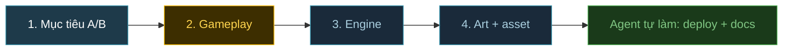

# Template: Plan game mới (demoN)

> Khi bắt đầu game mới, agent (skill `new-game`) rà mục 1-4 theo request của anh, mục nào thiếu thông tin thì hỏi anh, rồi ghi kết quả vào `demoN/PLAN.md`. Chốt xong mục 1-2 mới bắt đầu code thật.
> Demo port giữ nguyên gameplay (kiểu demo7/8): mục 2 ghi "giữ nguyên demoX", rồi nhảy sang mục 3.
> Lần build đầu luôn là **MVP**: vừa đủ để chơi hết 1 vòng core loop. Scope không cần ghi vào plan.
> Budget hiệu năng và cách verify không nằm trong plan, agent tự quyết khi làm (theo `tasks/lessons.md`).

Gameplay đặt trước engine và art vì nó quyết định engine cần gì. Ví dụ FPS 5v5 cần physics và bot AI, ARPG đông quái cần instancing và pooling.

---

## 1. Mục tiêu thử nghiệm

Mỗi demo trả lời đúng **1 câu hỏi**. Không có câu hỏi thì không biết lúc nào dừng.

- **Câu hỏi A/B:** _VD: "Godot 4 export Web có chạy mượt bằng Three.js không?"_
- **So với demo nào:** _demoX_
- **Kết quả mong đợi:** _đo cái gì, so cái gì_

## 2. Gameplay

- **Thể loại + reference:** _VD: ARPG top-down kiểu Diablo, FPS kiểu CS 1.3_
- **Core loop 3 tầng:**
  - 30 giây: _đánh, né, nhặt_
  - 5 phút: _dọn phòng, mở cửa, lên đồ_
  - Cả phiên chơi: _tới boss rồi thắng hoặc thua_
- **Verbs + controls:**

  | Hành động | Phím / chuột | Ghi chú |
  |---|---|---|
  | Di chuyển | | |
  | Tấn công | | |
  | Né / dash | | |
  | Skill | | |

- **Camera:** _top-down / isometric / third-person / first-person_
- **Game feel:** _hit-stop, knockback, i-frame khi dash, số damage, screen shake, SFX_
- **Kẻ địch:** mỗi loại 1 hành vi riêng

  | Loại | Hành vi | Ghi chú |
  |---|---|---|
  | | _lao vào cận chiến_ | |
  | | _giữ khoảng cách, bắn xa_ | |
  | Boss | _phase 1 -> phase 2 khi máu < 50%_ | |

- **Progression:** _loot, chỉ số, độ khó tăng dần_
- **Thắng / thua:** _điều kiện + chuyện gì xảy ra khi chết_
- **Tiêu chí "vui":** 1-2 câu để test tay. _VD: "dash né đòn boss thấy đã tay", "clear 1 phòng mất khoảng 45 giây"_

## 3. Engine + version + đường build

| Engine | Build | Lưu ý từ demo cũ |
|---|---|---|
| Three.js / Phaser + Vite | vài giây | Vercel tự build |
| Godot 4 | export headless | MCP sửa scene có thể xoá mất script, phải grep `.tscn` sau mỗi lần sửa |
| Unity 6 | batchmode ~36 phút | WaitForEndOfFrame treo khi headless, iterate chậm |

- **Chọn:** _engine + version cụ thể_
- **Lý do (theo gameplay mục 2):** _VD: cần physics -> Rapier_

## 4. Art + danh sách asset

Đầu vào: gameplay ở mục 2, bản MVP (cần những asset gì) + engine ở mục 3 (format nào dùng được). Nếu câu hỏi A/B ở mục 1 là về art (kiểu demo3, demo6) thì nguồn đã chốt sẵn, mục này chỉ lập danh sách chi tiết.

- **Nguồn:** _Kenney / KayKit / Quaternius / Poly Haven / Flare / VRoid..._
- **License:** _CC0 / CC-BY-SA_. Tạo `CREDITS.md` ngay từ ngày đầu.
- **Format + tối ưu:** _glTF + meshopt, texture WebP, atlas 2D_ (dùng lại `tools/` nếu hợp)
- **Danh sách asset:**

  | Hạng mục | Cần gì (MVP) | Nguồn | License | Format | Animation cần | Rủi ro |
  |---|---|---|---|---|---|---|
  | Nhân vật chính | _1 hero_ | _KayKit Adventurers_ | _CC0_ | _glTF_ | _idle, run, attack, dash, die_ | |
  | Quái | _4 loại_ | | | | | _rig khác hero_ |
  | Boss | _1_ | | | | | |
  | Môi trường | _3 khu_ | | | | | |
  | Prop / loot | | | | | | |
  | VFX / SFX / UI | | | | | | |

- **Rủi ro chung:** _retarget animation (demo6), rig không khớp, import lỗi bị cache (demo8)_. Làm thử phần rủi ro trước.

## Agent tự làm (không hỏi)

- [ ] Deploy Vercel: team `wecare2`, project `wcg-game-r-demoN`
- [ ] Thêm 1 dòng vào bảng demo trong `README.md`, kèm mục "Engine & art"
- [ ] Ghi plan vào `tasks/todo.md`, review cuối vào cùng file
- [ ] Thêm thuật ngữ mới vào `glossary.md`
- [ ] Gặp lỗi đáng nhớ thì ghi vào `tasks/lessons.md`
