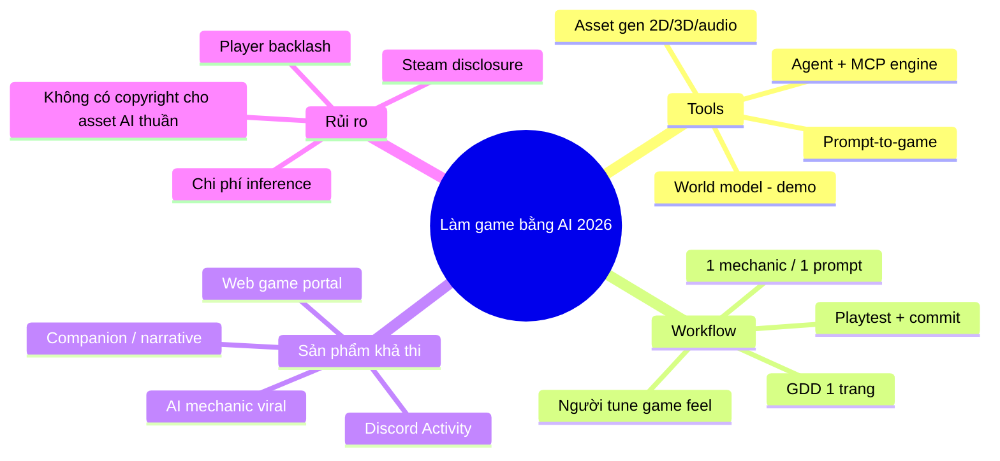
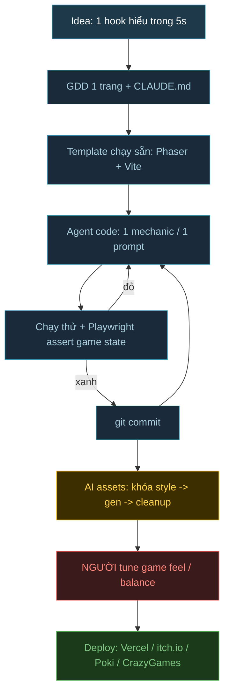
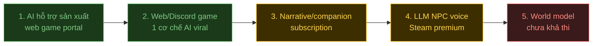

# Research: Làm game bằng AI — trend 2026

> Ngày research: 2026-10-09 · 3 teammate song song (Tools · Workflow · Thị trường)
> Lưu ý: nhiều nguồn là blog vendor/roundup; số doanh thu từng game là ước tính bên thứ 3; giá tool biến động liên tục.

## Chốt nhanh

- **Hot nhất 2026**: coding agent (Claude Code/Cursor/Codex) cắm thẳng vào engine qua **MCP** — Unity, Unreal 5.8, Roblox, Blender đều có MCP chính chủ.
- **Prompt-to-game** (Astrocade, Rosebud) chỉ mạnh ở prototype; **world model** (Genie 3) mới là demo, chưa làm game được.
- **Stack hợp AI nhất**: web (Phaser / Three.js) — toàn text, chạy browser, deploy 1 URL.
- **Tiền thật** đang nằm ở: AI hỗ trợ *sản xuất* (art/code) + AI companion. Game "AI là gameplay" phần lớn chưa có doanh thu lớn.
- **Người vẫn phải làm**: game feel, balancing, netcode multiplayer, marketing.

---

## 1. Tool landscape

### 1.1 Prompt-to-game & world model

| Tool | Làm gì | Giá | Độ chín |
|---|---|---|---|
| **Astrocade** 🔥 | Prompt -> game nhỏ, feed chơi/remix | Free | Raise $56M (05/2026), ~5M MAU |
| **Rosebud AI** | Prompt -> browser game 2D/3D, export .exe | Free giới hạn / credit | Chín nhất nhóm, team thu nhỏ |
| Summer Engine (Godot), GDevelop AI, SEELE | Prompt -> project engine thật, export được | Free tier | Mới |
| **Google Project Genie (Genie 3)** | Sinh thế giới tương tác real-time | AI Ultra ~$200-250/tháng | Demo, session ~60s, "không phải game engine" |
| Roblox Cube / 4D | Prompt -> object có tương tác | Free trong Roblox | Beta |

### 1.2 Coding agent + MCP cho engine 🔥

| Engine | Tình trạng AI/MCP |
|---|---|
| **Unity** | Unity AI open beta 05/2026 (Assistant Ask/Plan/Agent + MCP chính chủ). Personal ~$10/tháng/1000 credit. Community: CoplayDev unity-mcp (MIT) |
| **Unreal** | UE 5.8 MCP experimental (Blueprint/asset/level). UEFN tích hợp agent từ 08/2026 |
| **Roblox Studio** | MCP chính chủ, agent tự playtest, BYOK Claude/OpenAI/Gemini |
| **Godot** | Chỉ MCP community; GDScript lỏng type nên agent dễ lỗi hơn |
| **Blender** | MCP chính chủ Blender Lab v1.0 (04/2026). Bản community có CVE — cẩn thận `execute_blender_code` |
| **Web (Phaser/Three.js)** | Không cần MCP — agent đọc/sửa toàn bộ, test bằng Playwright |

### 1.3 Asset generation

| Mảng | Tool | Ghi chú |
|---|---|---|
| 3D | **Meshy 6**, **Tripo v3.1** | Auto-rig, low-poly/quad remesh, ~$16-20/tháng |
| 3D | Rodin Gen-2.5, Hunyuan3D, TRELLIS 2 (MIT, self-host) | Chi tiết cao / open |
| 2D | **PixelLab** (~$12/tháng), Retro Diffusion, Scenario | Sprite 4/8 hướng, tileset, khóa style |
| Animation | Cascadeur 2026.2, Mixamo | Auto-posing, auto-rig |
| Audio | **ElevenLabs** SFX/Music (license rõ cho game), Suno (rủi ro license), ACE-Step (MIT) | |

> Bối cảnh: tỷ lệ game dev dùng GenAI **giảm** 36% (2025) -> 29% (đầu 2026), 47% lo AI giảm chất lượng (GDC/Omdia).

---

## 2. Workflow vibe coding end-to-end

Vòng lặp lõi là **1 thay đổi -> chạy -> commit**; asset và tuning tách khỏi vòng code.

### 2.1 Chọn stack

| Stack | Hợp AI | Lý do |
|---|---|---|
| **Phaser / Three.js** | Cao nhất | Toàn text, train data nhiều, feedback tức thì, deploy 1 URL |
| Godot 4 | Khá | .tscn là text, có MCP; cần đọc được GDScript để verify |
| Unity | Thấp | Scene binary, phụ thuộc GUI editor (đang cải thiện nhờ Unity AI MCP) |

### 2.2 Case study

| Case | Build | Kết quả |
|---|---|---|
| fly.pieter.com (02/2025) | Cursor + Claude, Three.js, prototype 3h | $87K MRR ngày 17 (ad slot + F-16 $29.99) -> **$0** giữa 2026. Tiền đến từ audience, không phải code |
| Vibe Jam 2026 | 945 bài, ~242K player, rule ≥90% code AI | Gold $25K; giám khảo đánh giá chất lượng "sinh viên năm 3" |
| Curve Clash | Non-coder, Flutter + Firebase | 7 tháng, kẹt 2 tháng vì desync multiplayer |
| Metroidvania Godot (04/2026) | Gemini/Cline/Cursor | **Fail**: agent không giữ nổi >2-3 script, người không đọc được code để verify |

### 2.3 Best practices

- Spec trước, code sau: model mạnh plan, model rẻ execute.
- File nhỏ, modular — agent "chết" ở file 1,400-3,000 dòng.
- 1 prompt = 1 mechanic -> test -> commit (AI hay làm mất feature cũ).
- Mô tả bằng cảm giác ("rung khi chạm block") — LLM hiểu tốt.
- Expose game state ra `window`/JSON để Playwright assert (canvas không có accessibility tree).
- Khóa art bible trước khi gen asset hàng loạt.

### 2.4 Chỗ AI còn fail

- Game feel, balancing, difficulty pacing.
- Netcode multiplayer — làm single-player fun trước, dùng lib có sẵn (Colyseus).
- Codebase lớn, engine nặng editor.
- Marketing, store listing, localization.

### 2.5 Timeline thực tế

| Mục tiêu | Thời gian |
|---|---|
| Prototype chơi được | Vài giờ - 2 ngày |
| Web game hoàn chỉnh, 1 hook | 1-4 tuần |
| Game đa nền tảng + multiplayer lên store | 4-7 tháng |
| Game real-time phức tạp (RPG, metroidvania) | Vibe coding thuần chưa khả thi |

---

## 3. Có thể làm gì — thị trường

### 3.1 AI-native gameplay

| Loại | Ví dụ | Kết quả |
|---|---|---|
| Generative/combine | Infinite Craft | Viral cực mạnh, không công bố revenue |
| LLM NPC voice | Whispers from the Star | ~$290K gross (ước tính) |
| LLM NPC | Suck Up! | ~$58K nhưng >100M view YouTube nhờ streamer |
| On-device SLM | inZOI Smart Zoi (NVIDIA ACE) | 1M bản/7 ngày — AI là feature, không phải core |
| AI party game | Death by AI (Discord) | Peak ~700K DAU |
| AI companion | Character.AI, Zeta | Category ~$327M consumer spend H1/2026 |
| World model | Genie 3 | Chưa thương mại hóa |

### 3.2 Kênh phân phối

| Kênh | Quy mô | Monetization |
|---|---|---|
| **Poki / CrazyGames** | >1B / ~300M plays/tháng | Ads rev-share ~50-70% |
| itch.io | Niche | Dev giữ ~90% |
| **Discord Activities** | >25% MAU Discord dùng | IAP / subscription |
| Telegram Mini Apps | Sập sau tap-to-earn (Hamster 300M -> 41M) | Stars |
| Steam | Top 1% chiếm ~94% revenue | Premium |
| Mobile hybrid-casual | Ad revenue >$12B | Ads + IAP |

> AI-native có chi phí theo lượt chơi -> chỉ ads khó gánh; cần credit/subscription, BYO key hoặc model local.

### 3.3 Chi phí inference ước tính

| Tier model | ~/player-giờ (~100 call) |
|---|---|
| Rẻ (Haiku-class) | $0.01-0.10 |
| Tầm trung | $0.10-0.50 |
| Frontier | $1-5 |

Routing + cache giảm ~10x; on-device = 0 chi phí biên.

---

## 4. Rủi ro

| Rủi ro | Chi tiết | Giảm thiểu |
|---|---|---|
| Steam AI disclosure | Bản 01/2026: bỏ khai tool dev, vẫn khai nội dung AI player thấy; live-gen phải có guardrail | Đọc Steamworks docs gốc trước khi lên Steam |
| Copyright | Thaler v. Perlmutter (03/2026): asset AI thuần không có bản quyền | Lưu bằng chứng đóng góp của người, chỉnh sửa asset |
| Player backlash | Clair Obscur mất giải, Arc Raiders bị chê voice AI | Không lộ art AI kém; minh bạch |
| Chi phí inference | Có studio báo ~$3/player-giờ chưa tối ưu | Model rẻ + cache + trần chi phí |
| Hết viral = hết tiền | fly.pieter.com về $0 | Có kênh audience/retention |
| License audio | Suno đang bị kiện | Ưu tiên ElevenLabs / open MIT |

---

## 5. Đề xuất hướng làm (rủi ro thấp -> cao)

**Gợi ý cho game-r**: bắt đầu ở mức 1-2 — Phaser 3 + Vite, Claude Code làm dev, asset pack free CC0 (Kenney / 0x72 / Quaternius) cho art — không gen ảnh AI, ElevenLabs hoặc pack free cho SFX, ship lên itch.io/CrazyGames trong 1-4 tuần. Nếu muốn AI-native: 1 cơ chế AI (kiểu Infinite Craft) gọi model rẻ có cache + trần chi phí.

---

## Nguồn chính

**Tools**
- https://www.fortune.com/2026/05/05/astrocade-raises-56-million-series-b-sequoia-video-games-platform-ali-amir-sadeghian/
- https://blog.google/innovation-and-ai/models-and-research/google-deepmind/project-genie/
- https://about.roblox.com/newsroom/2026/02/accelerating-creation-powered-roblox-cube-foundation-model
- https://buildfastwithai.com/blogs/unity-ai-open-beta-guide-2026
- https://www.pugetsystems.com/blog/2026/07/09/unreal-engine-mcp-hands-on-testing-ai-inside-the-editor/
- https://www.moguravr.com/roblox-studio-mcp-server-agentic-update/
- https://www.strayspark.studio/blog/official-blender-mcp-server-comparison-2026
- https://www.strayspark.studio/blog/godot-mcp-setup-claude-code-2026
- https://app.cinevva.com/guides/ai-3d-model-generators
- https://www.cgchannel.com/2026/08/nekki-releases-cascadeur-2026-2-with-animation-layers/
- https://app.cinevva.com/guides/ai-music-generators-games
- https://respawn.outlookindia.com/gaming/gaming-news/survey-indicates-falling-generative-ai-use-among-game-developers

**Workflow**
- https://dev.to/promptway/he-built-a-flight-simulator-in-three-hours-and-hit-1m-a-year-in-17-days-then-it-went-to-zero-1b1l
- https://vibejam.com/2026/
- https://levels.io/vibe-jam-2026-winners-quality
- https://colyseus.io/blog/vibe-jam-2026/
- https://www.pocketgamer.biz/ai-was-my-engineering-team-not-my-creative-director/
- https://forum.godotengine.org/t/post-mortem-of-my-failed-attempt-to-vibe-code-a-metroidvania-game/137567/1
- https://dodopayments.com/engineering/ai-agents-build-8-games

**Thị trường & rủi ro**
- https://www.videogameschronicle.com/news/steam-games-disclosing-generative-ai-use-are-up-800-this-year/
- https://fragwyz.substack.com/p/three-years-of-ai-on-steam
- https://gigazine.net/gsc_news/en/20260120-steam-updates-ai-disclosure-guidelines
- https://www.mayerbrown.com/en/insights/publications/2026/03/supreme-court-denies-review-in-ai-authorship-case
- https://raijin.gg/app/3730100/Whispers_from_the_Star/sales-revenue
- https://sacra.com/research/character-ai/
- https://app.cinevva.com/guides/publish-game-crazygames
- https://www.mava.app/blog/discord-activities-a-guide-to-user-installable-apps
- https://www.theblock.co/post/339563/telegram-games-had-trouble-earning-revenue-retaining-users-in-q4-report
- https://app.cinevva.com/guides/ai-npcs-dialogue

## Chưa verify được

- Steam hiện bắt buộc hay tự nguyện khai báo AI (nguồn mâu thuẫn).
- Giá Rosebud; giá Meshy/Tripo lấy từ aggregator.
- Revenue Infinite Craft, AI Dungeon (không công khai).
- Con số $3/player-giờ chỉ là anecdote.
