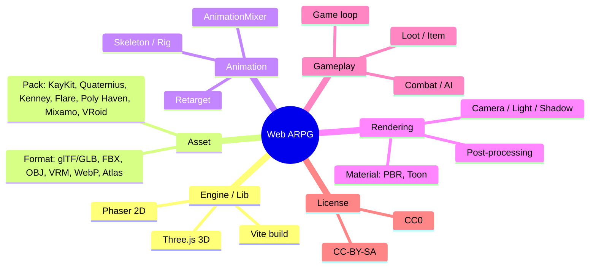

# Glossary — Thuật ngữ build game ARPG trên web (qua 6 demo)

> Sổ tay tra cứu khi học. Mỗi thuật ngữ: giải thích ngắn + gặp ở demo nào.
> Cập nhật: 2026-10-10 · Phạm vi: demo1 -> demo6 + docs/, tasks/, review đồ họa.

## Bản đồ tổng quan

Mỗi game đi qua cùng 1 pipeline: **lấy asset -> tối ưu bằng tool -> load vào engine -> render + gameplay -> build bằng Vite**.

## Các demo tóm tắt

| Demo | Thể loại | 2D/3D | Engine | Art |
|---|---|---|---|---|
| demo1 | Roguelike ARPG top-down | 2D | Phaser 3 (CDN, 1 file HTML) | Kenney Tiny Dungeon |
| demo2 | ARPG "Hầm Mộ Vua Xương" | 3D | Three.js | KayKit |
| demo3 | Cùng game, đổi art | 3D | Three.js | Quaternius |
| demo4 | Dark fantasy kiểu Diablo 4 | 3D | Three.js + N8AO | Poly Haven (PBR) + Quaternius, Mixamo (dự kiến) |
| demo5 | ARPG isometric "Hầm Mộ Ardwen" | 2D | Phaser 4 (npm) | Flare |
| demo6 | Anime kiểu Genshin | 3D | Three.js + three-vrm | VRoid + Quaternius UAL |

---

## 1. Engine / Library

| Thuật ngữ | Giải thích | Demo |
|---|---|---|
| **Game engine** | Bộ khung lo sẵn render, input, physics, audio, scene... để dev chỉ viết logic game. Engine "full" (Unity, Unreal, Godot) có editor; trên web hay dùng lib nhẹ hơn. | tất cả |
| **Rendering library** | Lib chỉ lo vẽ (render), không lo gameplay. Three.js thuộc loại này -> phần game loop, collision, AI phải tự viết. | 2, 3, 4, 6 |
| **Phaser** | Framework game 2D cho web (JS). Có sẵn Scene, sprite, tilemap, Arcade physics, tween, particle, camera. | 1, 5 |
| **Three.js** | Thư viện 3D trên WebGL. Khái niệm chính: Scene, Camera, Renderer, Mesh = Geometry + Material. | 2, 3, 4, 6 |
| **WebGL** | API đồ họa của browser để chạy GPU. Three.js / Phaser đều vẽ qua WebGL. | tất cả |
| **three/addons** | Các module phụ của Three.js: `GLTFLoader`, `SkeletonUtils`, `EffectComposer`, `BufferGeometryUtils`... | 2, 3, 4, 6 |
| **N8AO** | Lib SSAO (ambient occlusion) chất lượng cao cho Three.js. | 4 |
| **@pixiv/three-vrm** | Plugin load model VRM (avatar anime) vào Three.js, hỗ trợ expression, spring bone, MToon. | 6 |
| **Unity / Unreal / Godot / Roblox** | Các engine lớn, có editor. Nhắc trong research để so sánh, các demo không dùng. | docs |

## 2. Asset & Format

### 2.1 Asset là gì

**Asset** = mọi tài nguyên không phải code: model 3D, texture, sprite, animation, âm thanh, font, map. Game thường "đẹp hay xấu" phụ thuộc asset nhiều hơn code.

| Thuật ngữ | Giải thích | Demo |
|---|---|---|
| **Asset pack** | Bộ asset cùng style do 1 tác giả phát hành (nhân vật + quái + props + dungeon). Dùng pack đồng bộ -> game nhìn thống nhất. | tất cả |
| **Props** | Vật trang trí trong map: thùng, đuốc, cột, rương... | 2, 3, 4 |
| **Modular kit** | Asset dạng mảnh ghép (tường, sàn, góc) để lắp thành dungeon. | 2, 3 |
| **Placeholder** | Asset tạm để chạy được trước, thay sau. | 4 |
| **Low-poly** | Model ít polygon, style đơn giản, nhẹ máy. KayKit / Quaternius là low-poly. | 2, 3 |
| **Art direction / Art bible** | Định hướng mỹ thuật: palette, ánh sáng, mood. Art bible là tài liệu chốt các quy tắc đó. | review, docs |

### 2.2 Các asset pack đã dùng

| Pack | Mô tả | License | Demo |
|---|---|---|---|
| **Kenney** | Asset 2D/3D miễn phí rất phổ biến (Tiny Dungeon, UI RPG). | CC0 | 1 |
| **KayKit** | Pack 3D low-poly của Kay Lousberg (Adventurers, Skeletons, Dungeon Remastered), đã có rig + animation. | CC0 | 2 |
| **Quaternius** | Pack 3D low-poly (RPG Characters, Ultimate Monsters, Modular Dungeon, Universal Animation Library = UAL). | CC0 | 3, 4, 6 |
| **Poly Haven** | Thư viện asset PBR chất lượng cao (model + texture + HDRI), có API. | CC0 | 4 |
| **Mixamo** | Dịch vụ Adobe: auto-rig nhân vật + kho animation lớn. Không được phân phối lại file gốc. | Mixamo ToS | 4 (dự kiến) |
| **Flare** | Asset của game open-source Flare: Empyrean Campaign (2D isometric, sprite 8 hướng). | CC-BY-SA 3.0 | 5 |
| **VRoid** | Avatar anime tạo bằng VRoid Studio, xuất file .vrm. | VRoid Hub license (thoáng, không cần ghi công), 1 file CC0 | 6 |

### 2.3 File format

| Format | Giải thích | Demo |
|---|---|---|
| **glTF / GLB** | "JPEG của 3D" — chuẩn mở chứa mesh, material, skeleton, animation. `.gltf` = JSON + `.bin` + texture rời; `.glb` = gói tất cả vào 1 file binary. Format khuyên dùng cho web. | 2, 3, 4, 6 |
| **.bin** | File binary đi kèm `.gltf`, chứa dữ liệu vertex / animation. | 2 |
| **OBJ** | Format 3D cũ, chỉ có mesh (không rig, không animation). Phải convert sang GLB bằng `obj2gltf`. | 3 |
| **FBX** | Format 3D của Autodesk, phổ biến trong Mixamo / Unity. Nặng, browser không đọc trực tiếp tốt -> thường convert sang GLB. | 4 |
| **VRM** | glTF mở rộng cho avatar người (humanoid): có bone map chuẩn, expression, spring bone, license metadata. | 6 |
| **PNG / WebP** | Ảnh texture/sprite. WebP nhẹ hơn PNG nhiều, browser hiện đại đều hỗ trợ. | 1, 4, 5, 6 |
| **Sprite** | Ảnh 2D đại diện 1 nhân vật/vật thể trong game. | 1, 5 |
| **Spritesheet** | 1 ảnh lớn chứa nhiều frame sprite xếp lưới đều nhau. | 1 |
| **Texture atlas (JSON atlas)** | Như spritesheet nhưng frame không đều, có file JSON đi kèm ghi tọa độ từng frame. Giảm số lần load + draw call. | 5 |
| **Tileset / Tilemap** | Tileset = bộ ô gạch (tile) vẽ map; Tilemap = bản đồ ghép từ các tile đó. | 1, 5 |
| **Data URI / base64** | Nhúng ảnh thẳng vào HTML dạng chuỗi -> ra 1 file HTML tự chạy, không cần server. | 1 |
| **HDRI / Environment map** | Ảnh 360° dùng làm nguồn sáng + phản chiếu cho material PBR. | 4 |

### 2.4 Tối ưu asset

| Thuật ngữ | Giải thích | Demo |
|---|---|---|
| **Polygon / Triangle count** | Số tam giác của model. Càng nhiều càng chi tiết nhưng càng nặng GPU. | 3, 4 |
| **Poly budget** | Giới hạn tổng số polygon cho phép trên màn hình để giữ FPS. | 4 |
| **Simplify (decimate)** | Giảm số polygon của model tự động. | 4 |
| **Meshopt compression** | Nén dữ liệu mesh bằng meshoptimizer -> file GLB nhỏ, load nhanh. Cần decoder khi load. | 4 |
| **Quantize** | Lưu tọa độ vertex bằng số ít bit hơn (VD float32 -> int16) để nhẹ file. | 4 |
| **Dedup / Weld / Prune** | Gộp dữ liệu trùng / hàn vertex trùng vị trí / xóa dữ liệu không dùng. | 4 |
| **Merge (gộp mesh)** | Gộp nhiều mesh thành 1 để giảm draw call. VD 41 props -> 1 `dungeon.glb`. | 3, 4 |
| **Load budget** | Giới hạn dung lượng tải (MB) để game mở nhanh. | tasks |

## 3. Animation

| Thuật ngữ | Giải thích | Demo |
|---|---|---|
| **Skeleton / Rig** | Bộ xương ảo bên trong model. Rigging = gắn xương vào model. | 2, 3, 4, 6 |
| **Bone** | 1 khúc xương trong skeleton (hông, tay, đầu...). Animation thực chất là xoay/di chuyển bone theo thời gian. | 2, 3, 4, 6 |
| **Skinned mesh / Skinning** | Mesh mà mỗi vertex "dính" vào 1 hoặc vài bone, bone di chuyển -> da (skin) di chuyển theo. | 2, 3, 4, 6 |
| **Auto-rig** | Tool tự động tạo rig cho model (VD Mixamo). | 4, docs |
| **T-pose / Rest pose** | Tư thế gốc của model (dang tay chữ T) trước khi áp animation. Dùng làm chuẩn để khớp xương. | 4, 6 |
| **AnimationClip** | 1 đoạn animation có tên: idle, run, attack, die... | 2, 3, 4, 6 |
| **AnimationMixer** | Bộ "trộn" của Three.js: phát clip, chuyển clip, blend nhiều clip trên 1 model. | 2, 3, 4, 6 |
| **Crossfade** | Chuyển mượt từ clip này sang clip khác (VD run -> attack) thay vì giật cục. | 2, 3, 4, 6 |
| **LoopOnce / LoopRepeat** | Clip chạy 1 lần (attack, die) hay lặp lại (idle, run). | 2, 3, 4, 6 |
| **KeyframeTrack** | Dữ liệu animation của 1 thuộc tính (VD rotation của bone tay) theo các mốc thời gian (keyframe). | 6 |
| **Retargeting** | Áp animation làm cho skeleton A sang skeleton B (khác tỉ lệ, khác tên bone). VD dùng animation Quaternius cho avatar VRoid. | 6 |
| **Humanoid bone map** | Bảng ánh xạ tên bone của các rig khác nhau về 1 chuẩn chung (hips, spine, leftUpperArm...). Là nền tảng của retarget. | 6 |
| **Normalized rig** | Rig chuẩn hóa của VRM: mọi avatar có cùng hướng xương ở rest pose -> retarget dễ hơn. | 6 |
| **In Place vs Root motion** | In Place: animation chạy tại chỗ, code tự di chuyển nhân vật. Root motion: chính animation di chuyển nhân vật. Game web thường chọn In Place cho dễ kiểm soát. | 4 |
| **With Skin / Without Skin** | Tùy chọn tải Mixamo: kèm model (cho nhân vật) hay chỉ xương + chuyển động (cho file animation). | 4 |
| **Spring bone** | Xương "lò xo" mô phỏng vật lý cho tóc, váy, đuôi... đung đưa tự nhiên. | 6 |
| **Morph target / Blendshape** | Biến dạng mesh theo hình mẫu có sẵn — dùng cho biểu cảm mặt (blink, joy, angry). | 6 |
| **8-direction sprite** | Nhân vật 2D vẽ sẵn 8 hướng nhìn, mỗi hướng một bộ frame. | 5 |
| **Paper-doll** | Ghép nhân vật 2D từ nhiều lớp sprite (thân, giáp, mũ, vũ khí) -> đổi trang bị là đổi hình. | 5 |
| **Tween** | Animation nội suy giá trị (vị trí, scale, alpha) từ A -> B theo thời gian, không cần frame vẽ sẵn. | tất cả |

## 4. Rendering (đồ họa)

### 4.1 Nền tảng

| Thuật ngữ | Giải thích | Demo |
|---|---|---|
| **Scene** | "Sân khấu" chứa mọi object, đèn, camera. | tất cả |
| **Mesh = Geometry + Material** | Geometry = hình dạng (vertex, tam giác); Material = bề mặt trông thế nào (màu, độ bóng). | 2, 3, 4, 6 |
| **Renderer** | Thành phần vẽ Scene qua Camera ra màn hình (`WebGLRenderer`). | 2, 3, 4, 6 |
| **Draw call** | 1 lệnh CPU bảo GPU vẽ 1 thứ. Quá nhiều draw call -> chậm. Atlas, merge, instancing đều để giảm draw call. | tất cả |
| **Frame / FPS / Frame time** | FPS = số khung hình/giây. Frame time = ms để vẽ 1 khung (60 FPS ~ 16.7 ms). p95 = 95% frame nhanh hơn mức này. | review, tasks |
| **iGPU budget** | Ngân sách ms/frame tính cho GPU tích hợp (laptop yếu) — chuẩn tối thiểu để game mượt. | tasks |
| **DPR (Device Pixel Ratio)** | Tỉ lệ pixel thật / pixel CSS. Màn retina DPR=2 -> phải vẽ gấp 4 pixel. Thường giới hạn để giữ FPS. | 2, 3, 4, 6 |
| **Dynamic quality** | Tự hạ chất lượng (tắt bloom, giảm DPR) khi FPS thấp. | 2, 3, 4, 6 |

### 4.2 Camera & góc nhìn

| Thuật ngữ | Giải thích | Demo |
|---|---|---|
| **Perspective camera** | Camera có phối cảnh, xa nhỏ gần to — như mắt người. | 2, 3, 4, 6 |
| **Orthographic camera** | Camera không phối cảnh, xa gần cùng kích thước — hay dùng cho isometric thật. | — |
| **Top-down** | Nhìn thẳng từ trên xuống. | 1 |
| **Isometric** | Góc nhìn chéo ~45°, không phối cảnh — kiểu Diablo 2. 2D isometric dùng công thức `iso()` / `unIso()` đổi tọa độ lưới <-> màn hình. | 5 (2D), 2-4 (kiểu iso, 3D) |
| **Follow camera / Damping** | Camera bám theo nhân vật, có độ trễ mượt (damping, exponential smoothing). | tất cả |
| **Screen shake** | Rung camera khi đánh trúng / nổ -> tăng cảm giác lực. | tất cả |
| **Depth sorting / Y-sort** | Trong 2D, vật nào ở "dưới" màn hình thì vẽ sau (đè lên). Isometric sort theo (x+y). | 5 |
| **Camera occlusion / Cutaway** | Tường che mất nhân vật -> cắt tường hoặc làm mờ (fade/dither) tường đó. | 3, 4, 6 |
| **Raycaster** | Bắn tia từ camera/điểm để biết trúng object nào (click chọn, check che khuất). | 2, 3, 4, 6 |

### 4.3 Ánh sáng & bóng

| Thuật ngữ | Giải thích | Demo |
|---|---|---|
| **Hemisphere light** | Ánh sáng môi trường 2 màu (trời / đất), làm nền tổng thể. | 2, 3, 4, 6 |
| **Directional light** | Ánh sáng song song như mặt trời, dùng đổ bóng chính. | 2, 3, 4, 6 |
| **Point light** | Đèn tỏa mọi hướng từ 1 điểm (đuốc, lửa). Nặng -> giới hạn số lượng. | 2, 3, 4, 6 |
| **Light pool** | Chỉ giữ N đèn (VD 5) và gán cho các nguồn sáng gần nhân vật nhất -> tiết kiệm GPU. | 4 |
| **Rim light** | Đèn viền sau lưng nhân vật để tách khỏi nền tối. | 2, 3, 4, 6 |
| **Shadow map** | Kỹ thuật đổ bóng: render scene từ góc đèn để biết chỗ nào bị che. `PCFSoftShadowMap` = bóng viền mềm. | 2, 3, 4, 6 |
| **Shadow bias** | Thông số chống lỗi "shadow acne" (sọc bóng trên bề mặt). | 2, 3, 4, 6 |
| **Fog** | Sương mù làm vật ở xa mờ dần -> có chiều sâu, giấu rìa map. | 2, 3, 4, 6 |
| **Darkness mask (2D)** | Phủ 1 lớp tối toàn màn hình rồi "khoét" vùng sáng quanh đuốc / nhân vật. | 5 |

### 4.4 Material & Shading

| Thuật ngữ | Giải thích | Demo |
|---|---|---|
| **Shader / GLSL** | Chương trình chạy trên GPU quyết định mỗi vertex/pixel trông thế nào. GLSL là ngôn ngữ viết shader của WebGL. | 2, 3, 4, 6 |
| **PBR (Physically Based Rendering)** | Material mô phỏng vật lý ánh sáng thật (kim loại, nhám, bóng). Three.js: `MeshStandardMaterial`. | 4 |
| **Diffuse / Albedo map** | Texture màu gốc của bề mặt. | 4 |
| **Normal map** | Texture giả chi tiết lồi lõm mà không thêm polygon. | 4, 6 |
| **ARM map** | 1 texture gộp 3 kênh: Ambient occlusion (R), Roughness (G), Metalness (B). | 4 |
| **UV / World-space UV** | UV = cách "dán" texture lên mesh. World-space UV = tính theo tọa độ thế giới -> texture liền mạch qua nhiều mảnh tường/sàn. | 4 |
| **Toon shading / Cel shading** | Shading kiểu hoạt hình: sáng tối chia bậc rõ ràng (gradient ramp 2-3 bậc) thay vì chuyển mượt. | 6 |
| **MToon** | Shader toon chuẩn của VRM. | 6 |
| **Outline** | Viền đen quanh nhân vật kiểu anime. | 6 |
| **Tone mapping** | Nén dải sáng HDR về màn hình thường. ACES Filmic = kiểu điện ảnh, tương phản; Neutral = giữ màu trung thực (hợp anime). | 2, 3, 4, 6 |
| **sRGB / Color space** | Chuẩn màu màn hình. Sai color space -> màu bị nhạt hoặc tối bất thường. | 2, 3, 4, 6 |
| **Additive blending** | Cộng màu lên nền -> hiệu ứng phát sáng (lửa, phép, tia loot). | tất cả |
| **InstancedMesh / Instancing** | Vẽ hàng trăm bản sao cùng 1 mesh trong 1 draw call (VD đống vàng). | 4 |
| **Frustum culling** | Không vẽ object nằm ngoài tầm nhìn camera. | 2, 3, 4, 6 |

### 4.5 Post-processing (hậu kỳ)

**Post-processing** = xử lý ảnh sau khi render xong, giống filter Instagram cho mỗi frame. Three.js dùng `EffectComposer` xếp chuỗi các "pass".

| Thuật ngữ | Giải thích | Demo |
|---|---|---|
| **Render pipeline** | Chuỗi bước từ scene -> ảnh cuối (render -> AO -> bloom -> color grade -> output). | tasks |
| **Bloom** | Vùng sáng lóa tỏa hào quang (`UnrealBloomPass`). | 2, 3, 4, 6 |
| **SSAO / AO** | Ambient Occlusion: tối các góc kẹt, khe hở -> tăng chiều sâu. SSAO tính trên màn hình. | 4 |
| **Anti-aliasing (FXAA / SMAA / MSAA)** | Khử răng cưa cạnh. MSAA = phần cứng; FXAA, SMAA = post-process (FXAA nhẹ nhất). | 2, 3, 4, 6 |
| **Color grading / Split-tone** | Chỉnh màu toàn khung. Split-tone = vùng tối ngả lạnh, vùng sáng ngả ấm. | 4 |
| **Vignette** | Tối dần ở viền màn hình, kéo mắt vào giữa. | 4 |
| **Film grain** | Nhiễu hạt kiểu phim. | 4 |
| **Half-res** | Tính hiệu ứng ở nửa độ phân giải rồi phóng lên -> tiết kiệm GPU. | 4 |

## 5. Gameplay

### 5.1 Lõi kỹ thuật

| Thuật ngữ | Giải thích | Demo |
|---|---|---|
| **Game loop** | Vòng lặp chạy mỗi frame: đọc input -> update logic -> render. Web dùng `requestAnimationFrame`. | tất cả |
| **Delta time (dt)** | Thời gian giữa 2 frame. Nhân tốc độ với dt -> game chạy cùng tốc độ dù 30 hay 144 FPS. Thường clamp để tránh "nhảy" khi tab bị treo. | tất cả |
| **Collision** | Phát hiện va chạm. Các demo dùng lưới (grid) cho tường + hình tròn (circle collider) cho nhân vật/quái. | tất cả |
| **AABB / Box3** | Hộp bao thẳng trục — hình va chạm đơn giản nhất. | 2, 3, 4, 6 |
| **Arcade physics** | Physics đơn giản của Phaser (hộp/tròn, không xoay). | 1, 5 |
| **Sliding movement** | Va tường thì trượt dọc theo tường thay vì đứng khựng. | 2, 3, 4, 6 |
| **ASCII grid map** | Map viết bằng ký tự (`#` tường, `.` sàn...) rồi code dựng thành 3D. | 2, 3, 4, 6 |
| **State machine (FSM)** | AI quái chuyển giữa các trạng thái: ngủ -> thức/khiêu khích -> đuổi -> tấn công -> trúng đòn. | 2, 3, 4, 6 |
| **Pathfinding / A\*** | Thuật toán tìm đường ngắn nhất né vật cản. Dùng cho click-to-move. | 5 |
| **Procedural generation** | Sinh map tự động bằng thuật toán, mỗi lần chơi khác nhau. | 1 |
| **Seeded PRNG** | Bộ sinh số ngẫu nhiên có seed: cùng seed -> cùng kết quả (dễ debug, chia sẻ map). VD `mulberry32`. | 1 |
| **Object pool** | Tạo sẵn object rồi tái sử dụng thay vì tạo/xóa liên tục -> tránh giật do garbage collection. | 6 |
| **Input: click-to-move / virtual joystick** | Điều khiển bằng click chuột kiểu Diablo, hoặc joystick ảo trên mobile. | 2-6 |

### 5.2 Combat & cảm giác (game feel)

| Thuật ngữ | Giải thích | Demo |
|---|---|---|
| **ARPG** | Action RPG — đánh real-time + hệ thống nhân vật/đồ (Diablo, Path of Exile). | tất cả |
| **Roguelike** | Map sinh ngẫu nhiên, chết là chơi lại từ đầu. | 1 |
| **Game feel / Juice** | "Độ đã tay": rung camera, hitstop, số damage bay, particle, âm thanh — những thứ làm 1 cú đánh có cảm giác. | review, docs |
| **VFX / Particles** | Hiệu ứng hình ảnh: tia lửa, khói, phép thuật — thường là nhiều hạt nhỏ (particle). | tất cả |
| **Hitstop** | Khựng hình vài chục ms khi đánh trúng -> cảm giác lực. | 2, 3, 4, 6 |
| **Hitbox** | Vùng gây/nhận sát thương. | tất cả |
| **Telegraph** | Báo trước đòn đánh (vòng đỏ dưới đất) để người chơi kịp né. | 2, 3, 4, 6 |
| **I-frames (invulnerability frames)** | Khoảng thời gian bất tử ngắn (khi lăn né, khi vừa trúng đòn). | 2, 3, 4, 6 |
| **Dodge roll / Dash** | Lăn né / lướt nhanh. | 2, 3, 4, 6 |
| **Knockback** | Đẩy lùi mục tiêu khi trúng đòn. | tất cả |
| **Projectile / Pierce** | Đạn bay (mũi tên, phép); pierce = xuyên qua nhiều mục tiêu. | tất cả |
| **Cooldown** | Thời gian chờ trước khi dùng lại skill. | tất cả |
| **Crit** | Đòn chí mạng, sát thương nhân lên. | tất cả |
| **Damage numbers** | Số sát thương bay lên khi đánh trúng. | tất cả |
| **HUD** | Giao diện trên màn hình: máu, mana, skill bar, minimap. | tất cả |

### 5.3 Loot & progression

| Thuật ngữ | Giải thích | Demo |
|---|---|---|
| **Loot** | Đồ rơi ra khi giết quái / mở rương. | tất cả |
| **Rarity** | Độ hiếm: common -> magic -> rare -> legendary/unique, mỗi bậc 1 màu. | tất cả |
| **Affix (prefix / suffix)** | Chỉ số ngẫu nhiên gắn vào đồ, đứng trước/sau tên (VD "*Sắc Bén* Kiếm *của Lửa*"). | tất cả |
| **Item level** | Cấp của món đồ, quyết định độ mạnh affix. | tất cả |
| **Loot beam** | Cột sáng màu đánh dấu đồ hiếm rơi trên đất. | 2, 3, 4, 6 |
| **XP / Level up** | Kinh nghiệm và lên cấp. | tất cả |
| **Balancing** | Cân bằng chỉ số để game không quá dễ/khó. | docs |

## 6. Tooling & Build

| Thuật ngữ | Giải thích | Demo |
|---|---|---|
| **Vite** | Build tool cho web: `npm run dev` chạy server có hot reload, `npm run build` đóng gói ra `dist/`. | 2-6 |
| **npm / package.json** | Trình quản lý thư viện JS / file khai báo dependency + script. | 2-6 |
| **CDN** | Load thư viện qua link hosted thay vì cài npm. | 1 |
| **Asset pipeline** | Script tự động biến asset gốc thành asset tối ưu cho game (thư mục `tools/`). | 4, 5, 6 |
| **gltf-transform** | Bộ công cụ xử lý file glTF bằng code: dedup, simplify, quantize, merge... | 4 |
| **meshoptimizer** | Thư viện tối ưu + nén mesh. | 4 |
| **sharp** | Lib Node xử lý ảnh nhanh (resize, convert sang WebP). | 4, 6 |
| **obj2gltf** | Tool convert OBJ -> glTF/GLB. | 3 |
| **Pillow (PIL)** | Lib xử lý ảnh của Python, dùng repack sprite atlas. | 5 |
| **Vertical slice** | Bản demo nhỏ nhưng làm "đủ chất" mọi khâu (art, gameplay, UI) cho 1 đoạn ngắn — để chứng minh hướng đi. | tasks |
| **A/B comparison** | So sánh 2 phương án cạnh nhau để chọn. | tasks |
| **Playwright / Chrome DevTools** | Tự động mở browser để test game, đo hiệu năng. | tasks, docs |
| **Vercel / Netlify / itch.io** | Nơi deploy / phát hành game web. | tasks, docs |

## 7. License

| Thuật ngữ | Giải thích | Demo |
|---|---|---|
| **CC0** | Public domain — dùng thoải mái, kể cả thương mại, không cần ghi công. | 1, 2, 3, 4, 6 |
| **CC-BY-SA 3.0** | Được dùng nhưng phải **ghi công** (BY) và sản phẩm phái sinh phải dùng **cùng license** (SA — share-alike). Lưu ý khi dùng thương mại. | 5 |
| **Mixamo ToS** | Được dùng animation trong game, nhưng **không được phân phối lại file gốc** -> không commit file Mixamo lên repo. | 4 |
| **CREDITS.md** | File ghi nguồn + license từng asset trong mỗi demo. | 2-6 |

## 8. AI & xu hướng (từ docs/research)

| Thuật ngữ | Giải thích |
|---|---|
| **Vibe coding** | Viết code chủ yếu bằng cách mô tả cho AI. |
| **Prompt-to-game** | Tool sinh game từ prompt. |
| **World model** | Model AI sinh thế giới tương tác real-time (VD Genie 3). |
| **GDD (Game Design Document)** | Tài liệu thiết kế game: luật chơi, nhân vật, màn chơi. |
| **Meshy / Tripo** | AI sinh model 3D từ text/ảnh. |
| **PixelLab** | AI sinh pixel art / sprite. |
| **Cascadeur** | Tool làm animation có AI hỗ trợ vật lý. |
| **Quad remesh** | Chuyển mesh tam giác lộn xộn (thường từ AI) thành lưới tứ giác sạch để rig/animate. |
| **Netcode / Desync** | Code đồng bộ multiplayer / lỗi lệch trạng thái giữa các máy. |
