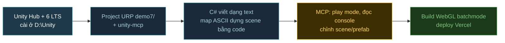

# demo5 — rà soát + fix đứng game (2026-10-13) · XONG, CHỜ ANH TEST TAY · https://wcg-game-r-demo5.vercel.app

Anh yêu cầu: rà soát demo5 đã chạy được chưa, deploy, cho link test. Anh duyệt plan "làm đi".

- [x] Live trước khi sửa = bản build HEAD (cùng hash `index-i-b-hn5w.js`)
- [x] Smoke headless `demo5/tools/smoke.mjs` (theo cách demo11) bắt bug: quái chết 10.5s sau bị `destroy()` nhưng vẫn nằm trong `enemies` -> `updateEnemies` gọi `setTexture` lên ảnh đã destroy -> lỗi trong RAF, Phaser không lên frame mới -> **game đứng ~10s sau con quái đầu tiên**. Bug có từ bản Phaser 3 (`be6de2e`)
- [x] Fix `main.js` `killEnemy`: splice quái khỏi `enemies` khi tween mờ xong. Smoke: bản cũ FAIL, bản sửa OK 17 checks (quest -> farm -> skill -> loot -> hạ Morvak -> nhận thưởng -> hành trang -> chết)
- [x] Deploy prod `wcg-game-r-demo5` -> bundle `index-VLQYOdC0.js` có fix, asset 200, `.env.local` 404
- [ ] Anh test tay trên browser

## Review / còn treo
- Làm trong git worktree từ HEAD vì working tree demo5 đang có bản viết lại dở của session khác (`main.js` rỗng). Phần đó **chưa đụng**, chờ anh chọn stash hay restore
- `demo5/node_modules` ở working tree chính đang là Phaser 3.90 (lệch package.json 4.2.1) -> cần `npm ci`
- Git integration Vercel của `wcg-game-r-demo5` build lỗi mỗi lần push (`vite: command not found`), không ảnh hưởng live. Vercel project `demo5` riêng (tạo 2026-10-13) đang host bản viết lại dở

# demo11 — Lục Địa MU, nhái MU Online trên Phaser 4 (2026-10-13) · XONG MVP, CHỜ ANH TEST TAY

Plan: [demo11/PLAN.md](../demo11/PLAN.md). Anh chốt: mục tiêu A/B = "Phaser 4 có chịu được đông quái + nhiều FX không", gameplay = farm + cộng điểm + ép đồ + Golden Invasion/boss, class DK + DW ("tạm k build elf"), engine Phaser 4. Live: https://wcg-game-r-demo11.vercel.app

## 0. Asset
- [x] Sparse clone `flareteam/flare-game` vào scratchpad (chỉ hero/enemies/tilesets/powers/loot/icons/sfx/maps)
- [x] `tools/build_assets.py` (dựa trên demo5): tileset nhiều ảnh, atlas tile chia trang ≤4096px, hero 50 layer (thân mặc định + giáp da/xích/tấm + vải + pháp sư 3 màu, 8 vũ khí, 3 khiên), 8 sprite quái, 35 âm thanh
- [x] Map: Lorencia = Black Oak City (100x100, 181 tile, vành đai đường quanh hồ), Dungeon = Family Crypt (giống demo5)
- [x] Wyvern gốc cho atlas cao 4665px, nên scale 0.5 cho dưới 4096. Tổng `public/a` 25MB, hero layer lazy-load

## 1. Gameplay
- [x] Chọn class DK / DW (Elf để "Sắp có"). Stat STR/AGI/VIT/ENE kiểu MU, 5 điểm/cấp, bảng C có nút + (Shift +10)
- [x] Skill: DK Xoáy Kiếm (Twisting Slash), Nộ Long Phá (Rageful Blow, cấp 8). DW Thiên Thạch (Meteor), Dịch Chuyển (cấp 3), Evil Spirit (cấp 6, 8 luồng xoáy xuyên quái). Chuột phải giữ = xả liên tục, 1-3 đổi skill
- [x] 8 loại quái Lorencia + 5 loại Dungeon, mỗi loại 1 hành vi (bầy, cắn rồi lùi, bắn xa, đi xuyên tường, chạy trốn). Nhóm spawn xếp cấp theo khoảng cách đi bộ từ thị trấn. Hồi sinh sau 10 giây
- [x] Thị trấn = vùng an toàn, NPC Amy (bình máu/mana), Hanzo (mua đồ, "bán hết đồ thường")
- [x] Đồ: 11 vũ khí/khiên + 7 bộ giáp theo class, +0..+9, Luck, Excellent (xanh lá). Ngọc Ước Nguyện +0→+6, Ngọc Tâm Linh +6→+9 (50%, Luck 75%, fail về +0). Kéo thả ngọc lên đồ trong túi V
- [x] Đồ +7/+8/+9 phát sáng trên người (Glow filter từng layer paperdoll, +9 thêm sao lấp lánh)
- [x] Golden Invasion: phút 4 rồi mỗi 8 phút, 36 quái vàng quanh hero, bị đánh thì chạy, rơi Hộp Kundun (Zen + ngọc + đồ Excellent)
- [x] Cổng Dungeon phía tây (cần cấp 15). Boss Gorgon: dậm AoE có vòng đỏ báo trước, máu < 50% thì gọi 6 đệ tử + đánh nhanh hơn. Hạ xong hiện bảng chiến thắng
- [x] Chết: mất 3% EXP cấp + 5% Zen, hồi sinh ở Lorencia

## 2. Hiệu năng (phần A/B)
- [x] Nền map = 1 Blitter chia chunk 8x8, ẩn chunk ngoài camera. Object map (cây, nhà) ẩn theo chunk
- [x] Quái: 1 flow field (BFS từ hero, bán kính 26 ô) dùng chung, spatial hash cho tách bầy/AoE/đạn, ẩn sprite ngoài màn, quái xa + rảnh nghĩ 1/4 frame
- [x] Số damage: BitmapText (RetroFont tự vẽ lúc chạy) + pool. FX phép: pool Image
- [x] HUD góc phải: FPS, 1% low, số quái, số object đang vẽ. `?bench=N&auto` đo 20s rồi in JSON (có nút copy), `?nofx`, `?cls=dw`, `?xp=N`, `?gold` (Golden Invasion sau 20s)

## 3. Verify (không mở browser, theo lessons)
- [x] `npm run selftest`: 7500 check (ép ngọc đúng tỉ lệ, rơi đồ, chỉ số, A*, flow field, spatial hash, mọi anim/icon/loot tồn tại trong atlas)
- [x] `tools/smoke.mjs`: Phaser HEADLESS + jsdom chạy scene thật, bot chơi hết vòng Lorencia → Golden Invasion → Dungeon → Gorgon cho cả DK và DW, không lỗi runtime, không rò object
- [x] `vite build` OK (JS 410KB gzip). Deploy Vercel `wecare2/wcg-game-r-demo11`, curl kiểm tra page + asset đều trả 200

## Review
- **Logic JS mỗi frame** (headless, chưa tính render, máy dev): 150 quái 1,4ms · 300 quái 2,1ms · 500 quái 2,5ms (p95 ~5ms). Chi phí tăng chậm hơn số quái nhờ culling + AI LOD, nên CPU còn dư nhiều trong 16,7ms. Phần còn chưa đo được là **render** (batch sprite, sort depth ~2.500 object, bloom + glow filter): cần anh mở link `?bench=300&auto` và `?bench=300&auto&nofx` trên máy thật rồi so FPS với demo5.
- **Smoke test bắt 3 bug mà build không thấy:** (1) chết trong Dungeon thì kẹt mãi ở trạng thái chết, do `scene.restart()` dùng lại instance và cờ `leaving` của lần qua cổng trước vẫn còn; (2) hero/quái đứng chạy tại chỗ vì phép kiểm đường thẳng chỉ xét tâm, đi sượt góc tường là kẹt; (3) Golden Goblin 650 máu quá trâu so với cấp lúc invasion đầu nổ, và DK hết mana quá nhanh. Đã sửa cả 3.
- **Chờ anh test tay:** game feel (Xoáy Kiếm giữa bầy, số damage, ép +7 phát sáng), tốc độ lên cấp (mặc định chưa tune kỹ, có `?xp=5` để test nhanh), FPS thật ở `?bench=300&auto`.
- **Chưa làm (ngoài MVP):** Fairy Elf, wings, Chaos/+10 trở lên, minimap, party/PK, nhạc nền.

---

# demo10 — Clone VLTK1 2D (2026-10-13) · XONG, CHỜ ANH TEST TAY · https://wcg-game-r-demo10.vercel.app

Spec chi tiết nằm ở `demo10/gameplay.md`. Những gì đã chốt:
- **Engine:** Phaser 4.2.1 + Vite
- **Art:** chỉ dùng Flare (CC-BY-SA 3.0)
- **Gameplay:** offline, chạy web desktop; 5 phái (Thiếu Lâm Côn, Đường Môn Phi đao, Nga My Kiếm, Cái Bang Chưởng, Võ Đang Kiếm); cấp tối đa 60, lên 60 mất khoảng 2 giờ khi bật auto; Ba Lăng huyện + Tương Dương + 4 map luyện công
- **Không làm:** Tống Kim, Dã Tẩu, mobile, độ bền, thể lực
- **Deploy:** Vercel `wcg-game-r-demo10`

**Kiến trúc:** tách **logic thuần JS** (`src/core/`, không import Phaser) khỏi **render** (`src/scenes/`). Nhờ vậy selftest chạy bằng Node giả lập được auto train 1 → 60 mà không cần browser. Tránh lặp lại demo5, nơi cả game dồn trong 1 file `main.js` 900 dòng.

## M0. Asset Flare
- [x] Sparse clone `flare-game` (chỉ lấy fantasycore + empyrean_campaign) vào `demo10/_raw/`, đưa `_raw/` vào gitignore
- [x] Lập bảng ánh xạ, ghi vào `gameplay.md` mục 4:
  - Map Flare → Ba Lăng huyện / Tương Dương / 4 map luyện công
  - Quái Flare → khoảng 12 loại theo 5 hệ + 1 boss
  - Bộ đồ + vũ khí paper-doll → 5 phái
  - Hiệu ứng power → skill
- [x] Viết `tools/build_assets.py` dựa trên bản của demo5: thêm parse map Flare sang JSON, đóng atlas WebP. Mục tiêu `public/` dưới 15MB
- [x] `CREDITS.md` + `CREDITS-flare.txt`

## M1. Khung + di chuyển
- [x] Vite + Phaser 4.2.1. Lấy từ `git show HEAD:demo5/src/main.js` các phần: A* 8 hướng, `regAtlas`, `setFrame`, lighting
- [x] `core/iso.js` (đổi tọa độ), `core/path.js` (A*), `scenes/World.js`: render map, click-to-move, camera bám nhân vật, ngồi hồi phục (V)
- [x] Đổi map qua cổng/xa phu

## M2. Combat lõi
- [x] `core/stats.js`: 4 chỉ số → máu, nội lực, sát thương, chính xác, né. Cộng +5 tiềm năng và +1 kỹ năng mỗi cấp
- [x] `core/combat.js`: chính xác/né, kháng, choáng/độc/chậm. Chết thì về điểm hồi sinh, mất 1% exp
- [x] Quái AI (đi tuần, đuổi, đánh, về chỗ cũ), hồi sinh theo khu. Click đánh liên tục tới khi quái chết
- [x] `core/exp.js`: bảng exp 1-60, exp giảm theo chênh lệch cấp

## M3. Ngũ hành + trang bị
- [x] `core/element.js`: vòng khắc, kháng theo hệ cho quái và người
- [x] `core/loot.js`: rơi đồ trắng/xanh với dòng ngẫu nhiên theo loại đồ + hệ, rơi tiền
- [x] `core/equip.js`: 10 ô, kích dòng ẩn theo vòng tương sinh 5 cặp (dòng xám → xanh)
- [x] UI dạng DOM: túi đồ (F4), trang bị/thuộc tính (F3), tooltip đồ, Alt hiện tên đồ dưới đất

## M4. Thành + NPC
- [x] Ba Lăng huyện, Tương Dương: Xa phu, Dược điếm, Tạp hóa, Thợ rèn (chỉ bán), Rương chứa đồ, Vệ binh
- [x] Mua/bán, Thổ Địa Phù về thành, ô thuốc 1-2-3

## M5. Auto train
- [x] `core/auto.js` (logic thuần): tìm quái gần nhất trong bán kính quanh điểm bật auto → đánh → xoay skill → uống thuốc theo ngưỡng % → nhặt đồ theo lọc phẩm chất + nhặt tiền → dừng khi hết thuốc/đầy túi
- [x] Nút Auto trên HUD + panel cài đặt, lưu cấu hình

## M6. Môn phái + skill
- [x] Màn tạo nhân vật (giới tính, hệ, luật Kim nam / Thủy nữ), 3 slot
- [x] `core/skills.js`: 5 phái × khoảng 6 skill, mở theo cấp 10/20/30/40/50 + tuyệt kỹ khi Xuất sư. Dùng hiệu ứng power của Flare, phân biệt theo 5 hệ
- [x] Panel võ công (F5), gán skill vào chuột trái/phải

## M7. Nhiệm vụ + boss + save
- [x] 3 nhiệm vụ tân thủ, chuỗi môn phái 10 → 50 + Xuất sư, panel nhiệm vụ (F11)
- [x] Boss hoàng kim cấp 55-60, hồi sinh theo giờ, rơi bộ Hoàng Kim theo phái
- [x] `core/save.js`: lưu localStorage, 3 slot

## M8. Hoàn thiện + verify + deploy
- [x] HUD đầy đủ (thanh máu/nội lực, ô skill, ô thuốc, minimap, log), bản đồ (Tab), âm thanh Flare
- [x] `tools/selftest.mjs`: Node chạy auto train 1 → 60 với từng phái. Đạt khi thời gian giả lập nằm trong 1h45-2h15, không chết liên tục, không kẹt đường
- [x] Verify bằng `npm run build` + selftest. Không tự mở browser, phần nhìn anh tự test tay
- [x] Deploy Vercel `wcg-game-r-demo10`, curl lại link live

## Rủi ro
- Map Flare có sẵn có thể không đủ 6 khu đúng cấp. Khi đó khu thiếu sẽ tự sinh từ tileset (M0 sẽ biết)
- Art Flare có thể không đủ cho 5 phái nhìn khác nhau rõ ràng. Hướng xử lý: đổi bộ đồ + vũ khí + tint màu theo hệ
- Cân bằng 2 giờ dựa vào selftest giả lập, cảm giác thật vẫn cần anh test tay

## Review (2026-10-13)
- **Selftest** (`node tools/selftest.mjs all`, seed 7): cả 5 phái lên cấp 60 trong **109-129 phút** giả lập (Thiếu Lâm 117, Đường Môn 129, Nga My 115, Cái Bang 115, Võ Đang 109). Làm đủ chuỗi nhiệm vụ t1 → Xuất Sư, rơi đồ Hoàng Kim, chết 0-1 lần, không kẹt
- **UI smoke test** (`node tools/uitest.mjs`): mọi bảng, NPC, HUD của 5 phái chạy không lỗi runtime (DOM giả, không mở browser)
- `npm run build` sạch lỗi. Deploy Vercel `wcg-game-r-demo10`, đã `vercel git disconnect`, curl link live + asset đều trả 200
- **Chưa verify:** phần hình (map, sprite, hiệu ứng, chuột) chưa xem bằng mắt vì không tự mở browser. Đã soát API Phaser 4 theo `node_modules/phaser/skills/v3-to-v4-migration` (sửa `setTintFill`)
- **Đổi so với plan:**
  - Nhiệm vụ môn phái đổi từ "diệt quái loại X" sang "diệt N quái ở map Y", để hợp với auto
  - Cổng ra map thành vật thể phải bấm, vì đường đi auto từng xuyên qua cổng
  - Không làm khu sảnh môn phái riêng: 5 sứ giả đứng ở Tương Dương
- **Lỗi đã sửa nhờ selftest:**
  - Bãi quái nằm trên đảo tách biệt (đã thêm flood fill)
  - Quái chỉ hồi sinh khi người chơi đứng xa
  - Đồ rơi vào ô không tới được
  - Quái bị kéo xa quay về hồi đầy máu
  - Kẹt góc tường khi đi theo đường đã nắn thẳng
  - Auto chưa bật lúc đi bộ tới bãi, nên quái đánh mà không đánh trả

---

# demo9 — FPS chiến thuật kiểu Counter-Strike 1.3 (2026-10-13) · XONG, CHỜ ANH TEST TAY

Anh duyệt "không (đổi). chạy đi" với option mặc định: Three.js + Rapier, offline 5v5 với bot, có đặt/gỡ bom, art low-poly Quaternius + Poly Haven. Live: https://wcg-game-r-demo9.vercel.app

## 0. Asset (subagent)
- [x] Lính Quaternius Ultimate Animated Character (SWAT = CT, Adventurer = T), 18 clip, socket súng `GunSocket_R`. Lấy GLB qua poly.pizza vì Google Drive chặn tải từ VM
- [x] Ultimate Gun Pack: 9 súng gom trong `guns.glb`, mỗi súng có node đầu nòng. Model C4 tự dựng bằng khối
- [x] 7 bộ texture Poly Haven (sa thạch, vữa, cát, đá lát, gỗ, cửa gỗ, kim loại gỉ), WebP
- [x] 28 âm thanh từ Kenney + OpenGameArt. Tiếng súng Tabasco theo CC-BY 3.0, đã ghi công trong menu + CREDITS.md
- [x] Tổng `public/` 4MB. Chạy lại được bằng `tools/build-assets.mjs`

## 1. Khung
- [x] Vite + Three.js 0.169 + `@dimforge/rapier3d-compat` 0.21. Logic `src/sim` tách khỏi `src/client`
- [x] Di chuyển kiểu GoldSrc: friction/accelerate/air strafe, crouch-jump, Shift đi rón rén, khựng lại khi trúng đạn
- [x] Viewmodel: nhún khi đi, giật khi bắn, hạ súng khi nạp đạn / rút súng, chớp nòng. Bỏ tay (tay dựng bằng khối nhìn vụng)

## 2. Map
- [x] Kiểu de_dust2 thu nhỏ: Long A, Catwalk, Mid (có cột chắn tầm nhìn), hầm B trên/dưới có mái, 2 site, thùng gỗ
- [x] Nav grid 0.5m + A* + làm mượt đường. Bot không cần graph waypoint vẽ tay. `tools/map-ascii.mjs` in map + kiểm đường nối

## 3. Bắn súng
- [x] Raycast Rapier cho tường, hitbox giải tích cho người (đầu x4, bụng x1.25, chân x0.75)
- [x] Spread + KickBack theo số CS 1.6, AWP 2 mức zoom, súng lục semi-auto
- [x] Glock, USP, Deagle, MP5, AK-47, M4A1, AWP, HE (vật lý Rapier, nảy), dao (đâm sau lưng x3)
- [x] Giáp/mũ theo armor ratio, lỗ đạn, bụi, máu, tracer, nổ

## 4. Luật CS
- [x] freeze 5s, mua trong 20s đầu, round 1:55, C4 35s, gỡ 10s/5s
- [x] Kinh tế đầy đủ (loss bonus tăng dần, thưởng đặt bom 800 cho T)
- [x] Buy menu số kiểu 1.3, chỉ mua trong spawn. Nhặt súng / bom, vứt súng (G)
- [x] Thắng 16 round trước (không đổi phe giữa trận)

## 5. Bot AI
- [x] Mua đồ theo tiền, phe T rush site / lurk / nhặt bom, phe CT chia A-B-mid / xoay site / gỡ bom
- [x] Nhìn qua raycast + FOV, nghe tiếng súng, phản xạ + sai số ngắm + bù giật theo 3 mức khó, counter-strafe, bắn loạt, ném HE

## 6. HUD
- [x] Máu/giáp/giờ/tiền/đạn, tâm ngắm co giãn, radar xoay, kill feed, bảng điểm, scope, hướng bị bắn, thanh đặt/gỡ bom, giọng radio
- [x] Menu: chọn phe (T / CT / tự chọn / xem bot), độ khó, độ nhạy, âm lượng

## 7. Verify + deploy
- [x] `npm run build` sạch
- [x] `npm run selftest`: 4 seed × 8 round PASS, có người chơi ở cả 2 phe cũng PASS. Ra đủ 4 kiểu kết thúc round
- [x] `tools/smoke-client.mjs` (jsdom + renderer giả): chạy 400s ở chế độ T/CT/xem bot, không lỗi JS, scene không phình
- [x] `tools/render-scene.mjs`: chụp góc nhìn FPS bằng rasterizer CPU, soát map / hướng model / súng trên tay / viewmodel
- [x] Deploy Vercel `wcg-game-r-demo9`. curl index, JS, glb, webp, mp3 đều 200
- [x] README demo9 + README gốc + CREDITS.md
- [ ] Anh chơi thử: cảm giác chuột, độ sáng/màu thật (ảnh CPU không có texture/bóng), FPS trên GPU thật
- [ ] Chưa soát bằng ảnh: hướng ngẩng/cúi người (xoay bone Chest) và hiệu ứng nổ/khói

## Review
- **Bug tìm được nhờ selftest:**
  - Bot dùng hết đạn súng lục từ 40m rồi rút dao.
  - Tỉ lệ trúng chỉ 4% vì bot vừa chạy vừa xả đạn. Sửa: bot dừng hẳn khi bắn (counter-strafe), tap súng lục theo khoảng cách.
  - Hai phe đứng yên bắn nhau suốt 90s dọc đường mid thẳng 75m. Sửa: thêm cột chắn mid + bot chỉ để ý địch trong 70m.
  - Nav 1m nở vật cản làm tắc khe hẹp, chuyển sang lưới 0.5m.
- **Bug tìm được nhờ ảnh CPU:** viewmodel quá to và quá sát camera. Tay dựng bằng khối bị lệch chỗ nên bỏ hẳn.
- **Cân bằng:** T thắng nhiều hơn khi để bot tự đánh nhau (~70% round). Nguyên nhân là T dồn 5 người vào một site chỉ có 2 CT giữ, cộng thêm hiệu ứng ăn theo kinh tế (đội thắng còn súng xịn cho round sau). Chưa chỉnh thêm.
- **Bundle:** JS 5MB (gzip 1.8MB), phần lớn là wasm Rapier nhúng base64. Asset 4MB.

---

# demo8 — ARPG 3D trên Godot 4 + Godot MCP (2026-10-12) · XONG, CHỜ ANH TEST TAY

Anh duyệt "làm full". Bối cảnh: demo7 là bản Unity anh làm ở máy local; demo8 làm trên VM này (Ubuntu 24.04, 4 vCPU, 15GB RAM, không GPU, không display).

Mục tiêu:
- Thử cho AI lái Godot qua MCP trên VM headless, tự làm trọn vòng: dựng scene, chạy, đọc lỗi, export web, deploy.
- Làm full slice như demo2 (Quán Rượu -> Đại Sảnh Xương Khô -> Hầm Mộ Vua Xương), 3 class, loot 4 độ hiếm, rồi so A/B với demo2 (Three.js) và demo7 (Unity).

## 0. Cài đặt + spike MCP
- [x] Godot 4.7.2-stable Linux x86_64 -> `/opt/godot/`, symlink `~/.local/bin/godot` (đã kiểm SHA512)
- [x] Export templates 4.7.2: chỉ giải nén 8 file `web*` (~85MB) từ gói 1.2GB -> `~/.local/share/godot/export_templates/4.7.2.stable/`
- [x] Thử 2 MCP, chọn **koltyakov/godot-mcp** (`/opt/godot-mcp/koltyakov`, đăng ký scope local). Coding-Solo bị loại vì `run_project` cần màn hình
- [x] Spike: tạo project, scene, script lỗi -> `run_project_diagnostics` bắt được lỗi kèm file + dòng

## 1. Khung demo8
- [x] Renderer Compatibility, autoload `Assets` + `S`, project settings (qua MCP)
- [x] `assets/models/`: sinh từ demo2 bằng `tools/build-assets.mjs` (giải nén meshopt cho model nhân vật). Font Be Vietnam Pro + Baloo 2 (OFL) vì bản Web không có font hệ thống
- [x] `.gitignore`, README, CREDITS; README gốc thêm demo8 + sửa đoạn "chỉ web-native"

## 2. Gameplay (port `demo2/src` -> ~3.000 dòng GDScript, gồm cả UI dựng bằng Control)
- [x] Map 3 khu, camera, 3 hero đổi 1/2/3, đánh, kỹ năng, lăn né, bình máu, click-to-move
- [x] 4 loại quái + boss: ngủ dưới sàn / trồi dậy, đuổi, đánh, bắn phép, vùng cảnh báo của boss. Giữ va chạm lưới + hình tròn như demo2 (không dùng NavigationAgent3D) để so A/B công bằng
- [x] Loot 4 độ hiếm + affix, rương, vàng, lên cấp, túi đồ, quest Lyra, Brann nói chuyện phiếm, minimap, icon 3D chụp bằng SubViewport
- [x] Fx: CPUParticles3D, shader vòng sóng / vệt chém / vùng cảnh báo / cột loot, glow của WorldEnvironment, hit flash bằng `material_overlay`, hitstop bằng `Engine.time_scale`

## 3. Verify
- [x] `DEMO8_SELFTEST=1`: tự chơi 21 bước từ quán tới boss -> **PASS**, chạy qua MCP `run_project_diagnostics`, không còn leak
- [x] `DEMO8_SHOT`: chụp 7 cảnh bằng render CPU (Xvfb + llvmpipe, không dùng browser), soát bằng mắt rồi sửa 6 lỗi hình
- [x] Export Web qua MCP `export_project`
- [ ] Anh chơi thử trên link (em không mở Playwright/Chrome)
- [ ] Đo FPS trên máy thật, so với demo2

## 4. Deploy
- [x] Vercel `wcg-game-r-demo8` -> https://wcg-game-r-demo8.vercel.app (curl: index/pck/wasm 200, wasm + pck nén brotli). Export không thread nên không cần header COOP/COEP

## Review
- **MCP làm được:** dựng project, autoload, settings, Environment, scene, soi cấu trúc model, chạy headless, export. Vòng sửa lỗi chính là `run_project_diagnostics` + selftest.
- **MCP vướng:**
  - Sửa scene qua MCP âm thầm xoá script nào tham chiếu autoload. Đã gắn tay trong `main.tscn`, không sửa scene này qua MCP nữa.
  - `check_script` không trả dòng lỗi; phải dùng `godot --check-only`.
  - Số nguyên bị ghi thành float.
- **Lỗi tìm được nhờ selftest:** `queue_free` để nút dialog cũ nằm lại tới cuối frame -> bấm nhầm "Nhận nhiệm vụ" thay vì "Nhận thưởng"; vòng tham chiếu dict -> anchor -> lambda làm rò `main.gd`.
- **Lỗi tìm được nhờ ảnh chụp:**
  - Hạt to 1m vì thiếu `billboard_keep_scale`.
  - Shader `blend_add` trên Compatibility không nhân ALPHA, nên phải tự nhân.
  - Sàn cháy sáng do ambient, sun và glow quá mạnh.
  - Dấu "!" hiện sai trên Brann.
  - Túi đồ tràn màn hình, boss bar lệch tâm.
- **So với demo2:** cùng gameplay nhưng bản Web nặng hơn nhiều: ~14.5MB tải (wasm 9.5MB) so với vài MB của Three.js. Code ~3.000 dòng GDScript so với ~1.950 dòng JS+CSS+HTML, vì UI phải dựng bằng Control thay vì HTML/CSS.
- **Chưa kiểm chứng:** cảm giác điều khiển, FPS và độ sáng trên GPU thật, cảm ứng trên mobile (chưa có joystick ảo như demo2).

---

# demo7 — ARPG 3D trên Unity 6 + MCP (2026-10-12) · XONG, CHỜ ANH TEST TAY

Mục tiêu: dựng lại vertical slice của **demo2** (Quán rượu -> Đại sảnh -> Hầm boss, art KayKit) bằng **Unity 6 LTS (URP)**, build WebGL, deploy Vercel. Dùng cùng art với demo2 để so A/B **engine** (Three.js tự viết vs Unity), không lẫn biến số art. Đây cũng là lần đầu thử quy trình **agent điều khiển editor qua MCP**.

Nguyên tắc để agent làm được tốt với Unity (scene là YAML/binary, khó đọc): **scene gần như rỗng, cả level dựng từ code** (map ASCII giống demo2, `LevelBuilder.cs`). Agent sửa logic bằng file `.cs`. MCP chỉ dùng để chạy play mode, đọc log console, chỉnh vài thứ trong editor, không nhồi logic vào scene.

## Quyết định
| Mục | Chọn | Lý do |
|---|---|---|
| Engine | Unity 6 LTS, URP | URP chạy được WebGL, nhẹ với card Intel UHD |
| MCP | CoplayDev `unity-mcp` (MIT, OpenUPM) | Free, có nút đăng ký Claude Code. Unity AI chính chủ tốn credit, để sau |
| Art | KayKit Adventurers / Skeletons / Dungeon Remastered, tải **bản FBX gốc** thẳng vào `Assets/Resources/Models/` | Unity đọc FBX trực tiếp. GLB của demo2 đã nén meshopt, Unity phải cài thêm glTFast + meshopt |
| Animation | **Legacy Animation**, gọi clip theo tên (đổi so với plan: bỏ Animator Controller) | Giống AnimationMixer của demo2, khỏi dựng state machine, port 1:1 được |
| Input | Input Manager cũ: WASD + chuột, phím giống demo2 (đổi so với plan) | Khỏi thêm package Input System, chạy WebGL ổn |
| Build | WebGL, nén Gzip + **Decompression Fallback** | Vercel không cần chỉnh header `Content-Encoding` |
| Git | `.gitignore` Unity chuẩn (bỏ `Library/ Temp/ Logs/ obj/ Builds/ UserSettings/`) | Library nặng vài GB |

## Việc
### Phase 0 — Môi trường (anh làm phần login)
- [x] Cài Unity Hub 3.22.2: winget cài bản **MSIX** nên Hub nằm trong `C:\Program Files\WindowsApps\UnityTechnologies.UnityHub_*\app\` (bỏ qua `--location`). Gọi Hub CLI từ terminal VS Code phải bỏ biến `ELECTRON_RUN_AS_NODE` trước, nếu không Hub chạy như Node và báo `Cannot find module '--headless'`
- [x] ~~Editor 6.6 (6000.6.5f1)~~: installer tự crash `0xC0000005` trên máy này (Hub cài, chạy tay admin, silent, 7-Zip đều fail). Đã gỡ Hub MSIX
- [x] Cài Hub bản .exe 3.22.2 (anh cài vào `E:\Game\UnityHub\Unity Hub\`), đã đăng nhập. Install path đổi sang `D:\Unity\Editors` bằng CLI
- [x] Cài **Unity 6000.0.84f1 (6.0 LTS)** + Web Build Support qua Hub CLI: chạy êm, không crash -> lỗi lúc trước là do installer bản 6.6.5f1, không phải do máy
- [x] License Personal: batchmode chạy được (log `Successfully resolved entitlement details`)
- [x] `uv` / `uvx` có sẵn (`%LOCALAPPDATA%\hermes\bin`)

### Phase 1 — Khung project + MCP
- [x] Tạo `demo7/` bằng `-createProject`, chép bộ setting URP (PC/Mobile RPAsset, Renderer, GraphicsSettings, QualitySettings) từ template `3d-cross-platform` có sẵn trong Editor; thêm `.gitignore`, `CREDITS.md`, `Licenses/`
- [x] `Editor/ProjectSetup.cs`: sinh texture FX, material FX trong `Resources/Fx` (để không bị strip), scene `Main` (1 GameObject), PlayerSettings WebGL
- [x] Cài `com.coplaydev.unity-mcp` v10.3.0 (git URL), đăng ký Claude Code: `claude mcp add --scope local --transport http UnityMCP http://localhost:8080/mcp` (ở thư mục game-r), `McpAutoStart.cs` bật auto-start server khi mở Editor
- [ ] Test MCP thật (đọc console, play/stop): cần anh mở Editor 1 lần + khởi động lại Claude Code để nạp server UnityMCP
- [x] `Editor/BuildScript.cs` + `tools/unity.ps1` (setup / test / build headless)

### Phase 2 — Gameplay (port từ demo2: main.js + items.js + fx.js + ui.js)
- [x] `Game.World.cs`: map ASCII -> sàn, tường, cột, cửa, prop, 8 đuốc (point light chập chờn), rương, tường mờ dần khi che hero, banner tên khu
- [x] `Game.Combat.cs`: hero di chuyển (WASD + click), lăn né, combo đánh, Lốc Xoáy / Nova Băng, đổi 3 hero; quái ngủ -> thức, đuổi, đánh, bắn phép; boss có telegraph + shock
- [x] Combat: chí mạng, hitstop (`Time.timeScale`), knockback, chớp trắng (MaterialPropertyBlock), XP + lên cấp, chết + hồi sinh
- [x] `Items.cs` + `Game.Loot.cs`: roll đồ 4 độ hiếm + affix + 3 đồ huyền thoại, cột sáng loot, vàng bay về hero, rương mở nắp, trang bị đổi model vũ khí trên tay
- [x] NPC Brann (ngồi ghế, thỉnh thoảng nói) + Lyra (quest dọn Đại Sảnh, trả thưởng đồ huyền thoại)
- [x] `Hud.cs` (uGUI dựng bằng code): máu/mana/XP, portrait, minimap, quest, chọn hero, boss bar, banner, toast, nút skill + cooldown, hội thoại, túi đồ (trang bị / bán / uống), số sát thương + thanh máu quái + nhãn loot bám theo thế giới
- [x] `Thumbs.cs`: chụp icon vũ khí + portrait lúc boot, nền trong suốt bằng difference matting (chụp nền đen + nền trắng)
- [x] FX: Volume (Bloom + ACES + Vignette), particle CPU 1 draw call (port thuật toán demo2), shock ring, slash, telegraph, orb, loot beam, camera rung

### Phase 3 — Build + so sánh
- [x] Test PlayMode `PlaythroughTest`: bot chơi hết màn (đổi hero, túi đồ, bình máu, nhận quest, dọn sảnh, trả quest, hạ boss, mở rương) **PASS trong 48s**, không exception; 11 ảnh ở `demo7/Logs/shots/`
- [x] Build WebGL: thành công, **15.0 MB** (wasm 8.97 + data 5.86 + js 0.13, gzip)
- [x] Deploy Vercel prod (anh yêu cầu) -> https://wcg-game-r-demo7.vercel.app/ (curl: index, loader, wasm/data/framework `.unityweb` đều 200; `.env.local` do CLI sinh ra trả 404, không bị public). Deploy lại: `cd demo7/Builds/WebGL && vercel deploy --prod --yes --scope wecare2`
- [x] README + glossary: thêm demo7 (bảng, engine & art, chạy thử, cấu trúc), thuật ngữ URP / Volume / uGUI / Legacy Animation / MCP for Unity / batchmode / IL2CPP / PlayMode test / decompression fallback
- [ ] Anh test tay trong Editor (mở `demo7/` bằng Hub -> scene Main -> Play) hoặc bản build

## Review
| Tiêu chí | demo2 (Three.js) | demo7 (Unity 6 URP) | demo8 (Godot, session khác) |
|---|---|---|---|
| Dung lượng tải | `dist/` 18 MB thô, ~7.9 MB gzip | 15.0 MB gzip | ~14.5 MB brotli |
| Code game | 1.651 dòng JS | 2.691 dòng C# + 428 dòng editor/test | — |
| Build | vài giây (Vite) | **36 phút** build WebGL lần đầu (IL2CPP + Emscripten), lần sau nhanh hơn nhờ cache | — |
| Test tự động | không | bot PlayMode chơi hết màn + chụp ảnh | selftest |

- Cùng gameplay nhưng C# dài hơn ~60%: phải dựng HUD bằng uGUI từ code (Hud.cs ~550 dòng thay cho HTML/CSS), particle billboard tự viết, quy đổi toạ độ three.js tay phải -> Unity tay trái (`U.P`, `U.Yaw`: lật trục z, yaw = 180° - θ).
- Agent làm Unity "headless" được trọn vòng: tạo project, import, setup, test, build đều chạy batchmode, không cần mở Editor. MCP chỉ còn là tiện ích khi anh mở Editor.
- Bẫy gặp phải:
  - `WaitForEndOfFrame` không bao giờ chạy tiếp trong batchmode -> test treo.
  - `Object.Destroy` trễ tới cuối frame -> chụp nhiều thumbnail trong 1 frame bị chồng hình, phải dùng `DestroyImmediate`.
  - Buffer HDR của URP không giữ alpha -> thumbnail nền trong suốt phải chụp 2 lần nền đen/trắng.
  - `Shader.Find` lúc runtime bị strip khi build -> material FX phải là asset nằm trong `Resources/`.
  - Installer 6000.6.5f1 crash trên máy này, Hub cài qua winget là bản MSIX lỗi đường dẫn -> dùng 6.0 LTS + Hub .exe.
- Chưa đo: FPS trên browser (anh test tay), thời gian tải lần đầu. Bản build đang ở chế độ "Shorter Build Time" của WebGL; đổi sang tối ưu Disk Size có thể giảm wasm nhưng build lâu hơn.
- FBX nhân vật nặng ~20 MB/file (tổng ~121 MB trong `Assets/Resources/Models/Chars`). Trước khi commit nên cân nhắc Git LFS hoặc `.gitignore` + script tải lại.

## Verify (không Playwright, theo lessons)
- Compile sạch: đọc console qua MCP hoặc log batchmode, không còn error
- Play mode qua MCP: đi hết 3 khu, giết boss, không exception trong console
- Build WebGL không lỗi; sau khi deploy, kiểm bằng curl: `index.html` + `.wasm` / `.data` trả 200
- Phần nhìn bằng mắt (ánh sáng, cảm giác đánh): anh test tay

## Rủi ro
| Rủi ro | Mức | Cách xử |
|---|---|---|
| Intel UHD làm editor chậm, WebGL FPS thấp | Vừa | URP preset thấp, tắt shadow mềm, giới hạn số point light |
| Build WebGL nặng (khoảng 15-30 MB) | Vừa | Strip engine code, nén texture, ghi số vào Review để so |
| Bản `unity-mcp` không ổn với Unity 6 mới nhất | Thấp-vừa | Fallback: agent vẫn sửa `.cs` + chạy batchmode, đọc `Editor.log` |
| KayKit FBX: clip animation tách file / tên khác bản GLB | Thấp | Map clip trong Animator Controller dựng bằng editor script |
| Ổ C đầy do cache Hub / Unity | Vừa | Chuyển Downloads + cache GI sang D |

---

# demo5 -> Phaser 4 (2026-10-10) · XONG CODE, CHỜ ANH TEST TAY

Anh duyệt: port + filter v4, sửa thẳng demo5.

Mục tiêu: chuyển demo5 từ `phaser@3.90.0` lên `phaser@4.2.1`, giữ nguyên gameplay/art Flare. Bản Phaser 3 vẫn còn trong git (`be6de2e`) để so.

## Điểm vỡ đã soi trong `src/main.js`
| Chỗ | Phaser 3 | Phaser 4 |
|---|---|---|
| Ánh sáng giả (`updateLight`) | RenderTexture `clear/fill/erase` vẽ ngay | Lệnh DynamicTexture được dồn lại, phải gọi `render()` sau khi vẽ. Rủi ro chính |
| Hit flash (`hitEnemy`) | `setTintFill(0xffffff)` | Bỏ `setTintFill` -> `setTint(...)` + tint mode `FILL` |
| Config game | `roundPixels: false` | Mặc định đổi -> ghi rõ, kiểm tra sprite iso có bị rung không |
| Còn lại (texture canvas, text, tween, camera flash, input) | | Giữ nguyên API, chỉ cần verify |

## Việc
- [x] Bump `phaser` -> 4.2.1 (`--save-exact`), đọc skill `v3-to-v4-migration`, `render-textures`, `filters-and-postfx`
- [x] Sửa điểm vỡ: ánh sáng giả đổi `erase(lstamp)` -> `stamp(..., { blendMode: ERASE })` + `render()`; hit flash -> `setTintMode(FILL)`. Các API còn lại (createCanvas, Text.setResolution, camera.flash, input) đã kiểm còn trong v4
- [x] Filter: bloom camera (`AddEffectBloom`, internal, threshold 0.6), glow loot Hiếm/Độc nhất + boss, vignette đỏ khi trúng đòn (thay `camera.flash`) + nhịp khi máu < 30%, grayscale tween khi chết. `?nofx` hoặc Canvas renderer -> bỏ hết filter
- [x] `npm run build` sạch
- [x] README/glossary: demo5 -> Phaser 4
- [ ] Anh test tay trên browser (không Playwright)
- [x] Deploy Vercel prod (anh yêu cầu) -> https://wcg-game-r-demo5.vercel.app/ (curl: bundle `index-h8AckWl2.js` có `4.2.1`, asset 200)

## Lighting v4 (option C, anh "ok" 2026-10-10)
Anh báo chưa thấy khác biệt -> thêm Lighting thật của v4. Đổi so với C: bật lighting cả tile vì map chỉ ~1.175 tile (296 obj + 879 nền), không phải hàng nghìn.
- [x] `lights.enable()`, ambient lạnh `0x9ca0b4`, đèn bám hero ấm (r 520)
- [x] 11 đuốc tường (tile 102/103, lửa ở gốc ±5, -119) + 2 chậu than (151): đèn cam nhấp nháy, khoét lớp tối quanh đuốc để thấy từ xa
- [x] Cầu lửa / băng mang đèn màu theo đạn; `lightAt` (nổ, lên cấp, mở rương, động đất) thêm chớp sáng màu tắt dần
- [x] Tile, nhân vật, quái, NPC, loot, bóng: `setLighting(true)`; nhân vật thêm `setSelfShadow`. FX/chữ/lớp tối không lit
- [x] `maxLights: 16`, `?nofx` tắt cả lighting lẫn filter (= look bản 3.90)
- [x] Deploy prod (anh yêu cầu), bundle `index-i-b-hn5w.js` có `maxLights:16`
- [ ] Anh xem và chỉnh độ sáng (ambient, cường độ đuốc chọn mò, chưa nhìn bằng mắt)

## Review
- Bundle: 3.90 = 1,519 KB min / 356 KB gzip -> 4.2.1 = 1,726 KB / 398 KB (+14% / +12%). Nâng `chunkSizeWarningLimit` 1600 -> 1800.
- Bẫy v4 tìm được nhờ đọc `DynamicTexture.js`: `erase(obj)` chỉ lưu tham chiếu object vào command buffer. Code cũ dùng lại 1 sprite `lstamp` rồi đổi vị trí giữa các lần erase -> sang v4 mọi vùng sáng sẽ dồn về vị trí cuối. `stamp()` lưu x/y/scale/blendMode theo giá trị nên đúng.
- Vignette v4: ngoài `radius` là phủ kín màu -> radius 0.75 (trùm góc 0.71), strength đỉnh 0.16.
- Chưa kiểm chứng bằng mắt: vùng sáng quanh hero, glow loot dưới lớp tối 94%, mức bloom. Cần đo FPS `?nofx` so với bản thường.

---

# demo7 — ARPG 2D trên Phaser 4 với art mới (2026-10-10) · ĐÃ BỎ

> Anh chê art pixel 0x72 xấu -> bỏ demo7: đã xóa folder `demo7/`, `_inbox/0x72/`, project Vercel `wcg-game-r-demo7`, gỡ khỏi README. Giữ lại plan + Review dưới đây làm ghi chép về Phaser 4.

Mục tiêu:
- Thử Phaser 4.2.1 viết từ đầu theo API mới (không port demo5), cùng vertical slice: 3 phòng hầm -> sảnh -> boss, 3 class, loot.
- Khai thác tính năng mới của Phaser 4: lighting, filters (glow, bloom, vignette...), renderer mới.
- So với demo5 (Phaser 3.90) về FPS, bundle size, số dòng code, chỗ khó khi viết bằng AI.

## 0. Art
- [x] **0x72 DungeonTileset II v1.7** (CC0, xác nhận trên trang itch), tải vào `_inbox/0x72/`.

## 1. Khung
- [x] `demo7/`: Vite 5.4.10 + `phaser@4.2.1` + sharp (tool).
- [x] Đọc skill/docs đi kèm package Phaser 4 (`node_modules/phaser/skills`, `docs/`) thay cho NOTES.md riêng.
- [x] `tools/build-assets.mjs`: atlas từ tile_list (giữ PNG, 17 KB, nhỏ hơn WebP không đáng), tileset GPU bake đục, normal map Sobel, fx SVG, favicon. Map sinh bằng code (`src/map.js`).

## 2. Gameplay
- [x] 3 class: Hiệp Sĩ (Xoáy Kiếm, Khiên Thánh), Pháp Sư (Cầu Lửa, Băng Giá), Cung Thủ (Mưa Tên, Lướt Gió). Lăn né, bình máu.
- [x] 3 phòng: Tiền Sảnh (NPC Lão Doc + 1 đợt) -> Sảnh Xương Orc (2 đợt, mini-boss Ogre, bẫy chông) -> Ngai Chúa Quỷ (Azgor 3 phase: slam, nova, charge, gọi quân).
- [x] AI: flow field BFS + line of sight; quái cận chiến, pháp sư bắn, tử linh sư gọi xương.
- [x] Loot vũ khí 4 độ hiếm (glow theo màu), vàng, bình máu/mana, lên cấp. HUD DOM, joystick cảm ứng.

## 3. Tính năng Phaser 4
- [x] TilemapGPULayer (sàn + tường) có lighting, normal map.
- [x] Lighting: đài phun lava/nước nhấp nháy, đèn bám hero, đạn phép phát sáng, flash khi nổ/lên cấp.
- [x] Filters: Bloom (`AddEffectBloom`), Vignette (đỏ khi trúng đòn), ColorMatrix (grayscale khi chết, đậm khi boss phase 3), Glow (loot hiếm, elite, boss, khiên), Wipe mở màn.
- [x] Tint mode `FILL` cho hit flash / bóng lăn né, `smoothPixelArt`.

## 4. Verify
- [x] `npm run build` sạch (bundle 1,73 MB min / 401 KB gzip, dist 1,9 MB).
- [ ] Chơi tới boss trên browser thật: **anh test tay** (em không chạy Playwright/Chrome theo yêu cầu).
- [ ] Đo FPS so với demo5 (cần máy thật, `?fps` và `?nofx`).
- [x] README + CREDITS.
- [x] Deploy Vercel -> https://wcg-game-r-demo7.vercel.app/ (anh yêu cầu deploy; smoke test bằng curl: index + asset trả 200).

## Review
- Lỗi đã sửa nhờ đọc source Phaser: (1) ô trống `-1` của TilemapGPULayer lấy mẫu pixel (0,0) của tileset nên phủ màu lên cả sàn -> tile 0 phải trong suốt; (2) Vignette v4 trộn theo `sin(g·π·strength)`, strength 0.6 làm tối gần hết màn -> dùng 0.16; (3) tile animated trên GPU layer hiện trắng -> đài phun dùng sprite.
- Lỗi logic: flow field BFS trọng số chéo 1.4 làm node bị push lại, tràn queue, treo tab -> BFS trọng số đều.
- Chưa kiểm chứng bằng mắt sau 2 bản sửa cuối (tile 0 trong suốt, vignette): chờ anh test.
- Ảnh chụp headless (software GL) trước khi bị dừng: bật filter camera ~30 fps, tắt ~60 fps -> filter là chi phí chính, cần đo trên GPU thật.

---

# demo4 + demo6 — bỏ low-poly, chỉ dùng asset có sẵn (2026-10-09) · ĐÃ DUYỆT, demo4 làm trước

Mục tiêu: giữ nguyên vertical slice của demo3 (3 phòng quán -> sảnh -> ngai, 3 class, loot, boss) để so A/B, chỉ thay art + render pipeline.
- **demo4: Dark fantasy kiểu Diablo 4.** Nhân vật/quái/animation lấy từ Mixamo, môi trường dùng texture PBR CC0 (Poly Haven / ambientCG) + Dungeon Building Kit (CC0), post-processing nặng.
- **demo6: Anime kiểu Genshin.** Nhân vật là VRoid sample avatar (bản CC0), animation Mixamo retarget sang VRM, shader MToon toon + outline.
- Không dùng art vẽ tay, không gen AI.

## 0. Chuẩn bị (anh làm)
- [ ] Tải tay từ Mixamo theo list em gửi (cần login Adobe):
  - Nhân vật: FBX Binary, With Skin
  - Animation: Without Skin, 30 FPS, tick In Place
- [ ] Chép vào `_inbox/mixamo/` (gitignore, không commit file gốc vì license Mixamo cấm phát tán raw)

## 1. Khung chung
- [ ] Copy demo3 -> demo4, demo6 (gameplay, UI, items, fx giữ nguyên)
- [ ] Viết lại `assets.js` theo nguồn asset mới
- [ ] Script convert FBX -> GLB + nén meshopt/webp, chạy được lại khi thêm asset

## 2. demo4 — Dark fantasy
**Phase A — môi trường + render (XONG 2026-10-10, nhân vật Quaternius làm placeholder)**
- [x] Copy demo3 -> demo4; list Mixamo cho anh ở `demo4/MIXAMO.md`; `_inbox/` vào gitignore
- [x] `tools/build-env.mjs`: Poly Haven API -> 26 props (simplify 2-12k tris, texture webp 512) gom `props.glb` 4.8 MB + 7 bộ PBR tường/sàn 1024 (4.3 MB)
- [x] `env.js`: tường/sàn/cột box + world-UV PBR, giá đuốc, đống vàng instanced
- [x] Mỗi phòng 1 tông: quán (gỗ + gạch ấm), sảnh (đá tu viện + đá phiến + 2 chậu lửa), ngai (đá đen nứt + gạch tối, đuốc tím)
- [x] Render: ACES, env map nhẹ, N8AO half-res, bloom, color grade (split-tone lạnh/ấm, vignette, grain), FXAA
- [x] Review demo3: đèn bám hero + rim, tường cắt có gờ đá sáng, cột sảnh fade, VFX skill shader gradient màu theo class, hit flash dịu, bong bóng thoại né HUD
- [x] Perf (iGPU Intel UHD, 1366x768): 77 -> 47 ms/frame nhờ light pool 5 đèn, shadow cách frame, SMAA -> FXAA. Máy yếu tự tắt AO; `?hq` ép chất lượng cao
**Phase B — chờ Mixamo**
- [ ] Hero: Paladin (melee), Mage (magic), Archer (ranged). Tên model chốt khi anh mở Mixamo
- [ ] Quái: skeleton zombie, mutant, parasite; boss: Warrok / Maw
- [ ] Item rơi đồ/icon -> vũ khí Poly Haven (estoc, dao găm, chùy, búa chiến, rìu, khiên diều), bỏ `dungeon.glb`
- [ ] Ngân sách: >= 45 FPS desktop (hiện 47 ms trên iGPU, cần đo máy có GPU rời), tải <= 25 MB (hiện ~15 MB)

## 3. demo6 — Anime (ĐANG LÀM, anh duyệt "build demo6" 2026-10-09)
Đổi so với plan gốc: **animation lấy Quaternius Universal Animation Library 1+2 (CC0) thay Mixamo** -> khỏi chờ tải tay, file được commit. Mixamo về sau cắm thêm vào cùng bộ retarget.
- [x] Nguồn: 7 VRoid CC0 từ OpenGameArt (D, D_Darkness, E, F, G, Sakurada, Shino), license nhúng trong `.vrm`: CC0 / redistribution allow / violent allow / credit unnecessary
- [x] `tools/build-assets.mjs`: VRM 14-21MB -> 2-3MB (texture webp theo loại, bỏ Thumbnail + normal map, morph chỉ giữ blink/joy/angry/sorrow/fun/A); UAL 2 file -> 1.9MB (chỉ xương + 34 clip, chỉ rotation + hông)
- [x] `retarget.js`: UAL (T-pose, +Z) -> VRM normalized rig, theo world-delta; lấy mẫu 1 lần dùng chung cho mọi avatar cùng cấu trúc rig
- [x] `assets.js`: pool VRM (parse 1 lần/instance, dùng chung texture), weapon gắn tay theo rest pose
- [x] `main.js`: hero Fumiya (kiếm) / Bibi (pháp) / Vita (cung); NPC Victoria, Shino, Shibu; địch = D_Darkness đổi màu + vũ khí; boss = D_Darkness x1.8 + aura
- [x] Look: MToon + outline, spring bone tóc/váy, chớp mắt, NeutralToneMapping, nắng ấm + trời xanh, môi trường toon (MeshToonMaterial), mặt đá ngoài phòng -> cỏ
- [x] Quái nằm dưới sàn -> đứng dậy (LayToIdle) thay cho trồi từ đất
- [x] Build sạch + deploy Vercel prod (2026-10-10) -> https://wcg-game-r-demo6.vercel.app/
- [ ] Verify lại trên máy thật: FPS sảnh + boss, gộp mesh tóc có lỗi hình không, chơi tới boss (anh dặn không chạy Playwright/Chrome ở session 10/10)
- Điểm yếu đã biết: không có anim bắn cung (dùng Pistol_Shoot), môi trường vẫn là dungeon Quaternius tô toon

### Review demo6 (2026-10-10)
Đo trên Playwright headless, GPU Intel UHD (D3D11):
- **Load 45s -> ~20s** (dev): retarget 6s -> 0.5s (lấy mẫu dùng chung), thumbnail 5.8s -> 2.4s + frame đầu 13s -> 0.7s (`compileAsync` qua KHR_parallel_shader_compile, compile vào RT của composer cho đúng biến thể shader), parse VRM chạy song song.
- **FPS 4.7 trước khi sửa**: 2263 draw call, ~2M tris/frame. Lý do: VRM tắt `frustumCulled` nên 13 nhân vật luôn được vẽ (thêm cả bóng + outline), tóc VRoid ~50-80 primitive/nhân vật. Đã sửa: cull theo actor (1 hình cầu quanh root, ngoài khung hình thì bỏ spring bone), gộp SkinnedMesh anh em cùng material (`mergeSiblings`). **Chưa đo lại FPS sau khi sửa.**
- Máy yếu tự tắt bloom: giờ tắt pass bloom nhưng vẫn render qua composer. Trước đây render thẳng ra màn hình thì phải compile lại toàn bộ shader MToon (vài giây đứng hình).
- Vũ khí đen thui: mesh Quaternius mất normal -> `computeVertexNormals` trong `prep`. Gốc vũ khí chuẩn hóa về đầu cán (`grip`). Gậy và cung đổi hướng cầm theo pose idle/bắn đo được, cung chuyển sang tay phải.
- Bong bóng thoại bị minimap che: port bản sửa `hud: true` từ demo4.
- Debug: `?debug` có thêm `G.camFree`, `G.renderer/composer/bloom`.

## 4. Verify & deploy
- [ ] `npm run build` sạch cho cả 2
- [ ] Playwright: chụp 3 phòng + combat + mobile, đo frame time, so với demo3
- [ ] Review đồ họa từng bản (như review demo2/3)
- [ ] Deploy Vercel (hỏi anh trước khi deploy)

---

# demo3 — ARPG 3D với asset Quaternius (2026-10-09)

Mục tiêu: dựng lại vertical slice của demo2 bằng asset **Quaternius (CC0)**, sửa luôn các lỗi trong `review-do-hoa-2026-10-09.md`, deploy Vercel.

## Asset
- [x] RPG Characters (Warrior, Wizard, Ranger, Rogue, Cleric, Monk), có animation
- [x] Ultimate Monsters "Big" (Orc, Orc_Skull, Demon, BlueDemon, Yeti, MushroomKing, Ninja, Tribal)
- [x] Modular Dungeon + Medieval Dungeon (OBJ -> GLB, gom 1 file `dungeon.glb`)
- [x] Nén meshopt + texture webp 512 (22MB -> 4.4MB nhân vật)

## Code
- [x] `assets.js`: load ít file, chuẩn hóa scale/pivot, tách vũ khí từ hero làm item
- [x] `main.js`: map grid 2 đơn vị, hero 3 class (melee/magic/ranged), quái Quaternius, boss Quỷ Vương
- [x] Sửa review: tường phía nam cắt thấp (cutaway), pixelRatio <= 2, label không đè HUD + ẩn label xa, nền ngoài phòng không đen tuyền, loading bar khớp %
- [x] `index.html`, `CREDITS.md`

## Verify & deploy
- [x] `npm run build` sạch
- [x] Chạy thử trên Chrome (console 0 lỗi, chơi tới boss)
- [x] Deploy Vercel -> https://wcg-game-r-demo3.vercel.app/

## Review
- Test qua Chrome DevTools MCP: desktop 1366x768 + mobile 390x844 @3x. 0 lỗi console. Đã test combat 3 class, quái trồi lên, boss chết ra banner chiến thắng.
- Request model: 72 -> 13 (prod tải khoảng 1.5 MB). Mobile canvas 780x1688 (2x), trước đó là 1x.
- FPS trong Chrome của MCP khoảng 27 (avg 37 ms), chưa đo trên máy thật. Bản demo2 đo cùng môi trường được khoảng 32. Nếu máy thật cũng chậm: gộp mesh props (giống tường) + giảm point light.
- `?debug` + phím T: dịch chuyển giữa 3 phòng để test.
